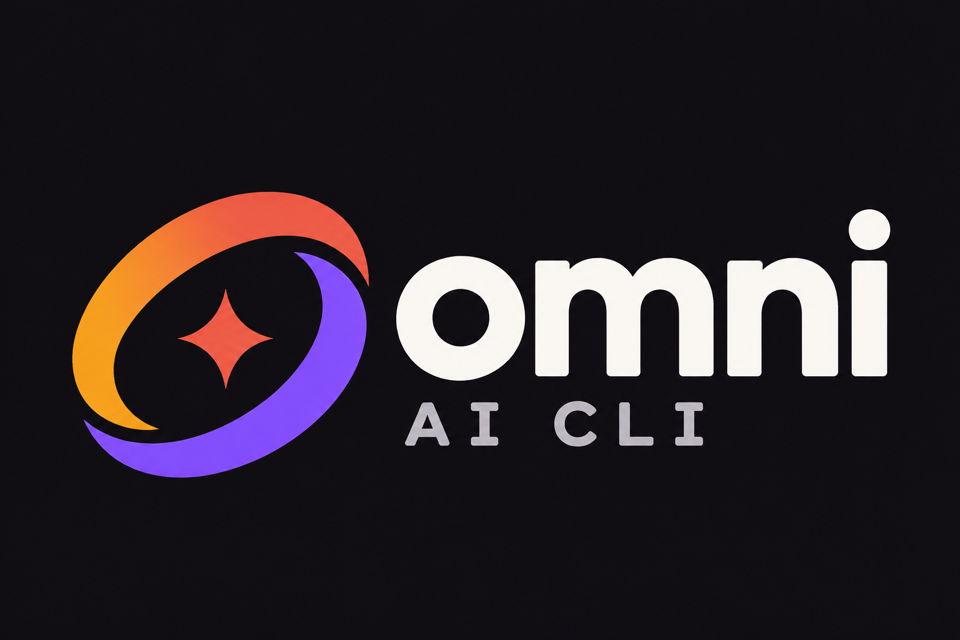
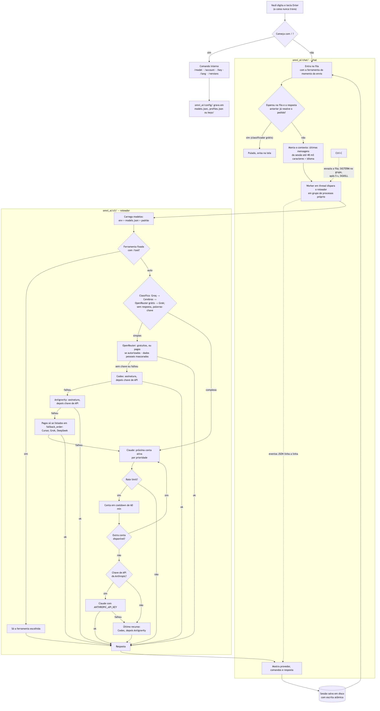
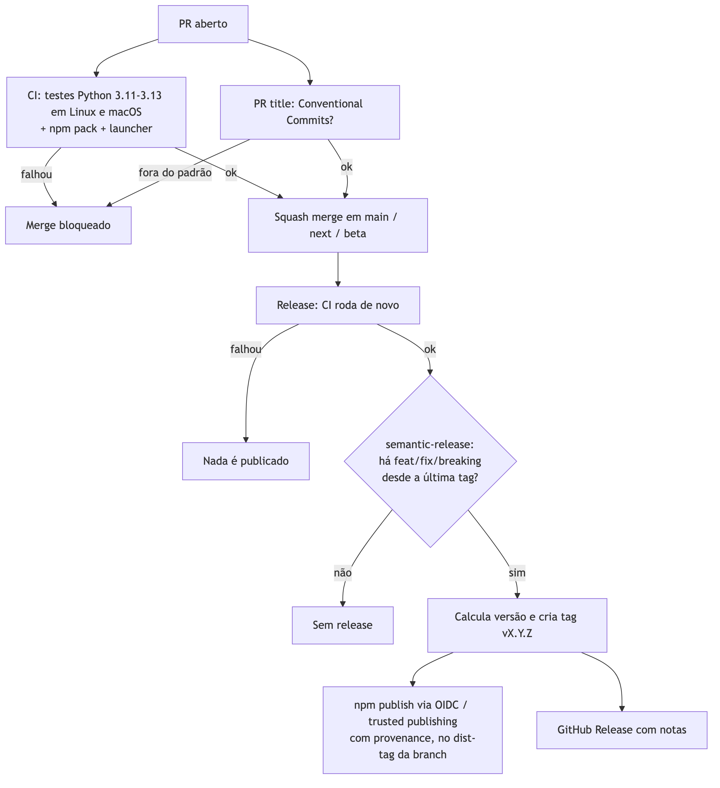

<p align="center">
  
</p>

# Omni AI CLI

[](https://www.npmjs.com/package/omni-ai-cli)
[](https://www.npmjs.com/package/omni-ai-cli)
[](https://marketplace.visualstudio.com/items?itemName=samuelrms.omni-ai-cli)
[](https://open-vsx.org/extension/samuelrms/omni-ai-cli)
[](https://docs.npmjs.com/trusted-publishers)
[](https://github.com/samuelrms/omni-ai-cli/actions/workflows/coverage.yml)
[](LICENSE)


> [English](docs/README.en.md) · [Español](docs/README.es.md) · [Français](docs/README.fr.md)
>
> **Site:** [omni.samuelramos.dev](https://omni.samuelramos.dev)

Um terminal de chat que junta **Claude Code, Codex, Cursor, Antigravity, Grok, DeepSeek e
OpenRouter** num lugar só. Você escreve a pergunta, o `ai` decide quem responde e, se a
ferramenta falhar ou estourar a cota, passa para a próxima sem você fazer nada.

Enquanto uma resposta está sendo gerada, a caixa de entrada continua livre: você segue
mandando pedidos, eles entram numa fila visível acima da caixa e rodam em ordem.

Com `ai serve`, tudo isso também fica disponível como uma [API compatível com a OpenAI](#modo-servidor), direto ou [em Docker](#docker).

Perguntas simples vão para as ferramentas mais baratas. Tarefas pesadas vão para o
Claude, com troca automática entre várias contas quando uma bate no limite. O histórico
fica salvo, a interface fala português, inglês, espanhol e francês, e modelos e contas
se configuram de dentro do próprio chat.

---

## Índice

- [Como funciona](#como-funciona)
- [Instalação](#instalação)
- [Como usar](#como-usar)
- [Extensão do editor](#extensão-do-editor)
- [Comandos do chat](#comandos-do-chat)
- [Modelos](#modelos)
- [Contas Claude](#contas-claude)
- [Login sem navegador](#login-sem-navegador)
- [Chaves de API](#chaves-de-api)
- [Modos](#modos)
- [Skills e MCP](#skills-e-mcp)
- [Uso direto, sem chat](#uso-direto-sem-chat)
- [Modo servidor](#modo-servidor)
- [Docker](#docker)
- [Onde ficam os arquivos](#onde-ficam-os-arquivos)
- [Estrutura do projeto](#estrutura-do-projeto)
- [Testes](#testes)
- [Releases e branches](#releases-e-branches)
- [Troubleshooting](#troubleshooting)
- [Limitações conhecidas](#limitações-conhecidas)
- [Privacidade](#privacidade)
- [Licença](#licença)

---

## Como funciona

Da linha digitada até a resposta salva. O chat (`omni_ai/chat/`) não chama nenhuma IA
direto: ele dispara o roteador (`omni_ai/cli/`) como subprocesso e lê os eventos que ele
emite, linha a linha, para mostrar quem está atendendo e o que está fazendo.



Três detalhes que o diagrama torna explícitos:

- **Cada conta Claude tem sua própria pasta de login.** Contas extras rodam com
  `CLAUDE_CONFIG_DIR` apontando para `~/.claude-accounts/<nome>`. A conta principal
  nunca é deslogada, e nenhuma credencial é copiada de um lugar para outro. Copiar o
  `.credentials.json` não funciona de forma confiável no macOS, onde o login fica no
  Keychain.
- **Ctrl-C mata a árvore inteira.** O roteador roda num grupo de processos próprio, então
  cancelar encerra também o `claude`, o `codex` ou o `agy` que estiver rodando embaixo,
  em vez de deixar processos órfãos gastando cota.
- **A fila não bloqueia nada.** Acima da caixa aparece o pedido em execução, o tempo e
  os próximos da fila. Um pedido que esperou passa por um classificador grátis antes de
  rodar: se a resposta anterior já o resolve, ele é pulado. Comandos e skills sempre
  rodam. Ctrl-C com a fila ativa cancela tudo sem sair do chat. Se você fechar o chat com
  pedidos na fila, eles ficam salvos na sessão e o `ai --resume ID` pergunta se quer continuar.
- **Cada resposta mostra quanto custou.** No fim de cada pedido aparecem os tokens e, quando
  a ferramenta informa (OpenRouter, Grok, Claude com chave de API), o custo em dólar. O
  `/usage` soma o gasto do dia por ferramenta.
- **Você vê por que a ferramenta foi escolhida.** No modo `auto`, uma linha curta diz se o
  pedido foi tratado como tarefa de código ou pergunta simples e quem classificou (Groq,
  Cerebras, OpenRouter, Grok ou as palavras-chave).
- **Só a resposta entra no histórico.** Linhas de status e diagnóstico aparecem na tela,
  mas não são enviadas como contexto na próxima pergunta. Raciocínio interno dos modelos
  também é descartado.

---

## Instalação

Um comando instala tudo e, rodado de novo, atualiza. Suas contas, chaves e modelos ficam em `~/.config/smart-ai` e não são tocados.

**macOS e Linux**:

```bash
curl -fsSL https://raw.githubusercontent.com/samuelrms/omni-ai-cli/main/get.sh | bash
```

**Windows** (PowerShell):

```powershell
irm https://raw.githubusercontent.com/samuelrms/omni-ai-cli/main/get.ps1 | iex
```

**No npm, yarn, pnpm ou bun:**

```bash
npm install -g omni-ai-cli
yarn global add omni-ai-cli
pnpm add -g omni-ai-cli
bun add -g omni-ai-cli
```

Qualquer um dos comandos acima (script ou gerenciador de pacotes) instala o mesmo `ai`.

**Homebrew** (macOS/Linux):

```bash
brew install samuelrms/tap/omni-ai-cli
```

> Em Homebrew recente, se recusar o tap como "untrusted", rode uma vez: `brew trust samuelrms/tap`.

Para atualizar depois: `ai --update` (ou `/update` no chat). Ao terminar, ele mostra as novidades das versões instaladas.

Pelo código-fonte, para desenvolver:

```bash
git clone https://github.com/samuelrms/omni-ai-cli ~/dev/omni-ai-cli
cd ~/dev/omni-ai-cli && ./scripts/install.sh        # Windows: powershell -File scripts\install.ps1
```

O instalador:

1. instala o **Claude Code** pelo instalador oficial se ele ainda não estiver na máquina;
2. abre o login da conta principal se ainda não houver um;
3. cria o comando `ai` em `~/.local/bin`;
4. mostra as contas Claude configuradas.

Requisitos: nenhum além de `curl` (macOS/Linux) ou PowerShell (Windows). Se não houver Python 3.11+, o instalador baixa um Python 3.12 só para o Omni AI, sem sudo e sem mexer no Python do sistema.
Codex (`codex`) e Antigravity (`agy`) são opcionais e entram na fila de alternativas quando estão instalados.

Se `~/.local/bin` não estiver no `PATH`, adicione ao `~/.zshrc`:

```bash
export PATH="$HOME/.local/bin:$PATH"
```

No Windows, o instalador cria `ai.cmd` em `%USERPROFILE%\.local\bin` e adiciona essa pasta ao `PATH`; abra um terminal novo depois.

---

## Como usar

```bash
ai
```

Na primeira vez ele pergunta o idioma e oferece instalar as ferramentas que faltam
(Claude Code, Codex, Cursor, Grok Build) com os instaladores oficiais. O Antigravity se
instala pela página dele. Depois é só escrever e teclar Enter.

| Tecla | Ação |
| --- | --- |
| Enter | Envia |
| ↑ / ↓ | Linhas anteriores |
| Ctrl-C | Durante a resposta: cancela. No prompt: salva e sai |
| Ctrl-D | Salva e sai |
| `\` + Enter · Shift+Enter · Option+Enter | Nova linha sem enviar (Shift+Enter no iTerm2, Ghostty, Kitty, WezTerm e VS Code; no Terminal do Mac use `\` + Enter) |
| Tab | Completa comandos e skills |

No menu do Tab, cada item termina dizendo de quem é: `omni`, `claude`, `codex` ou `agy`. Ao escolher
uma skill que tem argumentos (como `/pr-review [pr-number | --branch]`), o chat pergunta os
argumentos: Tab mostra as opções, dá para escrever o próprio texto, e Enter sem nada roda sem argumentos.

A tela segue o estilo do Claude Code e do Codex: caixa de entrada no rodapé com a barra de status
(ferramenta, modelo, modo e pasta), Tab para completar comandos e skills, cada ação da IA numa linha
(`● Ran …`, `● Edited …`, `● Called …`) com a saída recolhida, respostas em markdown e um indicador
"Trabalhando…" com o tempo. Ao abrir, uma splash de 1,5 s em tela cheia (Ctrl-C pula;
`SMART_AI_NO_SPLASH=1` desliga).

Ao sair, ele mostra o comando para voltar à mesma conversa:

```text
Sessão salva. Retome com: ai --resume 1f3a9c2b7d40
```

---

## Extensão do editor

**Omni AI CLI** — a mesma experiência de chat dentro do VS Code e do Cursor (barra lateral e aba do editor), rodando por cima do `ai`.

Instalar pela CLI:

```bash
# Cursor
cursor --install-extension samuelrms.omni-ai-cli

# VS Code
code --install-extension samuelrms.omni-ai-cli
```

Instalar pelo navegador: [Open VSX](https://open-vsx.org/extension/samuelrms/omni-ai-cli) · [VS Code Marketplace](https://marketplace.visualstudio.com/items?itemName=samuelrms.omni-ai-cli)

Na primeira execução a extensão instala o CLI `ai` por baixo se ele não existir e abre um tutorial de configuração.

---

## Comandos do chat

| Comando | O que faz |
| --- | --- |
| `/tool auto\|claude\|codex\|cursor\|agy\|openrouter\|grok\|deepseek` | Fixa uma ferramenta (`auto` decide sozinho) |
| `/model` | Lista os modelos de cada ferramenta |
| `/model codex gpt-6-astra` | Troca um modelo |
| `/model codex default` | Volta ao padrão |
| `/account` | Lista as contas Claude e se estão logadas |
| `/account add pessoal` | Cria uma conta e abre o login do Claude ali mesmo |
| `/account login NOME` | Refaz o login de uma conta |
| `/account sync NOME` | Recompartilha skills, plugins e MCPs da conta principal |
| `/account disable\|enable\|remove NOME` | Desativa, reativa ou remove |
| `/key` | Lista as chaves de API configuradas (mascaradas) |
| `/key claude\|codex\|cursor\|agy\|openrouter\|grok\|deepseek\|groq\|cerebras` | Adiciona uma chave, sem mostrar o que você digita |
| `/key add FERRAMENTA [NOME]` | Mais uma chave para a mesma ferramenta (vale para todas, inclusive Claude); as chaves são tentadas em ordem quando uma falha ou bate no limite |
| `/key remove FERRAMENTA [NOME]` | Remove a chave (sem nome, a principal) |
| `/status` · `/reset` | Status das contas · zera cooldowns |
| `/lang pt\|en\|es\|fr` | Muda o idioma |
| `/mode default\|plan\|edits\|auto\|yolo` | Modo de permissão, igual nas três ferramentas |
| `/sync` | Compartilha MCPs e skills entre Claude, Codex e Antigravity |
| `/usage [watch]` · `/limits` | Uso real de cada conta em barras (e-mail, plano, % da janela de 5 h e da semana, horário de reset) para Claude e Codex; gasto da chave no OpenRouter; nas demais, o aviso de limite que a ferramenta deu. `watch` atualiza a cada 30 s |
| `/queue [rm\|up\|down N\|clear]` | Mostra a fila; tira (`rm`), sobe (`up`), desce (`down`) um pedido ou esvazia (`clear`) o que espera |
| `/versions [N]` | O que mudou em cada versão, mais recente primeiro; `N` abre a nota técnica. Antes da primeira release, mostra os `feat`/`fix` do `main`. Os títulos saem no idioma do chat (traduzidos pelos classificadores grátis e guardados). Ao abrir o chat, uma linha avisa quando há versão nova. |
| `/clear` · `/compact` | Limpar a conversa · resumir a conversa num único bloco para economizar contexto |
| `/claude:usage` · `/codex:status` · `/agy:usage` … | Comandos nativos de cada ferramenta: abre a tela dela e volta ao Omni ao sair |
| `/setup [install]` | Guia de primeiro acesso: o que falta instalar, logar e configurar; `install` instala as ferramentas que faltam |
| `/terminal-setup` | Mostra como ter Shift+Enter (ou Option+Enter) para nova linha no seu terminal |
| `/skills` | Lista skills e comandos do projeto e do usuário, de Claude, Codex e Antigravity |
| `/nome args` | Roda a skill ou comando (ex.: `/pr-review 237`). Tab completa |
| `/history` · `/sent` · `/trace` | Conversa · o que foi enviado · eventos da execução |
| `/sessions` · `/resume ID` · `/new` | Sessões salvas |
| `/parallel codex: tarefa \| deepseek: tarefa` | 2 a 4 análises em paralelo, somente leitura (codex, openrouter, grok, deepseek) |
| `/help` · `/exit` | Ajuda · sair |

Enquanto a fila roda, `/clear`, `/new`, `/resume`, `/key`, `/usage` e os comandos nativos
esperam: eles tomam o terminal ou trocam a sessão. O resto funciona na hora.

Os comandos de configuração também funcionam fora do chat: `ai --model`,
`ai --account add pessoal`, `ai --key claude`, `ai --status`, `ai --reset`.

---

## Modelos

| Chave | Padrão | Valores aceitos |
| --- | --- | --- |
| `claude` | `opus` (o mais capaz) | `opus`, `sonnet`, `haiku` ou ID completo |
| `codex` | `gpt-6-astra` | ID de modelo do Codex |
| `codex_effort` | `high` | `minimal`, `low`, `medium`, `high`, `xhigh` |
| `agy` | padrão do Antigravity | ID de modelo do Antigravity |
| `openrouter` | automático (gratuito) | ID do modelo; pago só com `openrouter_paid on` |
| `openrouter_paid` | `off` | `on` autoriza modelos pagos do OpenRouter |
| `grok` | padrão do Grok | ID de modelo da xAI |
| `deepseek` | `deepseek-chat` | `deepseek-chat`, `deepseek-reasoner` |
| `cursor` | padrão da conta Cursor | ID de modelo do Cursor CLI |

A ordem de prioridade é: variável de ambiente, depois o que foi salvo com `/model` (em
`~/.config/smart-ai/models.json`), depois o padrão. As variáveis são
`SMART_AI_CLAUDE_MODEL`, `SMART_AI_CODEX_MODEL`, `SMART_AI_CODEX_EFFORT`,
`SMART_AI_AGY_MODEL`, `SMART_AI_OPENROUTER_MODEL`, `SMART_AI_GROK_MODEL`,
`SMART_AI_DEEPSEEK_MODEL` e `SMART_AI_CURSOR_MODEL`. Quando uma delas está definida, o
`/model` avisa que ela tem precedência.

---

## Contas Claude

```text
ai [auto] › /account add trabalho
Abrindo login do Claude para a conta "trabalho" (pasta isolada ~/.claude-accounts/trabalho).
Sua conta principal não é afetada.
✓ Conta "trabalho" adicionada com prioridade 3.
```

As contas são tentadas por ordem de prioridade. A que bate no limite entra em cooldown
(60 minutos por padrão, ajustável em `~/.config/smart-ai/profiles.json`) e a próxima assume. A conta
`primary` usa o login normal do Claude (`claude auth login`).

Skills, plugins, agentes, `CLAUDE.md`, `settings.json` e os servidores MCP da conta
principal são compartilhados com cada conta extra no login. Só o login fica separado.
Se você instalar uma skill ou um MCP novo depois, rode `/account sync NOME`.


---

## Login sem navegador

Em servidor, container ou SSH, abra o link em outro dispositivo:

```bash
ai --account login primary     # Claude
ai --account login codex
ai --account login grok
ai --account login cursor
ai --account login codex NOME  # conta extra
```

| Ferramenta | O que acontece sem navegador |
| --- | --- |
| Claude Code | Mostra um link e pede para colar o código no terminal |
| Codex | Sem navegador, o Omni usa `--device-auth`: link e código de uso único. O login padrão depende de `localhost:1455` |
| Cursor | Mostra um link e aguarda a autorização |
| Grok | Mostra um link e um código |
| Antigravity | Não testado. Ele não tem comando de login, então use `GEMINI_API_KEY` |

O Omni considera "sem navegador" uma sessão SSH, um container ou Linux sem tela. Use `SMART_AI_HEADLESS=1` ou `0` para definir manualmente.

Em container, o login precisa de terminal interativo (`docker exec -it`). Preserve em volume `~/.claude`, `~/.claude.json`, `~/.claude-accounts`, `~/.codex`, `~/.grok`, `~/.cursor`, `~/.config/cursor` e `~/.config/smart-ai`.

---

## Chaves de API

Além das assinaturas, cada ferramenta aceita uma chave de API. **A assinatura vem
primeiro**; a chave só entra quando a assinatura falha ou bate no limite, porque chave é
cobrada por uso. O OpenRouter funciona só com chave.

| Ferramenta | Comando | Variável que o CLI recebe | Onde criar |
| --- | --- | --- | --- |
| Claude | `/key claude` | `ANTHROPIC_API_KEY` | console.anthropic.com/settings/keys |
| Codex | `/key codex` | `CODEX_API_KEY` | platform.openai.com/api-keys |
| Antigravity | `/key agy` | `GEMINI_API_KEY` | aistudio.google.com/apikey |
| OpenRouter | `/key openrouter` | `OPENROUTER_API_KEY` | openrouter.ai/keys |
| Cursor | `/key cursor` | `CURSOR_API_KEY` | cursor.com/dashboard → Integrations |
| Grok | `/key grok` | `XAI_API_KEY` | console.x.ai |
| DeepSeek | `/key deepseek` | `DEEPSEEK_API_KEY` | platform.deepseek.com/api_keys |
| Groq (classificador) | `/key groq` | `GROQ_API_KEY` | console.groq.com/keys |
| Cerebras (classificador) | `/key cerebras` | `CEREBRAS_API_KEY` | cloud.cerebras.ai |

O Cursor usa primeiro o login da conta (`cursor-agent login`) e só depois as chaves. O
DeepSeek, como o OpenRouter, funciona só com chave e mascara dados pessoais antes do
envio. Groq e Cerebras não respondem perguntas: só classificam cada pedido (grátis) e
checam se um pedido da fila já foi resolvido.

```text
ai [auto] › /key claude
Chave de claude (console.anthropic.com/settings/keys). Cole e tecle Enter; ela não aparece na tela.
>
✓ Chave de claude salva em ~/.config/smart-ai/keys/claude (permissão 600).
```

As chaves ficam em `~/.config/smart-ai/keys/`, uma por arquivo, com permissão 600, e
são passadas só ao processo da ferramenta, nunca ao histórico nem ao log. Se a variável
já estiver definida no ambiente, ela tem precedência. `/key` lista o que está
configurado, mostrando só o início e o fim de cada chave.

No Claude, a chave funciona como uma conta extra depois de todas as assinaturas: se ela
também bater no limite, entra em cooldown como as outras.

> **Nunca cole uma chave como comando no shell.** Ela fica gravada no histórico do zsh.
> Se isso acontecer, revogue a chave no site da ferramenta e apague a linha de
> `~/.zsh_history`.

No OpenRouter, o padrão é usar só modelos gratuitos: o cliente escolhe até três
variantes `:free` do catálogo e usa `openrouter/free` como última alternativa. Modelos
pagos ficam bloqueados até você autorizar:

```text
/model openrouter_paid on            # autoriza; avisa que será cobrado na sua conta
/model openrouter anthropic/claude-opus-5.5
/model openrouter_paid off           # bloqueia de novo e volta ao gratuito
```

Com a autorização ligada, o modelo escolhido vem primeiro e os gratuitos ficam como
reserva. Desligada, o limite de preço zero é enviado em toda chamada, então nenhum
modelo pago responde.

---

## Modos

O modo vale para Claude, Codex e Antigravity ao mesmo tempo e aparece no prompt
(`ai [auto · plan] ›`). Cada sessão guarda o seu.

| Modo | O que faz | Claude | Codex | Antigravity |
| --- | --- | --- | --- | --- |
| `default` | Padrão de cada ferramenta | — | — | — |
| `plan` | Só lê e planeja, não altera nada | `plan` | `--sandbox read-only` | `--mode plan` |
| `edits` | Aceita edições de arquivo | `acceptEdits` | `--sandbox workspace-write` | `--mode accept-edits` |
| `auto` | Age sozinho, com as proteções da ferramenta | `auto` | `workspace-write`, sem aprovação | `--mode auto` |
| `yolo` | Sem permissões nem sandbox | `bypassPermissions` | `--dangerously-bypass-approvals-and-sandbox` | `--dangerously-skip-permissions` |

`/mode yolo` pede confirmação, porque a IA passa a poder apagar arquivos e rodar qualquer
comando. Fora do chat: `ai --mode plan "pergunta"`. O `/parallel` roda sempre em `plan`.

---

## Skills e MCP

Antes de rodar uma skill do projeto, o chat mostra o caminho dela. Uma skill do projeto substitui a sua de mesmo nome, e links que saem do projeto são ignorados.

O `ai` chama os próprios CLIs, então cada um usa as skills e os MCPs que já tem. O
`/sync` junta tudo e instala em cada ferramenta o que só existe nas outras:

```text
ai [auto] › /sync
Ferramentas encontradas: claude, codex, agy
  MCP   github                   codex → claude
  MCP   obsidian                 claude → codex
  skill humanizer                claude → codex  (~/.agents/skills/humanizer)
Aplicar? [s/N]
```

- Os MCPs são adicionados pelo comando `mcp add` de cada CLI, não editando arquivos na mão.
- O mesmo servidor com nomes diferentes é reconhecido pelo pacote ou URL e não é duplicado.
- MCPs que vêm dentro de um app (como os do Codex.app) ficam só nele.
- As skills são compartilhadas por atalho: `~/.claude/skills`, `~/.agents/skills` (Codex) e
  `~/.gemini/antigravity/skills`. Editar uma vale para as três.
- As contas Claude extras são atualizadas junto.
- Variáveis de ambiente dos MCPs, que podem ter tokens, são copiadas para a config da
  outra ferramenta. O `/sync` avisa antes.
- `/sync --dry-run` só mostra o que faria.

**Skills e comandos do projeto:** o chat lê `.claude/commands`, `.claude/skills`, `.agents/skills` e
`.agent/workflows` do projeto aberto, além das pastas do usuário. `/pr-review 237` vai para o
Claude do jeito que foi digitado, e ele executa o comando nativamente. Uma skill que só existe
no Codex ou no Antigravity vai para essa ferramenta, com as instruções do arquivo no pedido.

Como o chat não repassa pedidos de aprovação, uma ferramenta de MCP só roda se já estiver
liberada nas permissões do CLI ou se o modo for `auto` ou `yolo`. O OpenRouter não tem
skills nem MCP.

---

## Uso direto, sem chat

```bash
ai "o que é um design pattern?"        # roteamento automático
ai --claude "refatorar o módulo X"     # força Claude
ai --codex "explicar REST"             # força Codex
ai --agy "pesquisar React hooks"       # força Antigravity
ai --openrouter "explicar Docker"      # força OpenRouter
ai --cursor "corrigir o teste X"       # força Cursor
ai --deepseek "explicar CAP theorem"   # força DeepSeek
ai --install                           # instala as ferramentas que faltam (pergunta antes)
ai --classify "prompt"                 # mostra como seria classificado
ai --prompt-file pedido.txt            # lê o pedido de um arquivo
ai --log                               # últimas chamadas
ai doctor                              # diagnóstico de instalação, contas e chaves
ai --version                           # versão do Omni AI CLI
ai --completions zsh|bash              # autocomplete do shell
```

---

## Modo servidor

`ai serve` expõe o roteador como uma API compatível com a OpenAI. Ele usa os mesmos logins, chaves, contas, cooldowns e fallbacks do CLI.

```bash
ai serve                       # http://127.0.0.1:8080/v1
ai serve --host 0.0.0.0 --port 9000 --max-concurrent 4 --timeout 600
ai serve keys [list | add NAME | remove NAME]
```

### API de administração

Desligada por padrão. Configura um servidor em execução sem acesso ao shell.

```bash
ai serve admin-keys add ops                    # chave própria, mostrada uma única vez
ai serve --enable-admin
curl -H "Authorization: Bearer omni-admin-..." http://127.0.0.1:8080/admin/health
```

| Rota | Função |
| --- | --- |
| `GET/PUT /admin/config` | Modelos, ordem de fallback (`fallback_order`) e `routing` |
| `GET/POST /admin/keys`, `DELETE /admin/keys/{id}` | Chaves dos provedores. O id é `openrouter` ou `openrouter.work` |
| `GET /admin/accounts` | Contas, login e cooldown |
| `GET/POST /admin/api-keys`, `DELETE /admin/api-keys/{nome}` | Chaves dos clientes de `/v1` |
| `GET /admin/health` | Estado do servidor |
| `POST /admin/accounts/{conta}/login` | Inicia o login por assinatura: devolve o link e o id da tentativa |
| `POST /admin/accounts/{conta}/login/complete` | Conclui o login |
| `DELETE /admin/accounts/{conta}/login` | Cancela, com o id em `X-Omni-Login-Attempt` |

- **Chaves separadas:** uma chave de `/v1` nunca abre `/admin`, e vice-versa. Sem chave de administração, `--enable-admin` não inicia.
- **Rede:** de fora desta máquina, exige HTTPS por proxy reverso, que precisa definir `X-Forwarded-Proto`. `--admin-allow-http` desliga essa checagem. No Docker, a porta publicada conta como acesso externo.
- **Segredos:** as respostas mostram só o final das chaves de provedores. A exceção é a chave de cliente criada, mostrada uma única vez.
- **Campos protegidos:** modo de permissão, caminhos de binários e `config_dir` retornam 403.
- **Cuidado:** esta chave pode ligar modelos pagos (`openrouter_paid`) e trocar chaves de provedores. No Docker, use `SMART_AI_ADMIN=1`.

**Login pela API.** `{conta}` é `primary` e as outras contas Claude, `codex`, `cursor`, `grok`, ou `codex.NOME` para uma conta extra. Uma tentativa vale 10 minutos e cada conta aceita uma por vez (409).

| Ferramenta | Como concluir |
| --- | --- |
| Claude Code | Abra o link e envie `{"attempt_id": "...", "code": "..."}` com o código obtido |
| Codex, Grok | Abra o link, digite o `user_code` e envie `{"attempt_id": "..."}`. A resposta é 202 até concluir |
| Cursor | Abra o link e envie `{"attempt_id": "..."}`. A resposta é 202 até concluir |

O Antigravity e as ferramentas só com chave retornam 400. Os códigos e tokens não aparecem em respostas nem em logs. A exceção é o `user_code`, que precisa ser digitado no navegador.

### Escrita em paralelo

Nos modos de escrita, os pedidos rodam em paralelo, até `--max-concurrent`, sem mexer na pasta original.

| | Pasta com git | Pasta sem git |
| --- | --- | --- |
| **Onde trabalha** | Worktree em uma branch `omni/<id>`, a partir do último commit | Cópia da pasta, até 1 GB |
| **Resultado** | Commit na branch, informada em `X-Omni-Branch`. O merge é seu | Cópia em `~/.local/share/smart-ai/runs/`, informada em `X-Omni-Copy` |
| **Continuar** | Envie `X-Omni-Branch` no pedido seguinte | Envie `X-Omni-Copy` no pedido seguinte |
| **Limpeza** | O worktree sai ao final. A branch fica até você apagar | A cópia fica até você apagar |

- **Sem alterações:** a branch ou a cópia nova é descartada e o header não vem. Em streaming, o header sai no início e pode apontar para algo descartado.
- **Falha ou timeout:** o que já foi feito é mantido, e o header vem na resposta de erro. Depois de uma queda do servidor, as alterações são salvas no próximo início.
- **Concorrência:** dois pedidos na mesma branch ou cópia recebem 409. Só branches `omni/` podem ser continuadas.
- **Fila:** acima do limite, o pedido espera até `--queue-wait` segundos (60), com até `--queue-size` na fila (16). Só então recebe 429.
- **Limitações:** alterações sem commit e arquivos ignorados pelo git, como `node_modules`, não entram no worktree. O isolamento vale para arquivos: portas, bancos e outros serviços usados pelos comandos ainda podem colidir, e um comando pode escrever fora da pasta. A memória também conta: cada pedido é um processo de CLI. Os comandos git do próprio servidor não rodam hooks nem `core.fsmonitor` do repositório. Filtros do git, como os do Git LFS, continuam rodando: sirva só repositórios em que você confia.

```bash
ai serve work --workdir PASTA                  # lista
ai serve work remove ID --workdir PASTA        # mostra; com --yes, apaga
ai serve work prune --older-than 30 --workdir PASTA   # também --merged; com --yes, apaga
```

Sem `--yes`, nada é apagado. O comando só alcança branches `omni/` e cópias do Omni. Um item em uso, ou cópia alterada há menos de 15 minutos, é mantido.

### Como serviço

```bash
ai serve --install-service [--host H] [--port P] [--mode M] [--workdir PASTA]
ai serve --service-status
ai serve --uninstall-service
```

Inicia sozinho e reinicia em caso de falha, com launchd no macOS e systemd de usuário no Linux. No Windows, em containers e em WSL sem systemd, o comando avisa e não instala; rode `ai serve` manualmente.

- **Segredos:** o arquivo do serviço não guarda chaves. Sem chave salva, a instalação cria uma e a mostra uma única vez. Fora de `127.0.0.1`, exige uma chave salva antes.
- **Ambiente:** só `PATH` e as pastas do Omni passam para o serviço. Chaves que existem só no shell não passam: salve com `ai --key`. A instalação avisa quais são, e também quais CLIs não encontrou.
- **Pasta e modo:** o padrão é `plan`, em `~/.local/share/smart-ai/serve`. `--mode yolo` e sobrescrever um arquivo que o Omni não gerou exigem `--yes`.
- **Logs:** `~/.cache/smart-ai/serve.log`, com rotação, e `serve.out.log`, limpo a cada instalação.
- **Linux:** para iniciar no boot sem sessão aberta, rode `loginctl enable-linger $USER`. A instalação avisa, mas não faz isso sozinha.
- **Atualização:** `ai --update` reinicia o serviço. Em instalações sem git, reinstale o serviço depois.

### Uso da API

```python
from openai import OpenAI
client = OpenAI(base_url="http://127.0.0.1:8080/v1", api_key="omni-...")
client.chat.completions.create(model="omni-auto", messages=[{"role": "user", "content": "Olá"}])
```

No primeiro início, o servidor cria uma chave e a mostra uma única vez. Só o hash fica salvo. Em container, também é possível definir `SMART_AI_SERVER_KEY`. Não existe modo sem autenticação.

| Rota | Função |
| --- | --- |
| `POST /v1/chat/completions` | Resposta completa ou streaming (SSE) |
| `GET /v1/models` | `omni-auto`, que usa o roteador, e `omni/<ferramenta>` para cada ferramenta configurada |

| Header da resposta | Significado |
| --- | --- |
| `X-Omni-Provider` | Ferramenta que respondeu |
| `X-Omni-Usage` | `reported` (informado pelo provedor) ou `estimated` (estimado). Não aparece em streaming |
| `X-Omni-Ignored-Params` | Parâmetros recebidos e ignorados |

**Segurança:**

- Por padrão, as ferramentas rodam no modo `plan`, em uma pasta temporária, seja qual for o `SMART_AI_MODE`.
- **Para criar, editar e rodar comandos:** `ai serve --mode edits|auto|yolo --workdir PASTA`. A pasta é obrigatória e nada pede aprovação. [Cada pedido trabalha isolado](#escrita-em-paralelo). Quem tem a chave pode alterar a pasta e, com comandos, alcançar os logins das contas.
- **Somente leitura não impede ler arquivos.** Quem tem a chave pode pedir a uma ferramenta que leia arquivos desta máquina. MCPs configurados também podem estar disponíveis. Trate a chave como acesso à sua conta.
- O padrão é `127.0.0.1`. Para expor em rede, use `--host` e HTTPS com proxy reverso.
- Acima do limite de conexões (128 ou mais, conforme o sistema), a resposta é 503. O início de cada pedido precisa chegar em até 30 segundos. Em exposição pública, use também os limites por origem do proxy.
- Quem compartilha uma instância compartilha as mesmas contas e assinaturas. Verifique os termos de cada provedor.

**Limitações:**

- Quando o modo do servidor nega uma ação e a ferramenta encerra com erro, como faz o Grok, a resposta é `403 action_not_allowed`.
- `temperature` só vale em OpenRouter, DeepSeek e Grok via API. Nos CLIs, é ignorada e aparece em `X-Omni-Ignored-Params`.
- `max_tokens` é aproximado nos CLIs (cerca de 4 caracteres por token).
- `usage` é estimado quando o provedor não informa o consumo.
- Cada pedido pode consumir bastante cota, porque os CLIs de agente carregam o próprio contexto. No Codex, um simples "OK" já usou cerca de 19 mil tokens de entrada.
- Nos CLIs, o streaming entrega a resposta de uma vez, ao final. Só o OpenRouter envia pedaços durante a geração, exceto quando há dados pessoais mascarados.
- O fallback é transparente até o primeiro trecho da resposta. Se o provedor falhar depois disso, o cliente recebe um erro.
- `tools`/function calling só nos provedores de API (OpenRouter, DeepSeek e Grok via chave). As ferramentas nunca são executadas pelo servidor: a chamada volta para o seu código. Outros modelos retornam 400, porque os CLIs de agente não têm como devolver a chamada, a não ser com `--tool-emulation`. Com `omni-auto`, a ordem é OpenRouter, DeepSeek e Grok. No OpenRouter, sem `openrouter_paid`, só modelos gratuitos. Em streaming, a chamada chega de uma vez, ao final. Argumentos fora do schema fazem o servidor tentar o próximo provedor; só o núcleo do JSON Schema é checado (`type`, `required`, `enum`, `properties`, `items`, `additionalProperties`). `functions` (formato antigo) retorna 400.
- **Experimental:** `ai serve --tool-emulation` (`SMART_AI_TOOL_EMULATION=1` no Docker) emula `tools` em Claude Code e Grok CLI, com as ferramentas próprias deles desligadas. O modelo escreve a chamada em JSON, o servidor valida e tenta de novo uma vez, o que gasta mais cota. Só entra quando não há provedor de API. Codex e Cursor ficam de fora, porque não dá para desligar as ferramentas deles. O modelo pode errar mais que no modo nativo, os dados pessoais não são mascarados, e o conteúdo do cliente pode imitar o formato.
- Imagens retornam erro 400.
- O prompt chega às ferramentas como argumento de linha de comando e fica visível na lista de processos da máquina. O limite é de 100 KB por pedido.
- Perfis Claude legados, que trocam o arquivo de credenciais, limitam o servidor a um pedido por vez.

---

## Docker

Imagem com o Omni e os CLIs em versões fixas, para rodar o `ai serve` em servidor próprio. Inclui Claude Code, Codex, Cursor e Grok. O Antigravity não está incluído, porque não tem instalação por comando.

```bash
git clone https://github.com/samuelrms/omni-ai-cli && cd omni-ai-cli
docker compose up -d
docker compose logs omni                       # chave gerada no primeiro início
docker exec -it omni ai --account login primary
```

- **Login:** veja [Login sem navegador](#login-sem-navegador). Chaves de provedores vão com `docker exec -it omni ai --key <ferramenta>`.
- **Dados:** logins, chaves, configuração e cooldowns ficam no volume `omni-home`, que sobrevive à recriação do container. `docker compose down -v` apaga esse volume.
- **Chave do servidor:** sem chave informada, uma é gerada e aparece uma única vez no log. Para definir a sua, use `SMART_AI_SERVER_KEY`, ou `SMART_AI_SERVER_KEY_FILE` com um Docker secret. O `docker-compose.yml` traz o exemplo.
- **Porta:** publicada só em `127.0.0.1`. `OMNI_PORT` muda a porta.
- **Isolamento:** roda sem root, com sistema de arquivos somente leitura e sem capabilities.
- **Modos:** `OMNI_MODE=plan|edits|auto|yolo docker compose up -d` (padrão: `plan`). As ferramentas trabalham em `/workspace`, no volume `omni-workspace`. Para usar uma pasta sua, defina `OMNI_WORKSPACE=/caminho`, com escrita liberada para o uid 10001.
- **Risco fora do `plan`:** os comandos rodam no mesmo usuário que guarda os logins em `omni-home`. Quem tem a chave pode ler esses logins, então use uma chave por pessoa de confiança e revogue sessões se ela vazar.
- **Codex:** o sandbox dele não inicia no container, porque depende de recursos bloqueados pelo Docker e pelo kernel do host. Ele só usa ferramentas em `yolo`, com o container como isolamento. Em `plan`, `edits` e `auto`, ele apenas responde, sem ler nem alterar arquivos.
- **Atualização:** `git pull && docker compose up -d --build`. `ai --update` não se aplica à imagem.
- **Imagem pronta:** `export OMNI_IMAGE=ghcr.io/samuelrms/omni-ai-cli:latest && docker compose pull omni && docker compose up -d --no-build`. Cada release publica a versão e `latest`, para amd64 e arm64. Para fixar uma versão, troque `latest` pelo número, como `1.23.0`. A imagem inclui CLIs de terceiros, sujeitos aos termos de cada um; o uso da sua conta também segue esses termos.

Para expor em rede, use um proxy reverso com HTTPS, como o Caddy:

```text
omni.example.com {
    reverse_proxy 127.0.0.1:8080
}
```

**Risco:** o container não enxerga os arquivos da sua máquina, mas enxerga o volume. Quem tem a chave pode pedir a uma ferramenta que leia as credenciais guardadas nele. Trate a chave do servidor como acesso às suas contas.

---

## Onde ficam os arquivos

| Caminho | Conteúdo |
| --- | --- |
| `~/.config/smart-ai/profiles.json` | Contas Claude e regras de roteamento |
| `~/.config/smart-ai/models.json` | Modelos escolhidos com `/model` |
| `~/.config/smart-ai/lang` | Idioma do chat |
| `~/.config/smart-ai/keys/<ferramenta>` | Chaves de API, uma por arquivo (permissão 600) |
| `~/.claude-accounts/<nome>/` | Login isolado de cada conta Claude extra |
| `~/.local/share/smart-ai/sessions/` | Sessões do chat |
| `~/.cache/smart-ai/state.json` | Cooldowns ativos |
| `~/.cache/smart-ai/usage.log` | Log de uso, só metadados |
| `~/.config/smart-ai/server_keys.json` | Hash das chaves do `ai serve` (permissão 600) |
| `~/.config/smart-ai/admin_keys.json` | Hash das chaves da API de administração (permissão 600) |
| `~/.cache/smart-ai/costs.jsonl` | Custo e tokens de cada pedido do chat, sem pergunta nem resposta (soma do dia no `/usage`) |
| `~/.local/share/smart-ai/runs/` | Cópias dos pedidos de escrita em pastas sem git |
| `~/.local/share/smart-ai/partial/` | Cópia do que uma tentativa deixou antes de falhar, das 10 últimas vezes |
| `~/.cache/smart-ai/serve.log` | Log do `ai serve` como serviço, com rotação |

---

## Estrutura do projeto

```text
omni-ai-cli/
├── omni_ai/                  # o programa (pacote Python)
│   ├── tools.py              # cadastro único das ferramentas: nome, cor, CLI, modelo, chave
│   ├── cli/                  # comando ai: classifica, roteia e executa cada ferramenta
│   ├── chat/                 # chat: sessões, eventos, Ctrl-C, idiomas
│   ├── ui/                   # visual: caixa de entrada, barra de status, ações e respostas
│   ├── skills.py             # skills e comandos do projeto, do usuário e nativos
│   ├── config/               # modelos, chaves e contas Claude (/model, /key, /account)
│   ├── sync.py               # /sync: MCPs e skills entre as três ferramentas
│   ├── usage/                # uso e limites de cada ferramenta e conta
│   ├── export/               # exporta a conversa em PDF ou Markdown
│   ├── history.py            # conversas de todas as ferramentas (ai history)
│   ├── onboarding.py         # guia de primeiro acesso (ai --setup)
│   ├── openrouter/           # cliente OpenRouter: gratuitos, pagos só se autorizados
│   ├── grok.py               # cliente xAI, reaproveitado pelo DeepSeek
│   ├── deepseek.py           # cliente DeepSeek com dados pessoais mascarados
│   ├── agy_events.py         # lê os eventos do Antigravity para o chat e o servidor
│   ├── pii/                  # mascara e restaura dados pessoais
│   ├── server/               # ai serve: API compatível com a OpenAI
│   ├── osutils.py            # diferenças entre macOS, Linux e Windows
│   ├── profiles.json         # modelo inicial; o seu fica em ~/.config/smart-ai
│   └── vendor/               # prompt_toolkit e wcwidth embutidos (sem pip)
├── bin/ai.js                 # lançador npm: acha ou instala o Python e roda o pacote
├── scripts/                  # install.sh, install.ps1 e ai.cmd
├── docs/                     # README em inglês, espanhol e francês
├── tests/                    # executáveis fictícios, sem consumir cota
├── postman/                  # simulação HTTP do OpenRouter
├── get.sh / get.ps1          # instalação com um comando
├── Dockerfile · docker-compose.yml  # imagem e Compose do ai serve
└── package.json · LICENSE
```

O roteador não sabe nada de chat: ele só executa uma pergunta e, com
`SMART_AI_EVENTS=1`, emite eventos JSON. O chat não sabe nada de credenciais: contas e
modelos passam pelo `omni_ai/config/`.

---

## Testes

```bash
python3 -m unittest discover -s tests -v
bash -n scripts/install.sh
```

**Mais de 900 testes**: persistência e retomada de sessão, limite de contexto, permissão dos
arquivos, sessão aberta em dois terminais, leitura de eventos, cancelamento da árvore de
processos, paralelismo real, sandbox somente leitura, mascaramento de dados pessoais,
fallback OpenRouter → Codex, validação de modelos, armazenamento das chaves e o ciclo de vida das contas. Todos os
executáveis são fictícios: **nenhum teste autentica nem consome assinatura.**

Para testar o HTTP do OpenRouter contra a simulação Postman:

```bash
postman simulation run postman/simulations/openrouter.sim.yaml --port 4901 --no-history --output ndjson
SMART_AI_SIM_URL=http://127.0.0.1:4901/openrouter python3 -m unittest discover -s tests -v
```

---

## Releases e branches

Veja o que mudou em cada versão no [CHANGELOG](CHANGELOG.md) (em inglês) e nos [Releases](https://github.com/samuelrms/omni-ai-cli/releases).

Publicação no npm é automática, feita pelo GitHub Actions com semantic-release. A versão
sai das mensagens de commit (Conventional Commits) — ninguém edita `version` no
`package.json` à mão.

Cada release também publica a imagem Docker em `ghcr.io/samuelrms/omni-ai-cli`, com o número da versão. A tag `latest` só muda na `main`.

| Branch | Publica como | Exemplo |
|---|---|---|
| `main` | `latest` | `1.4.0` |
| `next` | `next` (release candidate) | `1.5.0-rc.1` |
| `beta` | `beta` | `2.0.0-beta.1` |
| outras / PR | nada, só CI | — |

| Commit | Efeito na versão |
|---|---|
| `fix: ...` | patch (`1.4.0` → `1.4.1`) |
| `feat: ...` | minor (`1.4.0` → `1.5.0`) |
| `feat!: ...` ou `BREAKING CHANGE:` no corpo | major (`1.4.0` → `2.0.0`) |
| `docs:`, `ci:`, `chore:`, `test:`, `refactor:` | sem release |

Use squash merge: o título do PR vira o commit, e o workflow `PR title` bloqueia título
fora do padrão.

### Mensagens de commit

O `/versions` mostra o título de cada `feat`/`fix` como a "visão simples" e o corpo como
"nota técnica". Por isso:

- **Título:** o que muda para quem usa, em inglês, no presente, sem nome de arquivo ou
  função. `feat: keep the input free and queue new requests while one runs`, não
  `feat: add Queue class to chat.py`.
- **Corpo:** o porquê e o comportamento novo em frases curtas; detalhes técnicos só no
  fim, se ajudarem.
- Um commit por mudança perceptível. Refatoração e testes vão em `refactor:`/`test:`,
  que não aparecem em `/versions`.



A publicação usa **OIDC / trusted publishing**: o GitHub Actions se autentica no npm sem
token, e o pacote sai com *provenance*. Configuração única:

1. **npm → página do pacote → Settings → Trusted Publisher**: adicionar *GitHub Actions*
   com `samuelrms/omni-ai-cli` e o workflow `release.yml`.
2. **GitHub → Settings → Branches**: proteger `main` (e `next`/`beta`, se usar) exigindo PR
   e os checks `Tests (...)`, `npm package` e `conventional`.
3. **GitHub → Settings → General → Pull Requests**: deixar só *Allow squash merging* e
   marcar *Default to pull request title*.

O workflow já pede `id-token: write` e `NPM_CONFIG_PROVENANCE`; não há `NPM_TOKEN` para
guardar nem rotacionar.

---

## Troubleshooting

| Problema | Solução |
| --- | --- |
| `OPENROUTER_API_KEY não configurada` | `/key openrouter` no chat ou `ai --key openrouter`. |
| `Arquivo de credenciais não encontrado` ou `Conta 'X' sem login` | `/account login X`. |
| `You've hit your session limit` | Cota da conta. O `ai` passa para a próxima; adicione outra com `/account add` ou uma chave com `/key claude`. |
| `Individual quota reached` (Antigravity) | Cota do Antigravity; ele é pulado até a renovação. |
| `Not inside a trusted directory` (Codex) | Instalação antiga. Rode o instalador de novo. |
| `Claude Code não instalado` | `./scripts/install.sh` (ou `scripts\install.ps1` no Windows) instala pelo instalador oficial. |
| Windows: atalhos de skills falham | Ative o Modo de Desenvolvedor ou rode como administrador; sem isso o `ai` usa junções de pasta. |
| Windows: `este pedido não pode ser passado com segurança` | A ferramenta foi instalada por um atalho `.cmd` que o `ai` não reconhece. Instale com o npm ou defina `<FERRAMENTA>_BIN` com o executável dela. |
| `/model` não muda nada | Uma variável `SMART_AI_*_MODEL` está definida e tem precedência. |
| `/key` não muda nada | A variável da ferramenta (`ANTHROPIC_API_KEY` etc.) está definida e tem precedência. |
| `Sessão já aberta em outro terminal` | Feche o outro terminal ou use `/new`. |
| `ai: command not found` | Adicione `~/.local/bin` ao `PATH`. |

---

## Limitações conhecidas

- Se uma ferramenta falhar depois de alterar arquivos, a próxima recebe a lista deles e continua a partir dali. Nada é desfeito: ela pode herdar algo incompleto, e efeitos fora da pasta, como comandos já executados, não são detectados.
- O chat usa os modos não interativos dos CLIs. Pedidos de aprovação nativos (por
  exemplo, "posso editar este arquivo?") não aparecem; nesses casos, use o CLI nativo.
- `/parallel` só analisa: Codex em `--sandbox read-only` ou OpenRouter, que não acessa os
  arquivos. Os agentes não editam o projeto ao mesmo tempo.
- A classificação simples/complexa é por palavras-chave e tamanho, não por um modelo.
- Trocar de modelo não renova a cota da conta.
- No Windows, o código usa os equivalentes nativos (grupo de processos e `taskkill`, `msvcrt`, junções de pasta), mas foi testado de verdade só no macOS. A exceção é a execução de ferramentas instaladas pelo npm, testada no CI em Windows.

---

## Privacidade

- Se uma ferramenta falhar depois de alterar arquivos, uma cópia deles fica só na sua máquina, com permissão restrita ao seu usuário.
- Sessões, chaves de API e logs ficam só na sua máquina, com permissão restrita ao seu usuário.
- O log de uso grava ferramenta, conta e status, **nunca o texto da pergunta**.
- Antes de ir para o OpenRouter, e-mails, telefones, documentos e outros dados pessoais
  são trocados por marcadores e restaurados na resposta. O mascaramento é por padrões e
  não garante anonimização total.
- Claude, Codex e Antigravity recebem o texto original, sob os termos de cada serviço.

---

## Apoie o projeto

O Omni AI CLI é gratuito e mantido pelo Samuel Ramos. Se ele ajuda no seu dia a dia, você pode apoiar pelo [GitHub Sponsors](https://github.com/sponsors/samuelrms) ou por PIX. Veja [como apoiar](https://github.com/samuelrms/omni-ai-cli/blob/main/SPONSORS.md).

## Licença

[MIT](LICENSE). Bibliotecas embutidas em `vendor/`: prompt_toolkit (BSD-3-Clause) e wcwidth (MIT), com as licenças em cada pasta.
