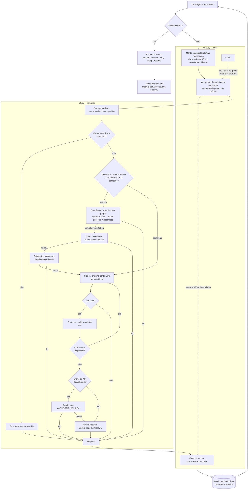

# Omni AI CLI


[](LICENSE)


> [English](docs/README.en.md) · [Español](docs/README.es.md) · [Français](docs/README.fr.md)

Um terminal de chat que junta **Claude Code, Codex, Antigravity e OpenRouter** num lugar
só. Você escreve a pergunta, o `ai` decide quem responde e, se a ferramenta falhar ou
estourar a cota, passa para a próxima sem você fazer nada.

Perguntas simples vão para as ferramentas mais baratas. Tarefas pesadas vão para o
Claude, com troca automática entre várias contas quando uma bate no limite. O histórico
fica salvo, a interface fala português, inglês, espanhol e francês, e modelos e contas
se configuram de dentro do próprio chat.

---

## Índice

- [Como funciona](#como-funciona)
- [Instalação](#instalação)
- [Como usar](#como-usar)
- [Comandos do chat](#comandos-do-chat)
- [Modelos](#modelos)
- [Contas Claude](#contas-claude)
- [Chaves de API](#chaves-de-api)
- [Modos](#modos)
- [Skills e MCP](#skills-e-mcp)
- [Uso direto, sem chat](#uso-direto-sem-chat)
- [Onde ficam os arquivos](#onde-ficam-os-arquivos)
- [Estrutura do projeto](#estrutura-do-projeto)
- [Testes](#testes)
- [Troubleshooting](#troubleshooting)
- [Limitações conhecidas](#limitações-conhecidas)
- [Privacidade](#privacidade)
- [Licença](#licença)

---

## Como funciona

Da linha digitada até a resposta salva. O chat (`chat.py`) não chama nenhuma IA
direto: ele dispara o roteador (`cli.py`) como subprocesso e lê os eventos que ele
emite, linha a linha, para mostrar quem está atendendo e o que está fazendo.



Três detalhes que o diagrama torna explícitos:

- **Cada conta Claude tem sua própria pasta de login.** Contas extras rodam com
  `CLAUDE_CONFIG_DIR` apontando para `~/.claude-accounts/<nome>`. A conta principal
  nunca é deslogada, e nenhuma credencial é copiada de um lugar para outro. Copiar o
  `.credentials.json` não funciona de forma confiável no macOS, onde o login fica no
  Keychain.
- **Ctrl-C mata a árvore inteira.** O roteador roda num grupo de processos próprio, então
  cancelar encerra também o `claude`, o `codex` ou o `agy` que estiver rodando embaixo,
  em vez de deixar processos órfãos gastando cota.
- **Só a resposta entra no histórico.** Linhas de status e diagnóstico aparecem na tela,
  mas não são enviadas como contexto na próxima pergunta. Raciocínio interno dos modelos
  também é descartado.

---

## Instalação

Um comando instala tudo e, rodado de novo, atualiza. Suas contas, chaves e modelos ficam em `~/.config/smart-ai` e não são tocados.

**macOS e Linux**:

```bash
curl -fsSL https://raw.githubusercontent.com/samuelrms/omni-ai-cli/main/get.sh | bash
```

**Windows** (PowerShell):

```powershell
irm https://raw.githubusercontent.com/samuelrms/omni-ai-cli/main/get.ps1 | iex
```

**Em breve no npm, yarn, pnpm e bun.** O pacote `omni-ai-cli` está pronto e sai assim que a publicação for liberada:

```bash
npm install -g omni-ai-cli
yarn global add omni-ai-cli
pnpm add -g omni-ai-cli
bun add -g omni-ai-cli
```

Por enquanto, use o comando de macOS/Linux ou Windows acima.

Para atualizar depois: `ai --update` (ou `/update` no chat).

Pelo código-fonte, para desenvolver:

```bash
git clone https://github.com/samuelrms/omni-ai-cli ~/dev/omni-ai-cli
cd ~/dev/omni-ai-cli && ./scripts/install.sh        # Windows: powershell -File scripts\install.ps1
```

O instalador:

1. instala o **Claude Code** pelo instalador oficial se ele ainda não estiver na máquina;
2. abre o login da conta principal se ainda não houver um;
3. cria o comando `ai` em `~/.local/bin`;
4. mostra as contas Claude configuradas.

Requisitos: nenhum além de `curl` (macOS/Linux) ou PowerShell (Windows). Se não houver Python 3.11+, o instalador baixa um Python 3.12 só para o Omni AI, sem sudo e sem mexer no Python do sistema.
Codex (`codex`) e Antigravity (`agy`) são opcionais e entram na fila de alternativas quando estão instalados.

Se `~/.local/bin` não estiver no `PATH`, adicione ao `~/.zshrc`:

```bash
export PATH="$HOME/.local/bin:$PATH"
```

No Windows, o instalador cria `ai.cmd` em `%USERPROFILE%\.local\bin` e adiciona essa pasta ao `PATH`; abra um terminal novo depois.

---

## Como usar

```bash
ai
```

Na primeira vez ele pergunta o idioma. Depois é só escrever e teclar Enter.

| Tecla | Ação |
| --- | --- |
| Enter | Envia |
| ↑ / ↓ | Linhas anteriores |
| Ctrl-C | Durante a resposta: cancela. No prompt: salva e sai |
| Ctrl-D | Salva e sai |
| `\` + Enter · Shift+Enter · Option+Enter | Nova linha sem enviar (Shift+Enter no iTerm2, Ghostty, Kitty, WezTerm e VS Code; no Terminal do Mac use `\` + Enter) |
| Tab | Completa comandos e skills |

No menu do Tab, cada item termina dizendo de quem é: `omni`, `claude`, `codex` ou `agy`. Ao escolher
uma skill que tem argumentos (como `/pr-review [pr-number | --branch]`), o chat pergunta os
argumentos: Tab mostra as opções, dá para escrever o próprio texto, e Enter sem nada roda sem argumentos.

A tela segue o estilo do Claude Code e do Codex: caixa de entrada no rodapé com a barra de status
(ferramenta, modelo, modo e pasta), Tab para completar comandos e skills, cada ação da IA numa linha
(`● Ran …`, `● Edited …`, `● Called …`) com a saída recolhida, respostas em markdown e um indicador
"Trabalhando…" com o tempo.

Ao sair, ele mostra o comando para voltar à mesma conversa:

```text
Sessão salva. Retome com: ai --resume 1f3a9c2b7d40
```

---

## Comandos do chat

| Comando | O que faz |
| --- | --- |
| `/tool auto\|claude\|codex\|agy\|openrouter` | Fixa uma ferramenta (`auto` decide sozinho) |
| `/model` | Lista os modelos de cada ferramenta |
| `/model codex gpt-6-astra` | Troca um modelo |
| `/model codex default` | Volta ao padrão |
| `/account` | Lista as contas Claude e se estão logadas |
| `/account add pessoal` | Cria uma conta e abre o login do Claude ali mesmo |
| `/account login NOME` | Refaz o login de uma conta |
| `/account sync NOME` | Recompartilha skills, plugins e MCPs da conta principal |
| `/account disable\|enable\|remove NOME` | Desativa, reativa ou remove |
| `/key` | Lista as chaves de API configuradas (mascaradas) |
| `/key claude\|codex\|agy\|openrouter` | Adiciona uma chave, sem mostrar o que você digita |
| `/key remove NOME` | Remove a chave |
| `/status` · `/reset` | Status das contas · zera cooldowns |
| `/lang pt\|en\|es\|fr` | Muda o idioma |
| `/mode default\|plan\|edits\|auto\|yolo` | Modo de permissão, igual nas três ferramentas |
| `/sync` | Compartilha MCPs e skills entre Claude, Codex e Antigravity |
| `/usage` · `/limits` | Uso e limites de todas as ferramentas e contas, com o horário de volta que cada uma informou |
| `/claude:usage` · `/codex:status` · `/agy:usage` … | Comandos nativos de cada ferramenta: abre a tela dela e volta ao Omni ao sair |
| `/terminal-setup` | Mostra como ter Shift+Enter (ou Option+Enter) para nova linha no seu terminal |
| `/skills` | Lista skills e comandos do projeto e do usuário, de Claude, Codex e Antigravity |
| `/nome args` | Roda a skill ou comando (ex.: `/pr-review 237`). Tab completa |
| `/history` · `/sent` · `/trace` | Conversa · o que foi enviado · eventos da execução |
| `/sessions` · `/resume ID` · `/new` | Sessões salvas |
| `/parallel codex: tarefa \| codex: tarefa` | 2 a 4 análises em paralelo, somente leitura |
| `/help` · `/exit` | Ajuda · sair |

Os comandos de configuração também funcionam fora do chat: `ai --model`,
`ai --account add pessoal`, `ai --key claude`, `ai --status`, `ai --reset`.

---

## Modelos

| Chave | Padrão | Valores aceitos |
| --- | --- | --- |
| `claude` | `opus` (o mais capaz) | `opus`, `sonnet`, `haiku` ou ID completo |
| `codex` | `gpt-6-astra` | ID de modelo do Codex |
| `codex_effort` | `high` | `minimal`, `low`, `medium`, `high`, `xhigh` |
| `agy` | padrão do Antigravity | ID de modelo do Antigravity |
| `openrouter` | automático (gratuito) | ID do modelo; pago só com `openrouter_paid on` |
| `openrouter_paid` | `off` | `on` autoriza modelos pagos do OpenRouter |

A ordem de prioridade é: variável de ambiente, depois o que foi salvo com `/model` (em
`~/.config/smart-ai/models.json`), depois o padrão. As variáveis são
`SMART_AI_CLAUDE_MODEL`, `SMART_AI_CODEX_MODEL`, `SMART_AI_CODEX_EFFORT`,
`SMART_AI_AGY_MODEL` e `SMART_AI_OPENROUTER_MODEL`. Quando uma delas está definida, o
`/model` avisa que ela tem precedência.

---

## Contas Claude

```text
ai [auto] › /account add trabalho
Abrindo login do Claude para a conta "trabalho" (pasta isolada ~/.claude-accounts/trabalho).
Sua conta principal não é afetada.
✓ Conta "trabalho" adicionada com prioridade 3.
```

As contas são tentadas por ordem de prioridade. A que bate no limite entra em cooldown
(60 minutos por padrão, ajustável em `~/.config/smart-ai/profiles.json`) e a próxima assume. A conta
`primary` usa o login normal do Claude (`claude auth login`).

Skills, plugins, agentes, `CLAUDE.md`, `settings.json` e os servidores MCP da conta
principal são compartilhados com cada conta extra no login. Só o login fica separado.
Se você instalar uma skill ou um MCP novo depois, rode `/account sync NOME`.


---

## Chaves de API

Além das assinaturas, cada ferramenta aceita uma chave de API. **A assinatura vem
primeiro**; a chave só entra quando a assinatura falha ou bate no limite, porque chave é
cobrada por uso. O OpenRouter funciona só com chave.

| Ferramenta | Comando | Variável que o CLI recebe | Onde criar |
| --- | --- | --- | --- |
| Claude | `/key claude` | `ANTHROPIC_API_KEY` | console.anthropic.com/settings/keys |
| Codex | `/key codex` | `CODEX_API_KEY` | platform.openai.com/api-keys |
| Antigravity | `/key agy` | `GEMINI_API_KEY` | aistudio.google.com/apikey |
| OpenRouter | `/key openrouter` | `OPENROUTER_API_KEY` | openrouter.ai/keys |

```text
ai [auto] › /key claude
Chave de claude (console.anthropic.com/settings/keys). Cole e tecle Enter; ela não aparece na tela.
>
✓ Chave de claude salva em ~/.config/smart-ai/keys/claude (permissão 600).
```

As chaves ficam em `~/.config/smart-ai/keys/`, uma por arquivo, com permissão 600, e
são passadas só ao processo da ferramenta, nunca ao histórico nem ao log. Se a variável
já estiver definida no ambiente, ela tem precedência. `/key` lista o que está
configurado, mostrando só o início e o fim de cada chave.

No Claude, a chave funciona como uma conta extra depois de todas as assinaturas: se ela
também bater no limite, entra em cooldown como as outras.

> **Nunca cole uma chave como comando no shell.** Ela fica gravada no histórico do zsh.
> Se isso acontecer, revogue a chave no site da ferramenta e apague a linha de
> `~/.zsh_history`.

No OpenRouter, o padrão é usar só modelos gratuitos: o cliente escolhe até três
variantes `:free` do catálogo e usa `openrouter/free` como última alternativa. Modelos
pagos ficam bloqueados até você autorizar:

```text
/model openrouter_paid on            # autoriza; avisa que será cobrado na sua conta
/model openrouter anthropic/claude-opus-5.5
/model openrouter_paid off           # bloqueia de novo e volta ao gratuito
```

Com a autorização ligada, o modelo escolhido vem primeiro e os gratuitos ficam como
reserva. Desligada, o limite de preço zero é enviado em toda chamada, então nenhum
modelo pago responde.

---

## Modos

O modo vale para Claude, Codex e Antigravity ao mesmo tempo e aparece no prompt
(`ai [auto · plan] ›`). Cada sessão guarda o seu.

| Modo | O que faz | Claude | Codex | Antigravity |
| --- | --- | --- | --- | --- |
| `default` | Padrão de cada ferramenta | — | — | — |
| `plan` | Só lê e planeja, não altera nada | `plan` | `--sandbox read-only` | `--mode plan` |
| `edits` | Aceita edições de arquivo | `acceptEdits` | `--sandbox workspace-write` | `--mode accept-edits` |
| `auto` | Age sozinho, com as proteções da ferramenta | `auto` | `workspace-write`, sem aprovação | `--mode auto` |
| `yolo` | Sem permissões nem sandbox | `bypassPermissions` | `--dangerously-bypass-approvals-and-sandbox` | `--dangerously-skip-permissions` |

`/mode yolo` pede confirmação, porque a IA passa a poder apagar arquivos e rodar qualquer
comando. Fora do chat: `ai --mode plan "pergunta"`. O `/parallel` roda sempre em `plan`.

---

## Skills e MCP

O `ai` chama os próprios CLIs, então cada um usa as skills e os MCPs que já tem. O
`/sync` junta tudo e instala em cada ferramenta o que só existe nas outras:

```text
ai [auto] › /sync
Ferramentas encontradas: claude, codex, agy
  MCP   github                   codex → claude
  MCP   obsidian                 claude → codex
  skill humanizer                claude → codex  (~/.agents/skills/humanizer)
Aplicar? [s/N]
```

- Os MCPs são adicionados pelo comando `mcp add` de cada CLI, não editando arquivos na mão.
- O mesmo servidor com nomes diferentes é reconhecido pelo pacote ou URL e não é duplicado.
- MCPs que vêm dentro de um app (como os do Codex.app) ficam só nele.
- As skills são compartilhadas por atalho: `~/.claude/skills`, `~/.agents/skills` (Codex) e
  `~/.gemini/antigravity/skills`. Editar uma vale para as três.
- As contas Claude extras são atualizadas junto.
- Variáveis de ambiente dos MCPs, que podem ter tokens, são copiadas para a config da
  outra ferramenta. O `/sync` avisa antes.
- `/sync --dry-run` só mostra o que faria.

**Skills e comandos do projeto:** o chat lê `.claude/commands`, `.claude/skills`, `.agents/skills` e
`.agent/workflows` do projeto aberto, além das pastas do usuário. `/pr-review 237` vai para o
Claude do jeito que foi digitado, e ele executa o comando nativamente. Uma skill que só existe
no Codex ou no Antigravity vai para essa ferramenta, com as instruções do arquivo no pedido.

Como o chat não repassa pedidos de aprovação, uma ferramenta de MCP só roda se já estiver
liberada nas permissões do CLI ou se o modo for `auto` ou `yolo`. O OpenRouter não tem
skills nem MCP.

---

## Uso direto, sem chat

```bash
ai "o que é um design pattern?"        # roteamento automático
ai --claude "refatorar o módulo X"     # força Claude
ai --codex "explicar REST"             # força Codex
ai --agy "pesquisar React hooks"       # força Antigravity
ai --openrouter "explicar Docker"      # força OpenRouter
ai --classify "prompt"                 # mostra como seria classificado
ai --log                               # últimas chamadas
```

---

## Onde ficam os arquivos

| Caminho | Conteúdo |
| --- | --- |
| `~/.config/smart-ai/profiles.json` | Contas Claude e regras de roteamento |
| `~/.config/smart-ai/models.json` | Modelos escolhidos com `/model` |
| `~/.config/smart-ai/lang` | Idioma do chat |
| `~/.config/smart-ai/keys/<ferramenta>` | Chaves de API, uma por arquivo (permissão 600) |
| `~/.claude-accounts/<nome>/` | Login isolado de cada conta Claude extra |
| `~/.local/share/smart-ai/sessions/` | Sessões do chat |
| `~/.cache/smart-ai/state.json` | Cooldowns ativos |
| `~/.cache/smart-ai/usage.log` | Log de uso, só metadados |

---

## Estrutura do projeto

```text
omni-ai-cli/
├── omni_ai/                  # o programa (pacote Python)
│   ├── cli.py                # comando ai: classifica, roteia e executa cada ferramenta
│   ├── chat.py               # chat: sessões, eventos, Ctrl-C, idiomas
│   ├── ui.py                 # visual: caixa de entrada, barra de status, ações e respostas
│   ├── skills.py             # skills e comandos do projeto, do usuário e nativos
│   ├── config.py             # modelos, chaves e contas Claude (/model, /key, /account)
│   ├── sync.py               # /sync: MCPs e skills entre as três ferramentas
│   ├── openrouter.py         # cliente OpenRouter: gratuitos, pagos só se autorizados
│   ├── pii.py                # mascara e restaura dados pessoais
│   ├── osutils.py            # diferenças entre macOS, Linux e Windows
│   ├── profiles.json         # modelo inicial; o seu fica em ~/.config/smart-ai
│   └── vendor/               # prompt_toolkit e wcwidth embutidos (sem pip)
├── bin/ai.js                 # lançador npm: acha ou instala o Python e roda o pacote
├── scripts/                  # install.sh, install.ps1 e ai.cmd
├── docs/                     # README em inglês, espanhol e francês
├── tests/                    # executáveis fictícios, sem consumir cota
├── postman/                  # simulação HTTP do OpenRouter
├── get.sh / get.ps1          # instalação com um comando
└── package.json · LICENSE
```

O roteador não sabe nada de chat: ele só executa uma pergunta e, com
`SMART_AI_EVENTS=1`, emite eventos JSON. O chat não sabe nada de credenciais: contas e
modelos passam pelo `config.py`.

---

## Testes

```bash
python3 -m unittest discover -s tests -v
bash -n scripts/install.sh
```

**38 testes**: persistência e retomada de sessão, limite de contexto, permissão dos
arquivos, sessão aberta em dois terminais, leitura de eventos, cancelamento da árvore de
processos, paralelismo real, sandbox somente leitura, mascaramento de dados pessoais,
fallback OpenRouter → Codex, validação de modelos, armazenamento das chaves e o ciclo de vida das contas. Todos os
executáveis são fictícios: **nenhum teste autentica nem consome assinatura.**

Para testar o HTTP do OpenRouter contra a simulação Postman:

```bash
postman simulation run postman/simulations/openrouter.sim.yaml --port 4901 --no-history --output ndjson
SMART_AI_SIM_URL=http://127.0.0.1:4901/openrouter python3 -m unittest discover -s tests -v
```

---

## Troubleshooting

| Problema | Solução |
| --- | --- |
| `OPENROUTER_API_KEY não configurada` | `/key openrouter` no chat ou `ai --key openrouter`. |
| `Arquivo de credenciais não encontrado` ou `Conta 'X' sem login` | `/account login X`. |
| `You've hit your session limit` | Cota da conta. O `ai` passa para a próxima; adicione outra com `/account add` ou uma chave com `/key claude`. |
| `Individual quota reached` (Antigravity) | Cota do Antigravity; ele é pulado até a renovação. |
| `Not inside a trusted directory` (Codex) | Instalação antiga. Rode o instalador de novo. |
| `Claude Code não instalado` | `./scripts/install.sh` (ou `scripts\install.ps1` no Windows) instala pelo instalador oficial. |
| Windows: atalhos de skills falham | Ative o Modo de Desenvolvedor ou rode como administrador; sem isso o `ai` usa junções de pasta. |
| `/model` não muda nada | Uma variável `SMART_AI_*_MODEL` está definida e tem precedência. |
| `/key` não muda nada | A variável da ferramenta (`ANTHROPIC_API_KEY` etc.) está definida e tem precedência. |
| `Sessão já aberta em outro terminal` | Feche o outro terminal ou use `/new`. |
| `ai: command not found` | Adicione `~/.local/bin` ao `PATH`. |

---

## Limitações conhecidas

- O chat usa os modos não interativos dos CLIs. Pedidos de aprovação nativos (por
  exemplo, "posso editar este arquivo?") não aparecem; nesses casos, use o CLI nativo.
- `/parallel` só analisa: Codex em `--sandbox read-only` ou OpenRouter, que não acessa os
  arquivos. Os agentes não editam o projeto ao mesmo tempo.
- A classificação simples/complexa é por palavras-chave e tamanho, não por um modelo.
- Trocar de modelo não renova a cota da conta.
- O OpenRouter não tem streaming nesta versão: a resposta aparece inteira no final.
- No Windows, o código usa os equivalentes nativos (grupo de processos e `taskkill`, `msvcrt`, junções de pasta), mas foi testado de verdade só no macOS.

---

## Privacidade

- Sessões, chaves de API e logs ficam só na sua máquina, com permissão restrita ao seu usuário.
- O log de uso grava ferramenta, conta e status, **nunca o texto da pergunta**.
- Antes de ir para o OpenRouter, e-mails, telefones, documentos e outros dados pessoais
  são trocados por marcadores e restaurados na resposta. O mascaramento é por padrões e
  não garante anonimização total.
- Claude, Codex e Antigravity recebem o texto original, sob os termos de cada serviço.

---

## Licença

[MIT](LICENSE). Bibliotecas embutidas em `vendor/`: prompt_toolkit (BSD-3-Clause) e wcwidth (MIT), com as licenças em cada pasta.
