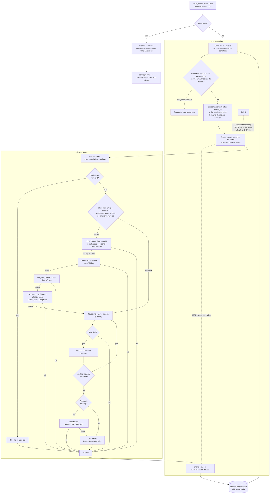
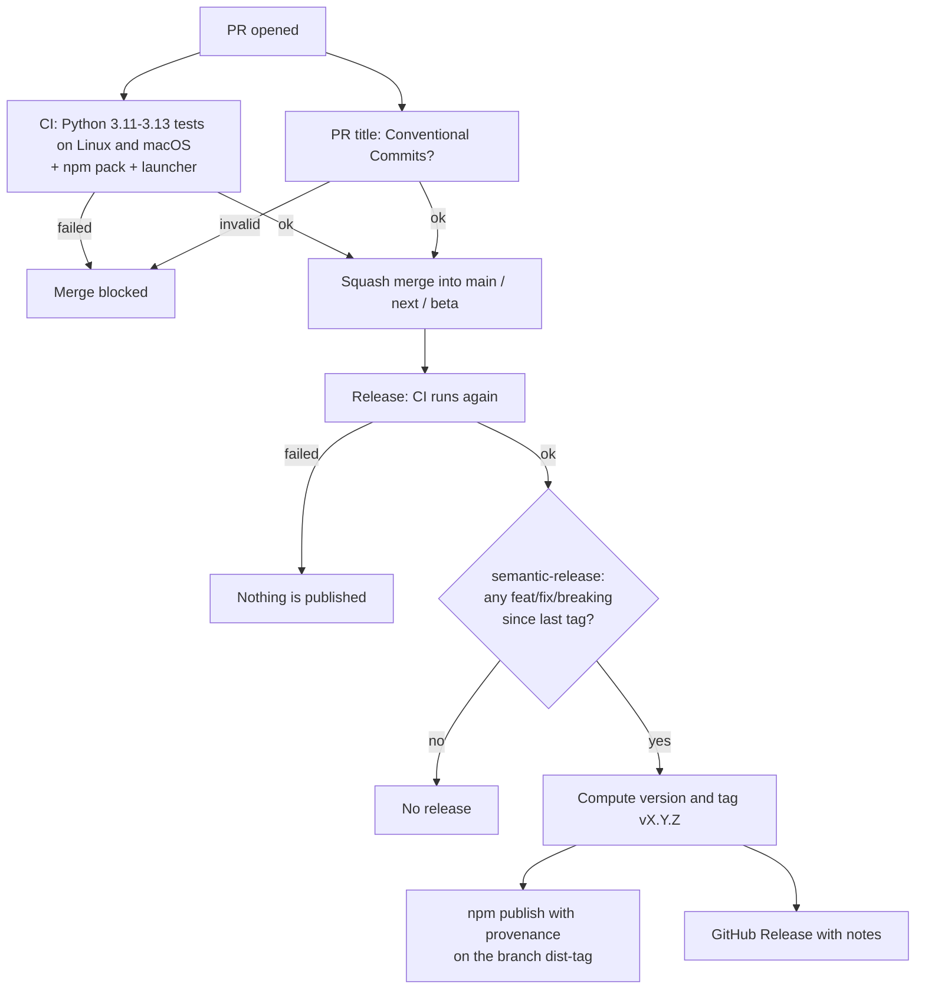

# Omni AI CLI


[](../LICENSE)


> [Português](../README.md) · [Español](README.es.md) · [Français](README.fr.md)

A chat terminal that brings **Claude Code, Codex, Cursor, Antigravity, Grok, DeepSeek and
OpenRouter** together in one place. You type your question, `ai` decides who answers, and
if a tool fails or runs out of quota, it moves on to the next one without you doing anything.

While an answer is being generated, the input box stays free: you keep sending requests,
they go into a queue shown above the box and run in order.

Simple questions go to the cheaper tools. Heavy tasks go to Claude, with automatic
switching between several accounts when one hits its limit. History is saved, the
interface speaks Portuguese, English, Spanish and French, and models and accounts are
configured from inside the chat itself.

---

## Contents

- [How it works](#how-it-works)
- [Installation](#installation)
- [How to use](#how-to-use)
- [Chat commands](#chat-commands)
- [Models](#models)
- [Claude accounts](#claude-accounts)
- [API keys](#api-keys)
- [Modes](#modes)
- [Skills and MCP](#skills-and-mcp)
- [Direct use, no chat](#direct-use-no-chat)
- [Where files live](#where-files-live)
- [Project structure](#project-structure)
- [Tests](#tests)
- [Troubleshooting](#troubleshooting)
- [Known limitations](#known-limitations)
- [Privacy](#privacy)
- [License](#license)

---

## How it works

From the typed line to the saved answer. The chat (`chat.py`) does not call any AI
directly: it launches the router (`cli.py`) as a subprocess and reads the events it
emits, line by line, to show who is answering and what they are doing.



Three details the diagram makes explicit:

- **Each Claude account has its own login folder.** Extra accounts run with
  `CLAUDE_CONFIG_DIR` pointing to `~/.claude-accounts/<nome>`. The main account is
  never logged out, and no credential is copied from one place to another. Copying
  `.credentials.json` does not work reliably on macOS, where the login lives in the
  Keychain.
- **Ctrl-C kills the whole tree.** The router runs in its own process group, so
  canceling also ends the `claude`, `codex` or `agy` running underneath, instead of
  leaving orphan processes burning quota.
- **The queue blocks nothing.** Above the box you see the running request, the elapsed
  time and the next ones in line. A request that waited goes through a free classifier
  before running: if the previous answer already covers it, it is skipped. Commands and
  skills always run. Ctrl-C with the queue active cancels everything without leaving the chat. If you
  close the chat with requests in line, they stay saved in the session and `ai --resume ID` offers to run them.
- **Only the answer goes into the history.** Status and diagnostic lines appear on
  screen, but are not sent as context with the next question. The models' internal
  reasoning is also discarded.

---

## Installation

One command installs everything and, run again, updates it. Your accounts, keys and models live in `~/.config/smart-ai` and are left untouched.

**macOS and Linux**:

```bash
curl -fsSL https://raw.githubusercontent.com/samuelrms/omni-ai-cli/main/get.sh | bash
```

**Windows** (PowerShell):

```powershell
irm https://raw.githubusercontent.com/samuelrms/omni-ai-cli/main/get.ps1 | iex
```

**Coming soon to npm, yarn, pnpm and bun.** The `omni-ai-cli` package is ready and ships as soon as publishing is unlocked:

```bash
npm install -g omni-ai-cli
yarn global add omni-ai-cli
pnpm add -g omni-ai-cli
bun add -g omni-ai-cli
```

For now, use the macOS/Linux or Windows command above.

To update later: `ai --update` (or `/update` in the chat).

From source, for development:

```bash
git clone https://github.com/samuelrms/omni-ai-cli ~/dev/omni-ai-cli
cd ~/dev/omni-ai-cli && ./scripts/install.sh        # Windows: powershell -File scripts\install.ps1
```

The installer:

1. installs **Claude Code** through the official installer if it is not on the machine yet;
2. opens the main account login if there isn't one yet;
3. creates the `ai` command in `~/.local/bin`;
4. shows the configured Claude accounts.

Requirements: nothing beyond `curl` (macOS/Linux) or PowerShell (Windows). If Python 3.11+ is missing, the installer downloads a Python 3.12 just for Omni AI, without sudo and without touching the system Python.
Codex (`codex`) and Antigravity (`agy`) are optional and join the fallback queue when they are installed.

If `~/.local/bin` is not in your `PATH`, add this to `~/.zshrc`:

```bash
export PATH="$HOME/.local/bin:$PATH"
```

On Windows, the installer creates `ai.cmd` in `%USERPROFILE%\.local\bin` and adds that folder to `PATH`; open a new terminal afterwards.

---

## How to use

```bash
ai
```

The first time, it asks for the language. After that, just type and press Enter.

| Key | Action |
| --- | --- |
| Enter | Sends |
| ↑ / ↓ | Previous lines |
| Ctrl-C | During an answer: cancels. At the prompt: saves and exits |
| Ctrl-D | Saves and exits |
| `\` + Enter · Shift+Enter · Option+Enter | New line without sending (Shift+Enter in iTerm2, Ghostty, Kitty, WezTerm and VS Code; in macOS Terminal use `\` + Enter) |
| Tab | Completes commands and skills |

In the Tab menu every item ends with its owner: `omni`, `claude`, `codex` or `agy`. When you pick a
skill that takes arguments (like `/pr-review [pr-number | --branch]`), the chat asks for them: Tab
shows the options, you can type your own text, and Enter alone runs it without arguments.

The screen follows Claude Code and Codex: an input box at the bottom with a status bar (tool,
model, mode and folder), Tab to complete commands and skills, each AI action on one line
(`● Ran …`, `● Edited …`, `● Called …`) with its output collapsed, markdown answers and a
"Working…" indicator with elapsed time. On start, a 1.5s full-screen splash (Ctrl-C skips;
`SMART_AI_NO_SPLASH=1` turns it off).

On exit, it shows the command to return to the same conversation:

```text
Sessão salva. Retome com: ai --resume 1f3a9c2b7d40
```

---

## Chat commands

| Command | What it does |
| --- | --- |
| `/tool auto\|claude\|codex\|cursor\|agy\|openrouter\|grok\|deepseek` | Pins a tool (`auto` decides on its own) |
| `/model` | Lists the models of each tool |
| `/model codex gpt-6-astra` | Changes a model |
| `/model codex default` | Goes back to the default |
| `/account` | Lists the Claude accounts and whether they are logged in |
| `/account add pessoal` | Creates an account and opens the Claude login right there |
| `/account login NOME` | Redoes the login of an account |
| `/account sync NAME` | Re-shares skills, plugins and MCPs from the main account |
| `/account disable\|enable\|remove NOME` | Disables, re-enables or removes |
| `/key` | Lists the configured API keys (masked) |
| `/key claude\|codex\|cursor\|agy\|openrouter\|grok\|deepseek\|groq\|cerebras` | Adds a key, without showing what you type |
| `/key add TOOL [NAME]` | One more key for the same tool (any tool, Claude included); keys are tried in order when one fails or hits its limit |
| `/key remove TOOL [NAME]` | Removes the key (no name: the main one) |
| `/status` · `/reset` | Account status · clears cooldowns |
| `/lang pt\|en\|es\|fr` | Changes the language |
| `/mode default\|plan\|edits\|auto\|yolo` | Permission mode, the same on all three tools |
| `/sync` | Shares MCPs and skills across Claude, Codex and Antigravity |
| `/usage [watch]` · `/limits` | Real usage of each account as bars (e-mail, plan, % of the 5-hour and weekly windows, reset time) for Claude and Codex; key spend on OpenRouter; for the others, the limit message the tool gave. `watch` refreshes every 30 s |
| `/queue [rm\|up\|down N\|clear]` | Shows the queue; removes (`rm`), moves up (`up`) or down (`down`) a request, or empties (`clear`) what waits |
| `/versions [N]` | What changed in each version, newest first; `N` opens the technical note. Before the first release, shows the `feat`/`fix` commits on `main` |
| `/clear` · `/compact` | Clear the conversation · summarize it into one block to save context |
| `/claude:usage` · `/codex:status` · `/agy:usage` … | Each tool's native commands: opens its screen and returns to Omni on exit |
| `/terminal-setup` | Shows how to get Shift+Enter (or Option+Enter) for new lines in your terminal |
| `/skills` | Lists project and user skills and commands from Claude, Codex and Antigravity |
| `/name args` | Runs the skill or command (e.g. `/pr-review 237`). Tab completes |
| `/history` · `/sent` · `/trace` | Conversation · what was sent · run events |
| `/sessions` · `/resume ID` · `/new` | Saved sessions |
| `/parallel codex: tarefa \| deepseek: tarefa` | 2 to 4 analyses in parallel, read-only (codex, openrouter, grok, deepseek) |
| `/help` · `/exit` | Help · exit |

While the queue is running, `/clear`, `/new`, `/resume`, `/key`, `/usage` and the native
commands wait: they take over the terminal or switch the session. Everything else works right away.

The configuration commands also work outside the chat: `ai --model`,
`ai --account add pessoal`, `ai --key claude`, `ai --status`, `ai --reset`.

---

## Models

| Key | Default | Accepted values |
| --- | --- | --- |
| `claude` | `opus` (the most capable) | `opus`, `sonnet`, `haiku` or full ID |
| `codex` | `gpt-6-astra` | Codex model ID |
| `codex_effort` | `high` | `minimal`, `low`, `medium`, `high`, `xhigh` |
| `agy` | Antigravity default | Antigravity model ID |
| `openrouter` | automatic (free) | model ID; paid only with `openrouter_paid on` |
| `openrouter_paid` | `off` | `on` authorizes paid OpenRouter models |
| `grok` | Grok default | xAI model ID |
| `deepseek` | `deepseek-chat` | `deepseek-chat`, `deepseek-reasoner` |
| `cursor` | Cursor account default | Cursor CLI model ID |

The priority order is: environment variable, then what was saved with `/model` (in
`~/.config/smart-ai/models.json`), then the default. The variables are
`SMART_AI_CLAUDE_MODEL`, `SMART_AI_CODEX_MODEL`, `SMART_AI_CODEX_EFFORT`,
`SMART_AI_AGY_MODEL`, `SMART_AI_OPENROUTER_MODEL`, `SMART_AI_GROK_MODEL`,
`SMART_AI_DEEPSEEK_MODEL` and `SMART_AI_CURSOR_MODEL`. When one of them is set,
`/model` warns that it takes precedence.

---

## Claude accounts

```text
ai [auto] › /account add trabalho
Abrindo login do Claude para a conta "trabalho" (pasta isolada ~/.claude-accounts/trabalho).
Sua conta principal não é afetada.
✓ Conta "trabalho" adicionada com prioridade 3.
```

Accounts are tried in priority order. The one that hits its limit goes on cooldown
(60 minutes by default, adjustable in `profiles.json`) and the next one takes over. The
`primary` account uses the normal Claude login (`claude auth login`).

Skills, plugins, agents, `CLAUDE.md`, `settings.json` and the main account's MCP servers
are shared with every extra account at login. Only the login stays separate. If you
install a new skill or MCP later, run `/account sync NAME`.


---

## API keys

Besides subscriptions, each tool accepts an API key. **The subscription comes
first**; the key only comes in when the subscription fails or hits its limit, because a
key is billed per use. OpenRouter works with a key only.

| Tool | Command | Variable the CLI receives | Where to create |
| --- | --- | --- | --- |
| Claude | `/key claude` | `ANTHROPIC_API_KEY` | console.anthropic.com/settings/keys |
| Codex | `/key codex` | `CODEX_API_KEY` | platform.openai.com/api-keys |
| Antigravity | `/key agy` | `GEMINI_API_KEY` | aistudio.google.com/apikey |
| OpenRouter | `/key openrouter` | `OPENROUTER_API_KEY` | openrouter.ai/keys |
| Cursor | `/key cursor` | `CURSOR_API_KEY` | cursor.com/dashboard → Integrations |
| Grok | `/key grok` | `XAI_API_KEY` | console.x.ai |
| DeepSeek | `/key deepseek` | `DEEPSEEK_API_KEY` | platform.deepseek.com/api_keys |
| Groq (classifier) | `/key groq` | `GROQ_API_KEY` | console.groq.com/keys |
| Cerebras (classifier) | `/key cerebras` | `CEREBRAS_API_KEY` | cloud.cerebras.ai |

Cursor uses the account login first (`cursor-agent login`) and only then the keys.
DeepSeek, like OpenRouter, works only with a key and masks personal data before sending.
Groq and Cerebras don't answer questions: they only classify each request (for free) and
check whether a queued request has already been answered.

```text
ai [auto] › /key claude
Chave de claude (console.anthropic.com/settings/keys). Cole e tecle Enter; ela não aparece na tela.
>
✓ Chave de claude salva em ~/.config/smart-ai/keys/claude (permissão 600).
```

Keys are stored in `~/.config/smart-ai/keys/`, one per file, with permission 600, and
are passed only to the tool's process, never to the history or the log. If the variable
is already set in the environment, it takes precedence. `/key` lists what is
configured, showing only the start and end of each key.

On Claude, the key works as an extra account after all the subscriptions: if it also
hits its limit, it goes on cooldown like the others.

> **Never paste a key as a shell command.** It gets recorded in the zsh history.
> If that happens, revoke the key on the tool's website and delete the line from
> `~/.zsh_history`.

On OpenRouter the default is free models only: the client picks up to three `:free`
variants from the catalog and uses `openrouter/free` as a last alternative. Paid models
stay blocked until you authorize them:

```text
/model openrouter_paid on            # authorizes; warns it will be billed to your account
/model openrouter anthropic/claude-opus-5.5
/model openrouter_paid off           # blocks again and goes back to free
```

With authorization on, the chosen model goes first and free models stay as backup. With
it off, a zero price cap is sent on every call, so no paid model answers.

---

## Modes

The mode applies to Claude, Codex and Antigravity at once and shows in the prompt
(`ai [auto · plan] ›`). Each session keeps its own.

| Mode | What it does | Claude | Codex | Antigravity |
| --- | --- | --- | --- | --- |
| `default` | Each tool's default | — | — | — |
| `plan` | Reads and plans only, changes nothing | `plan` | `--sandbox read-only` | `--mode plan` |
| `edits` | Accepts file edits | `acceptEdits` | `--sandbox workspace-write` | `--mode accept-edits` |
| `auto` | Acts on its own, with the tool's safeguards | `auto` | `workspace-write`, no approval | `--mode auto` |
| `yolo` | No permissions or sandbox | `bypassPermissions` | `--dangerously-bypass-approvals-and-sandbox` | `--dangerously-skip-permissions` |

`/mode yolo` asks for confirmation, because the AI can then delete files and run any
command. Outside the chat: `ai --mode plan "question"`. `/parallel` always runs in `plan`.

---

## Skills and MCP

`ai` calls the CLIs themselves, so each one uses the skills and MCPs it already has.
`/sync` gathers everything and installs in each tool what only exists in the others:

```text
ai [auto] › /sync
Ferramentas encontradas: claude, codex, agy
  MCP   github                   codex → claude
  MCP   obsidian                 claude → codex
  skill humanizer                claude → codex  (~/.agents/skills/humanizer)
Aplicar? [s/N]
```

- MCPs are added through each CLI's own `mcp add` command, not by editing files by hand.
- The same server under different names is recognized by package or URL and not duplicated.
- MCPs that ship inside an app (like Codex.app's) stay there.
- Skills are shared by link: `~/.claude/skills`, `~/.agents/skills` (Codex) and
  `~/.gemini/antigravity/skills`. Editing one applies to all three.
- Extra Claude accounts are refreshed too.
- MCP environment variables, which may hold tokens, are copied into the other tool's
  config. `/sync` warns before doing it.
- `/sync --dry-run` only shows what it would do.

**Project skills and commands:** the chat reads `.claude/commands`, `.claude/skills`, `.agents/skills`
and `.agent/workflows` from the open project, plus the user folders. `/pr-review 237` goes to
Claude exactly as typed, and Claude runs the command natively. A skill that only exists in
Codex or Antigravity goes to that tool, with the file's instructions in the request.

Since the chat doesn't forward approval prompts, an MCP tool only runs if it is already
allowed in the CLI's permissions or the mode is `auto` or `yolo`. OpenRouter has no skills
or MCP.

---

## Direct use, no chat

```bash
ai "o que é um design pattern?"        # automatic routing
ai --claude "refatorar o módulo X"     # forces Claude
ai --codex "explicar REST"             # forces Codex
ai --agy "pesquisar React hooks"       # forces Antigravity
ai --openrouter "explicar Docker"      # forces OpenRouter
ai --cursor "corrigir o teste X"       # forces Cursor
ai --deepseek "explicar CAP theorem"   # forces DeepSeek
ai --classify "prompt"                 # shows how it would be classified
ai --log                               # latest calls
```

---

## Where files live

| Path | Contents |
| --- | --- |
| `~/.config/smart-ai/profiles.json` | Claude accounts and routing rules |
| `~/.config/smart-ai/models.json` | Models chosen with `/model` |
| `~/.config/smart-ai/lang` | Chat language |
| `~/.config/smart-ai/keys/<ferramenta>` | API keys, one per file (permission 600) |
| `~/.claude-accounts/<nome>/` | Isolated login of each extra Claude account |
| `~/.local/share/smart-ai/sessions/` | Chat sessions |
| `~/.cache/smart-ai/state.json` | Active cooldowns |
| `~/.cache/smart-ai/usage.log` | Usage log, metadata only |

---

## Project structure

```text
omni-ai-cli/
├── omni_ai/                  # the program (Python package)
│   ├── tools.py              # single tool registry: name, color, CLI, model, key
│   ├── cli.py                # ai command: classifies, routes and runs each tool
│   ├── chat.py               # chat: sessions, events, Ctrl-C, languages
│   ├── ui.py                 # look: input box, status bar, actions and answers
│   ├── skills.py             # project, user and native skills/commands
│   ├── config.py             # models, keys and Claude accounts (/model, /key, /account)
│   ├── sync.py               # /sync: MCPs and skills across the three tools
│   ├── openrouter.py         # OpenRouter client: free, paid only if authorized
│   ├── grok.py               # xAI client, reused by DeepSeek
│   ├── deepseek.py           # DeepSeek client with personal data masked
│   ├── pii.py                # masks and restores personal data
│   ├── osutils.py            # differences between macOS, Linux and Windows
│   ├── profiles.json         # starting template; yours lives in ~/.config/smart-ai
│   └── vendor/               # bundled prompt_toolkit and wcwidth (no pip)
├── bin/ai.js                 # npm launcher: finds or installs Python and runs the package
├── scripts/                  # install.sh, install.ps1 and ai.cmd
├── docs/                     # README in English, Spanish and French
├── tests/                    # fake executables, no quota used
├── postman/                  # OpenRouter HTTP simulation
├── get.sh / get.ps1          # one-command install
└── package.json · LICENSE
```

The router knows nothing about chat: it only runs a question and, with
`SMART_AI_EVENTS=1`, emits JSON events. The chat knows nothing about credentials:
accounts and models go through `config.py`.

---

## Tests

```bash
python3 -m unittest discover -s tests -v
bash -n scripts/install.sh
```

**38 tests**: session persistence and resume, context limit, file permissions, session
open in two terminals, event reading, process tree cancellation, real parallelism,
read-only sandbox, personal data masking, OpenRouter → Codex fallback, model
validation, key storage and the account lifecycle. All the
executables are fake: **no test authenticates or uses up a subscription.**

To test OpenRouter's HTTP against the Postman simulation:

```bash
postman simulation run postman/simulations/openrouter.sim.yaml --port 4901 --no-history --output ndjson
SMART_AI_SIM_URL=http://127.0.0.1:4901/openrouter python3 -m unittest discover -s tests -v
```

---

## Releases and branches

Publishing to npm is automatic, run by GitHub Actions with semantic-release. The
version comes from commit messages (Conventional Commits) — nobody edits `version` in
`package.json` by hand.

| Branch | Publishes as | Example |
|---|---|---|
| `main` | `latest` | `1.4.0` |
| `next` | `next` (release candidate) | `1.5.0-rc.1` |
| `beta` | `beta` | `2.0.0-beta.1` |
| others / PR | nothing, CI only | — |

| Commit | Version effect |
|---|---|
| `fix: ...` | patch (`1.4.0` → `1.4.1`) |
| `feat: ...` | minor (`1.4.0` → `1.5.0`) |
| `feat!: ...` or `BREAKING CHANGE:` in the body | major (`1.4.0` → `2.0.0`) |
| `docs:`, `ci:`, `chore:`, `test:`, `refactor:` | no release |

Use squash merge: the PR title becomes the commit, and the `PR title` workflow blocks
titles that don't follow the convention.

### Commit messages

`/versions` shows the title of each `feat`/`fix` as the "simple view" and the body as the
"technical note". So:

- **Title:** what changes for the user, in English, present tense, no file or function
  names. `feat: keep the input free and queue new requests while one runs`, not
  `feat: add Queue class to chat.py`.
- **Body:** the why and the new behavior in short sentences; technical details only at
  the end, if they help.
- One commit per noticeable change. Refactoring and tests go in `refactor:`/`test:`,
  which don't show up in `/versions`.



One-time GitHub setup:

1. **Settings → Secrets and variables → Actions**: add `NPM_TOKEN` (an *Automation* or
   *Granular* npmjs.com token with publish permission).
2. **Settings → Branches**: protect `main` (and `next`/`beta` if used), requiring a PR and
   the `Tests (...)`, `npm package` and `conventional` checks.
3. **Settings → General → Pull Requests**: allow only *squash merging* and tick *Default
   to pull request title*.

---

## Troubleshooting

| Problem | Solution |
| --- | --- |
| `OPENROUTER_API_KEY não configurada` | `/key openrouter` in the chat or `ai --key openrouter`. |
| `Arquivo de credenciais não encontrado` or `Conta 'X' sem login` | `/account login X`. |
| `You've hit your session limit` | Account quota. `ai` moves to the next one; add another with `/account add` or a key with `/key claude`. |
| `Individual quota reached` (Antigravity) | Antigravity quota; it is skipped until it renews. |
| `Not inside a trusted directory` (Codex) | Old install. Run the installer again. |
| `Claude Code não instalado` | `./scripts/install.sh` (or `scripts\install.ps1` on Windows) installs it with the official installer. |
| Windows: skill links fail | Turn on Developer Mode or run as administrator; otherwise `ai` uses folder junctions. |
| `/model` changes nothing | A `SMART_AI_*_MODEL` variable is set and takes precedence. |
| `/key` changes nothing | The tool's variable (`ANTHROPIC_API_KEY` etc.) is set and takes precedence. |
| `Sessão já aberta em outro terminal` | Close the other terminal or use `/new`. |
| `ai: command not found` | Add `~/.local/bin` to the `PATH`. |

---

## Known limitations

- The chat uses the CLIs' non-interactive modes. Native approval prompts (for
  example, "can I edit this file?") do not appear; in those cases, use the native CLI.
- `/parallel` only analyzes: Codex in `--sandbox read-only` or OpenRouter, which does not
  access the files. The agents do not edit the project at the same time.
- The simple/complex classification is by keywords and length, not by a model.
- Switching models does not renew the account's quota.
- OpenRouter has no streaming in this version: the answer appears whole at the end.
- On Windows the code uses the native equivalents (process groups and `taskkill`, `msvcrt`, folder junctions), but it has only been tested for real on macOS.

---

## Privacy

- Sessions, API keys and logs stay only on your machine, with permissions restricted to your user.
- The usage log records tool, account and status, **never the text of the question**.
- Before going to OpenRouter, emails, phone numbers, documents and other personal data
  are swapped for placeholders and restored in the answer. Masking is pattern-based and
  does not guarantee full anonymization.
- Claude, Codex and Antigravity receive the original text, under each service's terms.

---

## License

[MIT](../LICENSE). Bundled in `vendor/`: prompt_toolkit (BSD-3-Clause) and wcwidth (MIT), each with its license.
