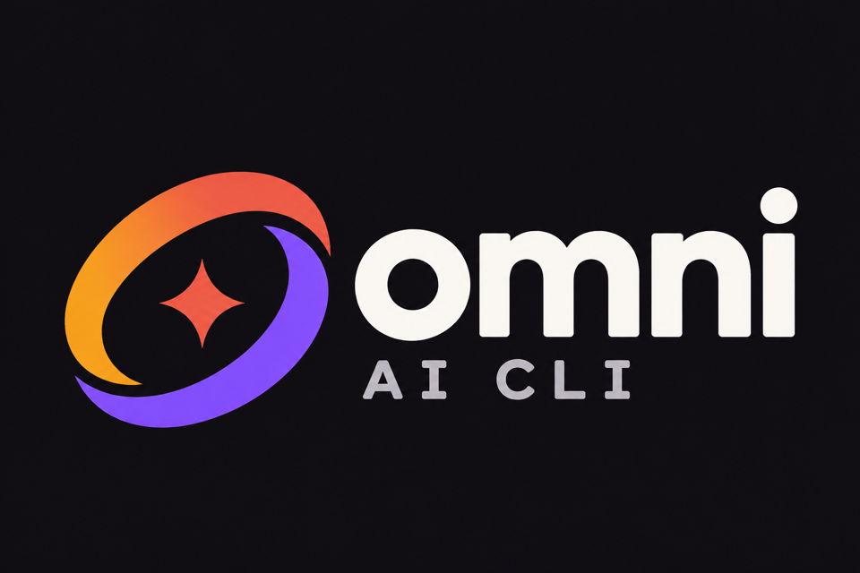
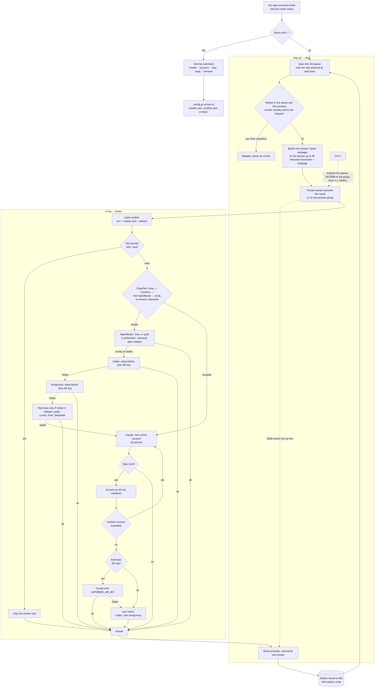
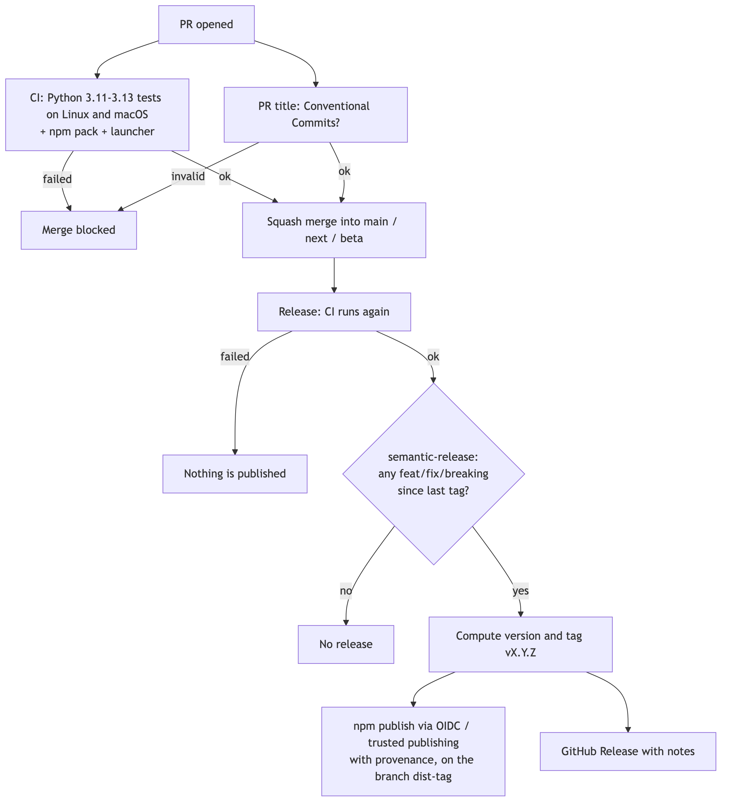

<p align="center">
  
</p>

# Omni AI CLI

[](https://www.npmjs.com/package/omni-ai-cli)
[](https://www.npmjs.com/package/omni-ai-cli)
[](https://marketplace.visualstudio.com/items?itemName=samuelrms.omni-ai-cli)
[](https://open-vsx.org/extension/samuelrms/omni-ai-cli)
[](https://docs.npmjs.com/trusted-publishers)
[](https://github.com/samuelrms/omni-ai-cli/actions/workflows/coverage.yml)
[](../LICENSE)


> [Português](../README.md) · [Español](README.es.md) · [Français](README.fr.md)

A chat terminal that brings **Claude Code, Codex, Cursor, Antigravity, Grok, DeepSeek and
OpenRouter** together in one place. You type your question, `ai` decides who answers, and
if a tool fails or runs out of quota, it moves on to the next one without you doing anything.

While an answer is being generated, the input box stays free: you keep sending requests,
they go into a queue shown above the box and run in order.

With `ai serve`, all of this is also available as an [OpenAI-compatible API](#server-mode), directly or [in Docker](#docker).

Simple questions go to the cheaper tools. Heavy tasks go to Claude, with automatic
switching between several accounts when one hits its limit. History is saved, the
interface speaks Portuguese, English, Spanish and French, and models and accounts are
configured from inside the chat itself.

---

## Contents

- [How it works](#how-it-works)
- [Installation](#installation)
- [How to use](#how-to-use)
- [Editor extension](#editor-extension)
- [Chat commands](#chat-commands)
- [Models](#models)
- [Claude accounts](#claude-accounts)
- [Browserless login](#browserless-login)
- [API keys](#api-keys)
- [Modes](#modes)
- [Skills and MCP](#skills-and-mcp)
- [Direct use, no chat](#direct-use-no-chat)
- [Server mode](#server-mode)
- [Docker](#docker)
- [Where files live](#where-files-live)
- [Project structure](#project-structure)
- [Tests](#tests)
- [Releases and branches](#releases-and-branches)
- [Troubleshooting](#troubleshooting)
- [Known limitations](#known-limitations)
- [Privacy](#privacy)
- [License](#license)

---

## How it works

From the typed line to the saved answer. The chat (`omni_ai/chat/`) does not call any AI
directly: it launches the router (`omni_ai/cli/`) as a subprocess and reads the events it
emits, line by line, to show who is answering and what they are doing.



Three details the diagram makes explicit:

- **Each Claude account has its own login folder.** Extra accounts run with
  `CLAUDE_CONFIG_DIR` pointing to `~/.claude-accounts/<nome>`. The main account is
  never logged out, and no credential is copied from one place to another. Copying
  `.credentials.json` does not work reliably on macOS, where the login lives in the
  Keychain.
- **Ctrl-C kills the whole tree.** The router runs in its own process group, so
  canceling also ends the `claude`, `codex` or `agy` running underneath, instead of
  leaving orphan processes burning quota.
- **The queue blocks nothing.** Above the box you see the running request, the elapsed
  time and the next ones in line. A request that waited goes through a free classifier
  before running: if the previous answer already covers it, it is skipped. Commands and
  skills always run. Ctrl-C with the queue active cancels everything without leaving the chat. If you
  close the chat with requests in line, they stay saved in the session and `ai --resume ID` offers to run them.
- **Each answer shows what it cost.** At the end of each request you see the tokens and,
  when the tool reports it (OpenRouter, Grok, Claude on an API key), the cost in dollars.
  `/usage` adds up the day's spend per tool.
- **You see why a tool was picked.** In `auto` mode, one short line says whether the request
  was treated as a coding task or a simple question and who labelled it (Groq, Cerebras,
  OpenRouter, Grok or the keywords).
- **Only the answer goes into the history.** Status and diagnostic lines appear on
  screen, but are not sent as context with the next question. The models' internal
  reasoning is also discarded.

---

## Installation

One command installs everything and, run again, updates it. Your accounts, keys and models live in `~/.config/smart-ai` and are left untouched.

**macOS and Linux**:

```bash
curl -fsSL https://raw.githubusercontent.com/samuelrms/omni-ai-cli/main/get.sh | bash
```

**Windows** (PowerShell):

```powershell
irm https://raw.githubusercontent.com/samuelrms/omni-ai-cli/main/get.ps1 | iex
```

**On npm, yarn, pnpm or bun:**

```bash
npm install -g omni-ai-cli
yarn global add omni-ai-cli
pnpm add -g omni-ai-cli
bun add -g omni-ai-cli
```

Any of the commands above (script or package manager) installs the same `ai`.

**Homebrew** (macOS/Linux):

```bash
brew install samuelrms/tap/omni-ai-cli
```

> On recent Homebrew, if it refuses the tap as "untrusted", run once: `brew trust samuelrms/tap`.

To update later: `ai --update` (or `/update` in the chat). When done, it shows what's new in the installed versions.

From source, for development:

```bash
git clone https://github.com/samuelrms/omni-ai-cli ~/dev/omni-ai-cli
cd ~/dev/omni-ai-cli && ./scripts/install.sh        # Windows: powershell -File scripts\install.ps1
```

The installer:

1. installs **Claude Code** through the official installer if it is not on the machine yet;
2. opens the main account login if there isn't one yet;
3. creates the `ai` command in `~/.local/bin`;
4. shows the configured Claude accounts.

Requirements: nothing beyond `curl` (macOS/Linux) or PowerShell (Windows). If Python 3.11+ is missing, the installer downloads a Python 3.12 just for Omni AI, without sudo and without touching the system Python.
Codex (`codex`) and Antigravity (`agy`) are optional and join the fallback queue when they are installed.

If `~/.local/bin` is not in your `PATH`, add this to `~/.zshrc`:

```bash
export PATH="$HOME/.local/bin:$PATH"
```

On Windows, the installer creates `ai.cmd` in `%USERPROFILE%\.local\bin` and adds that folder to `PATH`; open a new terminal afterwards.

---

## How to use

```bash
ai
```

The first time, it asks for the language and offers to install the missing tools
(Claude Code, Codex, Cursor, Grok Build) with the official installers. Antigravity is
installed from its own page. After that, just type and press Enter.

| Key | Action |
| --- | --- |
| Enter | Sends |
| ↑ / ↓ | Previous lines |
| Ctrl-C | During an answer: cancels. At the prompt: saves and exits |
| Ctrl-D | Saves and exits |
| `\` + Enter · Shift+Enter · Option+Enter | New line without sending (Shift+Enter in iTerm2, Ghostty, Kitty, WezTerm and VS Code; in macOS Terminal use `\` + Enter) |
| Tab | Completes commands and skills |

In the Tab menu every item ends with its owner: `omni`, `claude`, `codex` or `agy`. When you pick a
skill that takes arguments (like `/pr-review [pr-number | --branch]`), the chat asks for them: Tab
shows the options, you can type your own text, and Enter alone runs it without arguments.

The screen follows Claude Code and Codex: an input box at the bottom with a status bar (tool,
model, mode and folder), Tab to complete commands and skills, each AI action on one line
(`● Ran …`, `● Edited …`, `● Called …`) with its output collapsed, markdown answers and a
"Working…" indicator with elapsed time. On start, a 1.5s full-screen splash (Ctrl-C skips;
`SMART_AI_NO_SPLASH=1` turns it off).

On exit, it shows the command to return to the same conversation:

```text
Sessão salva. Retome com: ai --resume 1f3a9c2b7d40
```

---

## Editor extension

**Omni AI CLI** — the same chat experience inside VS Code and Cursor (sidebar and editor tab), running on top of `ai`.

Install from the CLI:

```bash
# Cursor
cursor --install-extension samuelrms.omni-ai-cli

# VS Code
code --install-extension samuelrms.omni-ai-cli
```

Install from the browser: [Open VSX](https://open-vsx.org/extension/samuelrms/omni-ai-cli) · [VS Code Marketplace](https://marketplace.visualstudio.com/items?itemName=samuelrms.omni-ai-cli)

On first run the extension installs the `ai` CLI underneath if missing and opens a setup walkthrough.

---

## Chat commands

| Command | What it does |
| --- | --- |
| `/tool auto\|claude\|codex\|cursor\|agy\|openrouter\|grok\|deepseek` | Pins a tool (`auto` decides on its own) |
| `/model` | Lists the models of each tool |
| `/model codex gpt-6-astra` | Changes a model |
| `/model codex default` | Goes back to the default |
| `/account` | Lists the Claude accounts and whether they are logged in |
| `/account add pessoal` | Creates an account and opens the Claude login right there |
| `/account login NOME` | Redoes the login of an account |
| `/account sync NAME` | Re-shares skills, plugins and MCPs from the main account |
| `/account disable\|enable\|remove NOME` | Disables, re-enables or removes |
| `/key` | Lists the configured API keys (masked) |
| `/key claude\|codex\|cursor\|agy\|openrouter\|grok\|deepseek\|groq\|cerebras` | Adds a key, without showing what you type |
| `/key add TOOL [NAME]` | One more key for the same tool (any tool, Claude included); keys are tried in order when one fails or hits its limit |
| `/key remove TOOL [NAME]` | Removes the key (no name: the main one) |
| `/status` · `/reset` | Account status · clears cooldowns |
| `/lang pt\|en\|es\|fr` | Changes the language |
| `/mode default\|plan\|edits\|auto\|yolo` | Permission mode, the same on all three tools |
| `/sync` | Shares MCPs and skills across Claude, Codex and Antigravity |
| `/usage [watch]` · `/limits` | Real usage of each account as bars (e-mail, plan, % of the 5-hour and weekly windows, reset time) for Claude and Codex; key spend on OpenRouter; for the others, the limit message the tool gave. `watch` refreshes every 30 s |
| `/queue [rm\|up\|down N\|clear]` | Shows the queue; removes (`rm`), moves up (`up`) or down (`down`) a request, or empties (`clear`) what waits |
| `/versions [N]` | What changed in each version, newest first; `N` opens the technical note. Before the first release, shows the `feat`/`fix` commits on `main`. Titles come in the chat's language (translated by the free classifiers and cached). When the chat opens, one line tells you about a new version. |
| `/clear` · `/compact` | Clear the conversation · summarize it into one block to save context |
| `/claude:usage` · `/codex:status` · `/agy:usage` … | Each tool's native commands: opens its screen and returns to Omni on exit |
| `/setup [install]` | First-run guide: what is left to install, log in and set up; `install` installs the missing tools |
| `/terminal-setup` | Shows how to get Shift+Enter (or Option+Enter) for new lines in your terminal |
| `/skills` | Lists project and user skills and commands from Claude, Codex and Antigravity |
| `/name args` | Runs the skill or command (e.g. `/pr-review 237`). Tab completes |
| `/history` · `/sent` · `/trace` | Conversation · what was sent · run events |
| `/sessions` · `/resume ID` · `/new` | Saved sessions |
| `/parallel codex: tarefa \| deepseek: tarefa` | 2 to 4 analyses in parallel, read-only (codex, openrouter, grok, deepseek) |
| `/help` · `/exit` | Help · exit |

While the queue is running, `/clear`, `/new`, `/resume`, `/key`, `/usage` and the native
commands wait: they take over the terminal or switch the session. Everything else works right away.

The configuration commands also work outside the chat: `ai --model`,
`ai --account add pessoal`, `ai --key claude`, `ai --status`, `ai --reset`.

---

## Models

| Key | Default | Accepted values |
| --- | --- | --- |
| `claude` | `opus` (the most capable) | `opus`, `sonnet`, `haiku` or full ID |
| `codex` | `gpt-6-astra` | Codex model ID |
| `codex_effort` | `high` | `minimal`, `low`, `medium`, `high`, `xhigh` |
| `agy` | Antigravity default | Antigravity model ID |
| `openrouter` | automatic (free) | model ID; paid only with `openrouter_paid on` |
| `openrouter_paid` | `off` | `on` authorizes paid OpenRouter models |
| `grok` | Grok default | xAI model ID |
| `deepseek` | `deepseek-chat` | `deepseek-chat`, `deepseek-reasoner` |
| `cursor` | Cursor account default | Cursor CLI model ID |

The priority order is: environment variable, then what was saved with `/model` (in
`~/.config/smart-ai/models.json`), then the default. The variables are
`SMART_AI_CLAUDE_MODEL`, `SMART_AI_CODEX_MODEL`, `SMART_AI_CODEX_EFFORT`,
`SMART_AI_AGY_MODEL`, `SMART_AI_OPENROUTER_MODEL`, `SMART_AI_GROK_MODEL`,
`SMART_AI_DEEPSEEK_MODEL` and `SMART_AI_CURSOR_MODEL`. When one of them is set,
`/model` warns that it takes precedence.

---

## Claude accounts

```text
ai [auto] › /account add trabalho
Abrindo login do Claude para a conta "trabalho" (pasta isolada ~/.claude-accounts/trabalho).
Sua conta principal não é afetada.
✓ Conta "trabalho" adicionada com prioridade 3.
```

Accounts are tried in priority order. The one that hits its limit goes on cooldown
(60 minutes by default, adjustable in `profiles.json`) and the next one takes over. The
`primary` account uses the normal Claude login (`claude auth login`).

Skills, plugins, agents, `CLAUDE.md`, `settings.json` and the main account's MCP servers
are shared with every extra account at login. Only the login stays separate. If you
install a new skill or MCP later, run `/account sync NAME`.


---

## Browserless login

On a server, in a container or over SSH, open the link on another device:

```bash
ai --account login primary     # Claude
ai --account login codex
ai --account login grok
ai --account login cursor
ai --account login codex NAME  # extra account
```

| Tool | What happens without a browser |
| --- | --- |
| Claude Code | Shows a link and asks you to paste the code into the terminal |
| Codex | Without a browser, Omni uses `--device-auth`: a link and a one-time code. The default login depends on `localhost:1455` |
| Cursor | Shows a link and waits for authorization |
| Grok | Shows a link and a code |
| Antigravity | Not tested. It has no login command, so use `GEMINI_API_KEY` |

Omni treats an SSH session, a container or Linux without a display as "no browser". Set `SMART_AI_HEADLESS=1` or `0` to choose manually.

In a container, login needs an interactive terminal (`docker exec -it`). Keep `~/.claude`, `~/.claude.json`, `~/.claude-accounts`, `~/.codex`, `~/.grok`, `~/.cursor`, `~/.config/cursor` and `~/.config/smart-ai` in a volume.

---

## API keys

Besides subscriptions, each tool accepts an API key. **The subscription comes
first**; the key only comes in when the subscription fails or hits its limit, because a
key is billed per use. OpenRouter works with a key only.

| Tool | Command | Variable the CLI receives | Where to create |
| --- | --- | --- | --- |
| Claude | `/key claude` | `ANTHROPIC_API_KEY` | console.anthropic.com/settings/keys |
| Codex | `/key codex` | `CODEX_API_KEY` | platform.openai.com/api-keys |
| Antigravity | `/key agy` | `GEMINI_API_KEY` | aistudio.google.com/apikey |
| OpenRouter | `/key openrouter` | `OPENROUTER_API_KEY` | openrouter.ai/keys |
| Cursor | `/key cursor` | `CURSOR_API_KEY` | cursor.com/dashboard → Integrations |
| Grok | `/key grok` | `XAI_API_KEY` | console.x.ai |
| DeepSeek | `/key deepseek` | `DEEPSEEK_API_KEY` | platform.deepseek.com/api_keys |
| Groq (classifier) | `/key groq` | `GROQ_API_KEY` | console.groq.com/keys |
| Cerebras (classifier) | `/key cerebras` | `CEREBRAS_API_KEY` | cloud.cerebras.ai |

Cursor uses the account login first (`cursor-agent login`) and only then the keys.
DeepSeek, like OpenRouter, works only with a key and masks personal data before sending.
Groq and Cerebras don't answer questions: they only classify each request (for free) and
check whether a queued request has already been answered.

```text
ai [auto] › /key claude
Chave de claude (console.anthropic.com/settings/keys). Cole e tecle Enter; ela não aparece na tela.
>
✓ Chave de claude salva em ~/.config/smart-ai/keys/claude (permissão 600).
```

Keys are stored in `~/.config/smart-ai/keys/`, one per file, with permission 600, and
are passed only to the tool's process, never to the history or the log. If the variable
is already set in the environment, it takes precedence. `/key` lists what is
configured, showing only the start and end of each key.

On Claude, the key works as an extra account after all the subscriptions: if it also
hits its limit, it goes on cooldown like the others.

> **Never paste a key as a shell command.** It gets recorded in the zsh history.
> If that happens, revoke the key on the tool's website and delete the line from
> `~/.zsh_history`.

On OpenRouter the default is free models only: the client picks up to three `:free`
variants from the catalog and uses `openrouter/free` as a last alternative. Paid models
stay blocked until you authorize them:

```text
/model openrouter_paid on            # authorizes; warns it will be billed to your account
/model openrouter anthropic/claude-opus-5.5
/model openrouter_paid off           # blocks again and goes back to free
```

With authorization on, the chosen model goes first and free models stay as backup. With
it off, a zero price cap is sent on every call, so no paid model answers.

---

## Modes

The mode applies to Claude, Codex and Antigravity at once and shows in the prompt
(`ai [auto · plan] ›`). Each session keeps its own.

| Mode | What it does | Claude | Codex | Antigravity |
| --- | --- | --- | --- | --- |
| `default` | Each tool's default | — | — | — |
| `plan` | Reads and plans only, changes nothing | `plan` | `--sandbox read-only` | `--mode plan` |
| `edits` | Accepts file edits | `acceptEdits` | `--sandbox workspace-write` | `--mode accept-edits` |
| `auto` | Acts on its own, with the tool's safeguards | `auto` | `workspace-write`, no approval | `--mode auto` |
| `yolo` | No permissions or sandbox | `bypassPermissions` | `--dangerously-bypass-approvals-and-sandbox` | `--dangerously-skip-permissions` |

`/mode yolo` asks for confirmation, because the AI can then delete files and run any
command. Outside the chat: `ai --mode plan "question"`. `/parallel` always runs in `plan`.

---

## Skills and MCP

`ai` calls the CLIs themselves, so each one uses the skills and MCPs it already has.
`/sync` gathers everything and installs in each tool what only exists in the others:

```text
ai [auto] › /sync
Ferramentas encontradas: claude, codex, agy
  MCP   github                   codex → claude
  MCP   obsidian                 claude → codex
  skill humanizer                claude → codex  (~/.agents/skills/humanizer)
Aplicar? [s/N]
```

- MCPs are added through each CLI's own `mcp add` command, not by editing files by hand.
- The same server under different names is recognized by package or URL and not duplicated.
- MCPs that ship inside an app (like Codex.app's) stay there.
- Skills are shared by link: `~/.claude/skills`, `~/.agents/skills` (Codex) and
  `~/.gemini/antigravity/skills`. Editing one applies to all three.
- Extra Claude accounts are refreshed too.
- MCP environment variables, which may hold tokens, are copied into the other tool's
  config. `/sync` warns before doing it.
- `/sync --dry-run` only shows what it would do.

**Project skills and commands:** the chat reads `.claude/commands`, `.claude/skills`, `.agents/skills`
and `.agent/workflows` from the open project, plus the user folders. `/pr-review 237` goes to
Claude exactly as typed, and Claude runs the command natively. A skill that only exists in
Codex or Antigravity goes to that tool, with the file's instructions in the request.

Since the chat doesn't forward approval prompts, an MCP tool only runs if it is already
allowed in the CLI's permissions or the mode is `auto` or `yolo`. OpenRouter has no skills
or MCP.

---

## Direct use, no chat

```bash
ai "o que é um design pattern?"        # automatic routing
ai --claude "refatorar o módulo X"     # forces Claude
ai --codex "explicar REST"             # forces Codex
ai --agy "pesquisar React hooks"       # forces Antigravity
ai --openrouter "explicar Docker"      # forces OpenRouter
ai --cursor "corrigir o teste X"       # forces Cursor
ai --deepseek "explicar CAP theorem"   # forces DeepSeek
ai --install                           # installs the missing tools (asks first)
ai --classify "prompt"                 # shows how it would be classified
ai --log                               # latest calls
ai doctor                              # diagnose install, accounts and keys
ai --version                           # Omni AI CLI version
ai --completions zsh|bash              # shell autocomplete
```

---

## Server mode

`ai serve` exposes the router as an OpenAI-compatible API. It uses the same logins, keys, accounts, cooldowns and fallbacks as the CLI.

```bash
ai serve                       # http://127.0.0.1:8080/v1
ai serve --host 0.0.0.0 --port 9000 --max-concurrent 4 --timeout 600
ai serve keys [list | add NAME | remove NAME]
```

### Administration API

Off by default. Configures a running server without shell access.

```bash
ai serve admin-keys add ops                    # its own key, shown once
ai serve --enable-admin
curl -H "Authorization: Bearer omni-admin-..." http://127.0.0.1:8080/admin/health
```

| Route | Purpose |
| --- | --- |
| `GET/PUT /admin/config` | Models, fallback order (`fallback_order`) and `routing` |
| `GET/POST /admin/keys`, `DELETE /admin/keys/{id}` | Provider keys. The id is `openrouter` or `openrouter.work` |
| `GET /admin/accounts` | Accounts, login and cooldown |
| `GET/POST /admin/api-keys`, `DELETE /admin/api-keys/{name}` | Keys for `/v1` clients |
| `GET /admin/health` | Server health |
| `POST /admin/accounts/{account}/login` | Starts a subscription login: returns the link and the attempt id |
| `POST /admin/accounts/{account}/login/complete` | Finishes the login |
| `DELETE /admin/accounts/{account}/login` | Cancels, with the id in `X-Omni-Login-Attempt` |

- **Separate keys:** a `/v1` key never opens `/admin`, and vice versa. Without an admin key, `--enable-admin` does not start.
- **Network:** from outside this machine, it requires HTTPS through a reverse proxy, which must set `X-Forwarded-Proto`. `--admin-allow-http` turns this check off. In Docker, the published port counts as external access.
- **Secrets:** responses show only the end of provider keys. The exception is a newly created client key, shown once.
- **Protected fields:** permission mode, binary paths and `config_dir` return 403.
- **Careful:** this key can turn on paid models (`openrouter_paid`) and replace provider keys. In Docker, use `SMART_AI_ADMIN=1`.

**Login through the API.** `{account}` is `primary` and the other Claude accounts, `codex`, `cursor`, `grok`, or `codex.NAME` for an extra account. An attempt lasts 10 minutes and each account takes one at a time (409).

| Tool | How to finish |
| --- | --- |
| Claude Code | Open the link and send `{"attempt_id": "...", "code": "..."}` with the code you get |
| Codex, Grok | Open the link, type the `user_code` and send `{"attempt_id": "..."}`. The answer is 202 until it finishes |
| Cursor | Open the link and send `{"attempt_id": "..."}`. The answer is 202 until it finishes |

Antigravity and key-only tools return 400. Codes and tokens do not appear in responses or logs. The exception is `user_code`, which has to be typed in the browser.

### Parallel writes

In write modes, requests run in parallel, up to `--max-concurrent`, without touching the original folder.

| | Folder with git | Folder without git |
| --- | --- | --- |
| **Where it works** | Worktree on an `omni/<id>` branch, from the latest commit | Copy of the folder, up to 1 GB |
| **Result** | Commit on the branch, named in `X-Omni-Branch`. Merging is up to you | Copy in `~/.local/share/smart-ai/runs/`, named in `X-Omni-Copy` |
| **Continue** | Send `X-Omni-Branch` on the next request | Send `X-Omni-Copy` on the next request |
| **Cleanup** | The worktree goes at the end. The branch stays until you delete it | The copy stays until you delete it |

- **No changes:** a new branch or copy is discarded and the header is absent. When streaming, the header goes out first and may point at something discarded.
- **Failure or timeout:** what was done is kept, and the header comes with the error response. After a server crash, changes are saved on the next start.
- **Concurrency:** two requests on the same branch or copy get 409. Only `omni/` branches can be continued.
- **Queue:** over the limit, a request waits up to `--queue-wait` seconds (60), with up to `--queue-size` in line (16). Only then does it get 429.
- **Limitations:** uncommitted changes and files ignored by git, such as `node_modules`, are not in the worktree. Isolation covers files: ports, databases and other services used by commands can still collide, and a command can write outside the folder. Memory counts too: each request is one CLI process.

```bash
ai serve work --workdir FOLDER                 # lists
ai serve work remove ID --workdir FOLDER       # shows; with --yes, deletes
ai serve work prune --older-than 30 --workdir FOLDER  # also --merged; with --yes, deletes
```

Without `--yes`, nothing is deleted. The command only reaches `omni/` branches and Omni's copies. An item in use, or a copy changed less than 15 minutes ago, is kept.

### As a service

```bash
ai serve --install-service [--host H] [--port P] [--mode M] [--workdir FOLDER]
ai serve --service-status
ai serve --uninstall-service
```

Starts by itself and restarts on failure, with launchd on macOS and systemd user services on Linux. On Windows, in containers and on WSL without systemd, the command says so and installs nothing; run `ai serve` manually.

- **Secrets:** the service file holds no keys. With no saved key, installing creates one and shows it once. Outside `127.0.0.1`, a saved key is required first.
- **Environment:** only `PATH` and the Omni folders reach the service. Keys that exist only in your shell do not: save them with `ai --key`. Installing lists them, along with any CLIs it could not find.
- **Folder and mode:** the default is `plan`, in `~/.local/share/smart-ai/serve`. `--mode yolo` and overwriting a file Omni did not generate require `--yes`.
- **Logs:** `~/.cache/smart-ai/serve.log`, rotated, and `serve.out.log`, cleared on each install.
- **Linux:** to start at boot with no open session, run `loginctl enable-linger $USER`. Installing warns about it but does not do it for you.
- **Updates:** `ai --update` restarts the service. On installs without git, reinstall the service afterwards.

### Using the API

```python
from openai import OpenAI
client = OpenAI(base_url="http://127.0.0.1:8080/v1", api_key="omni-...")
client.chat.completions.create(model="omni-auto", messages=[{"role": "user", "content": "Olá"}])
```

On first start, the server creates a key and shows it once. Only its hash is stored. In a container, you can also set `SMART_AI_SERVER_KEY`. There is no unauthenticated mode.

| Route | Purpose |
| --- | --- |
| `POST /v1/chat/completions` | Full response or streaming (SSE) |
| `GET /v1/models` | `omni-auto`, which uses the router, and `omni/<tool>` for each configured tool |

| Response header | Meaning |
| --- | --- |
| `X-Omni-Provider` | Tool that answered |
| `X-Omni-Usage` | `reported` (by the provider) or `estimated`. Not present when streaming |
| `X-Omni-Ignored-Params` | Parameters received and ignored |

**Security:**

- By default, tools run in `plan` mode, in a temporary folder, whatever `SMART_AI_MODE` says.
- **To create, edit and run commands:** `ai serve --mode edits|auto|yolo --workdir FOLDER`. The folder is required and nothing asks for approval. [Each request works in isolation](#parallel-writes). Whoever has the key can change the folder and, with commands, reach the account logins.
- **Read-only does not prevent reading files.** Anyone with the key can ask a tool to read files on this machine. Configured MCPs may also be available. Treat the key as access to your account.
- The default is `127.0.0.1`. To expose it on a network, use `--host` and HTTPS through a reverse proxy.
- Sharing an instance means sharing the same accounts and subscriptions. Check each provider's terms.

**Limitations:**

- When the server's mode refuses an action and the tool ends with an error, as Grok does, the response is `403 action_not_allowed`.
- `temperature` only applies to OpenRouter, DeepSeek and Grok over the API. CLIs ignore it, and it shows up in `X-Omni-Ignored-Params`.
- `max_tokens` is approximate on CLIs (about 4 characters per token).
- `usage` is estimated when the provider does not report it.
- Each request can use a lot of quota, because agent CLIs load their own context. On Codex, a simple "OK" used about 19 thousand input tokens.
- On CLIs, streaming delivers the answer at once, at the end. Only OpenRouter sends pieces during generation, except when personal data was masked.
- Fallback is transparent until the first piece of the answer. If the provider fails after that, the client gets an error.
- `tools`/function calling only on API providers (OpenRouter, DeepSeek and Grok with a key). The server never runs the tools: the call goes back to your code. Other models return 400, because agent CLIs cannot hand the call back, unless `--tool-emulation` is on. With `omni-auto`, the order is OpenRouter, DeepSeek and Grok. On OpenRouter, without `openrouter_paid`, only free models. When streaming, the call arrives in one piece at the end. Arguments outside the schema make the server try the next provider; only the core of JSON Schema is checked (`type`, `required`, `enum`, `properties`, `items`, `additionalProperties`). `functions` (old format) returns 400.
- **Experimental:** `ai serve --tool-emulation` (`SMART_AI_TOOL_EMULATION=1` in Docker) emulates `tools` on Claude Code and the Grok CLI, with their own tools switched off. The model writes the call as JSON, and the server checks it and retries once, which spends more quota. It only applies when no API provider is available. Codex and Cursor are left out, because their tools cannot be switched off. The model may get it wrong more often than in native mode, personal data is not masked, and client content can imitate the format.
- Images return a 400 error.
- The prompt reaches the tools as a command-line argument, so it is visible in the machine's process list. The limit is 100 KB per request.
- Legacy Claude profiles, which swap the credentials file, limit the server to one request at a time.

---

## Docker

An image with Omni and the CLIs at pinned versions, to run `ai serve` on your own server. It includes Claude Code, Codex, Cursor and Grok. Antigravity is not included, because it has no command-line install.

```bash
git clone https://github.com/samuelrms/omni-ai-cli && cd omni-ai-cli
docker compose up -d
docker compose logs omni                       # key generated on first start
docker exec -it omni ai --account login primary
```

- **Login:** see [Browserless login](#browserless-login). Provider keys go through `docker exec -it omni ai --key <tool>`.
- **Data:** logins, keys, config and cooldowns live in the `omni-home` volume, which survives recreating the container. `docker compose down -v` deletes it.
- **Server key:** if none is provided, one is generated and shown once in the log. To set your own, use `SMART_AI_SERVER_KEY`, or `SMART_AI_SERVER_KEY_FILE` with a Docker secret. `docker-compose.yml` has the example.
- **Port:** published only on `127.0.0.1`. `OMNI_PORT` changes the port.
- **Isolation:** runs without root, with a read-only filesystem and no capabilities.
- **Modes:** `OMNI_MODE=plan|edits|auto|yolo docker compose up -d` (default: `plan`). Tools work in `/workspace`, on the `omni-workspace` volume. To use your own folder, set `OMNI_WORKSPACE=/path`, writable by uid 10001.
- **Risk outside `plan`:** commands run as the same user that holds the logins in `omni-home`. Whoever has the key can read those logins, so give keys only to people you trust and revoke sessions if one leaks.
- **Codex:** its sandbox does not start in the container, because it needs features blocked by Docker and the host kernel. It only uses tools in `yolo`, with the container as isolation. In `plan`, `edits` and `auto` it only answers, without reading or changing files.
- **Updating:** `git pull && docker compose up -d --build`. `ai --update` does not apply to the image.
- **Ready-made image:** `export OMNI_IMAGE=ghcr.io/samuelrms/omni-ai-cli:latest && docker compose pull omni && docker compose up -d --no-build`. Each release publishes its version and `latest`, for amd64 and arm64. To pin a version, replace `latest` with its number, such as `1.23.0`. The image includes third-party CLIs, subject to their own terms; using your account also follows those terms.

To expose it on a network, use a reverse proxy with HTTPS, such as Caddy:

```text
omni.example.com {
    reverse_proxy 127.0.0.1:8080
}
```

**Risk:** the container cannot see your machine's files, but it can see the volume. Anyone with the key can ask a tool to read the credentials stored there. Treat the server key as access to your accounts.

---

## Where files live

| Path | Contents |
| --- | --- |
| `~/.config/smart-ai/profiles.json` | Claude accounts and routing rules |
| `~/.config/smart-ai/models.json` | Models chosen with `/model` |
| `~/.config/smart-ai/lang` | Chat language |
| `~/.config/smart-ai/keys/<ferramenta>` | API keys, one per file (permission 600) |
| `~/.claude-accounts/<nome>/` | Isolated login of each extra Claude account |
| `~/.local/share/smart-ai/sessions/` | Chat sessions |
| `~/.cache/smart-ai/state.json` | Active cooldowns |
| `~/.cache/smart-ai/usage.log` | Usage log, metadata only |
| `~/.config/smart-ai/server_keys.json` | Hashes of the `ai serve` keys (permission 600) |
| `~/.config/smart-ai/admin_keys.json` | Hashes of the administration API keys (mode 600) |
| `~/.cache/smart-ai/costs.jsonl` | Cost and tokens of each chat request, no prompt or answer (day total in `/usage`) |
| `~/.local/share/smart-ai/runs/` | Copies from write requests in folders without git |
| `~/.cache/smart-ai/serve.log` | Log of `ai serve` as a service, rotated |

---

## Project structure

```text
omni-ai-cli/
├── omni_ai/                  # the program (Python package)
│   ├── tools.py              # single tool registry: name, color, CLI, model, key
│   ├── cli/                  # ai command: classifies, routes and runs each tool
│   ├── chat/                 # chat: sessions, events, Ctrl-C, languages
│   ├── ui/                   # look: input box, status bar, actions and answers
│   ├── skills.py             # project, user and native skills/commands
│   ├── config/               # models, keys and Claude accounts (/model, /key, /account)
│   ├── sync.py               # /sync: MCPs and skills across the three tools
│   ├── usage/                # usage and limits of each tool and account
│   ├── export/               # exports the conversation as PDF or Markdown
│   ├── history.py            # conversations from all tools (ai history)
│   ├── onboarding.py         # first-run guide (ai --setup)
│   ├── openrouter/           # OpenRouter client: free, paid only if authorized
│   ├── grok.py               # xAI client, reused by DeepSeek
│   ├── deepseek.py           # DeepSeek client with personal data masked
│   ├── agy_events.py         # reads Antigravity events for the chat and the server
│   ├── pii/                  # masks and restores personal data
│   ├── server/               # ai serve: OpenAI-compatible API
│   ├── osutils.py            # differences between macOS, Linux and Windows
│   ├── profiles.json         # starting template; yours lives in ~/.config/smart-ai
│   └── vendor/               # bundled prompt_toolkit and wcwidth (no pip)
├── bin/ai.js                 # npm launcher: finds or installs Python and runs the package
├── scripts/                  # install.sh, install.ps1 and ai.cmd
├── docs/                     # README in English, Spanish and French
├── tests/                    # fake executables, no quota used
├── postman/                  # OpenRouter HTTP simulation
├── get.sh / get.ps1          # one-command install
├── Dockerfile · docker-compose.yml  # ai serve image and Compose file
└── package.json · LICENSE
```

The router knows nothing about chat: it only runs a question and, with
`SMART_AI_EVENTS=1`, emits JSON events. The chat knows nothing about credentials:
accounts and models go through `omni_ai/config/`.

---

## Tests

```bash
python3 -m unittest discover -s tests -v
bash -n scripts/install.sh
```

**More than 900 tests**: session persistence and resume, context limit, file permissions, session
open in two terminals, event reading, process tree cancellation, real parallelism,
read-only sandbox, personal data masking, OpenRouter → Codex fallback, model
validation, key storage and the account lifecycle. All the
executables are fake: **no test authenticates or uses up a subscription.**

To test OpenRouter's HTTP against the Postman simulation:

```bash
postman simulation run postman/simulations/openrouter.sim.yaml --port 4901 --no-history --output ndjson
SMART_AI_SIM_URL=http://127.0.0.1:4901/openrouter python3 -m unittest discover -s tests -v
```

---

## Releases and branches

See what changed in each version in the [CHANGELOG](../CHANGELOG.md) and [Releases](https://github.com/samuelrms/omni-ai-cli/releases).

Publishing to npm is automatic, run by GitHub Actions with semantic-release. The
version comes from commit messages (Conventional Commits) — nobody edits `version` in
`package.json` by hand.

Each release also publishes the Docker image to `ghcr.io/samuelrms/omni-ai-cli`, tagged with the version number. The `latest` tag only moves on `main`.

| Branch | Publishes as | Example |
|---|---|---|
| `main` | `latest` | `1.4.0` |
| `next` | `next` (release candidate) | `1.5.0-rc.1` |
| `beta` | `beta` | `2.0.0-beta.1` |
| others / PR | nothing, CI only | — |

| Commit | Version effect |
|---|---|
| `fix: ...` | patch (`1.4.0` → `1.4.1`) |
| `feat: ...` | minor (`1.4.0` → `1.5.0`) |
| `feat!: ...` or `BREAKING CHANGE:` in the body | major (`1.4.0` → `2.0.0`) |
| `docs:`, `ci:`, `chore:`, `test:`, `refactor:` | no release |

Use squash merge: the PR title becomes the commit, and the `PR title` workflow blocks
titles that don't follow the convention.

### Commit messages

`/versions` shows the title of each `feat`/`fix` as the "simple view" and the body as the
"technical note". So:

- **Title:** what changes for the user, in English, present tense, no file or function
  names. `feat: keep the input free and queue new requests while one runs`, not
  `feat: add Queue class to chat.py`.
- **Body:** the why and the new behavior in short sentences; technical details only at
  the end, if they help.
- One commit per noticeable change. Refactoring and tests go in `refactor:`/`test:`,
  which don't show up in `/versions`.



Publishing uses **OIDC / trusted publishing**: GitHub Actions authenticates to npm with no
token and the package ships with *provenance*. One-time setup:

1. **npm → package page → Settings → Trusted Publisher**: add *GitHub Actions* with
   `samuelrms/omni-ai-cli` and the `release.yml` workflow.
2. **GitHub → Settings → Branches**: protect `main` (and `next`/`beta` if used), requiring a
   PR and the `Tests (...)`, `npm package` and `conventional` checks.
3. **GitHub → Settings → General → Pull Requests**: allow only *squash merging* and tick
   *Default to pull request title*.

The workflow already requests `id-token: write` and `NPM_CONFIG_PROVENANCE`; there is no
`NPM_TOKEN` to store or rotate.

---

## Troubleshooting

| Problem | Solution |
| --- | --- |
| `OPENROUTER_API_KEY não configurada` | `/key openrouter` in the chat or `ai --key openrouter`. |
| `Arquivo de credenciais não encontrado` or `Conta 'X' sem login` | `/account login X`. |
| `You've hit your session limit` | Account quota. `ai` moves to the next one; add another with `/account add` or a key with `/key claude`. |
| `Individual quota reached` (Antigravity) | Antigravity quota; it is skipped until it renews. |
| `Not inside a trusted directory` (Codex) | Old install. Run the installer again. |
| `Claude Code não instalado` | `./scripts/install.sh` (or `scripts\install.ps1` on Windows) installs it with the official installer. |
| Windows: skill links fail | Turn on Developer Mode or run as administrator; otherwise `ai` uses folder junctions. |
| `/model` changes nothing | A `SMART_AI_*_MODEL` variable is set and takes precedence. |
| `/key` changes nothing | The tool's variable (`ANTHROPIC_API_KEY` etc.) is set and takes precedence. |
| `Sessão já aberta em outro terminal` | Close the other terminal or use `/new`. |
| `ai: command not found` | Add `~/.local/bin` to the `PATH`. |

---

## Known limitations

- The chat uses the CLIs' non-interactive modes. Native approval prompts (for
  example, "can I edit this file?") do not appear; in those cases, use the native CLI.
- `/parallel` only analyzes: Codex in `--sandbox read-only` or OpenRouter, which does not
  access the files. The agents do not edit the project at the same time.
- The simple/complex classification is by keywords and length, not by a model.
- Switching models does not renew the account's quota.
- On Windows the code uses the native equivalents (process groups and `taskkill`, `msvcrt`, folder junctions), but it has only been tested for real on macOS.

---

## Privacy

- Sessions, API keys and logs stay only on your machine, with permissions restricted to your user.
- The usage log records tool, account and status, **never the text of the question**.
- Before going to OpenRouter, emails, phone numbers, documents and other personal data
  are swapped for placeholders and restored in the answer. Masking is pattern-based and
  does not guarantee full anonymization.
- Claude, Codex and Antigravity receive the original text, under each service's terms.

---

## License

[MIT](../LICENSE). Bundled in `vendor/`: prompt_toolkit (BSD-3-Clause) and wcwidth (MIT), each with its license.
