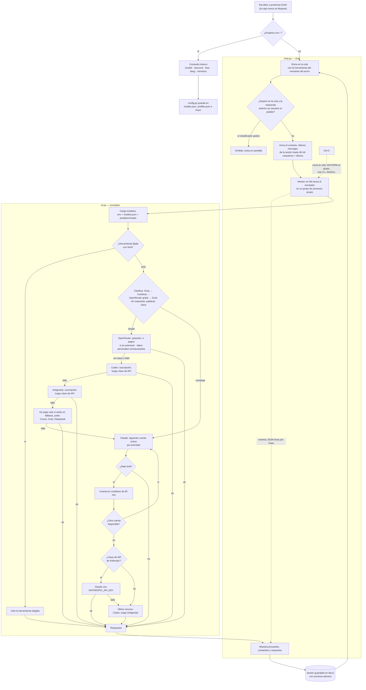
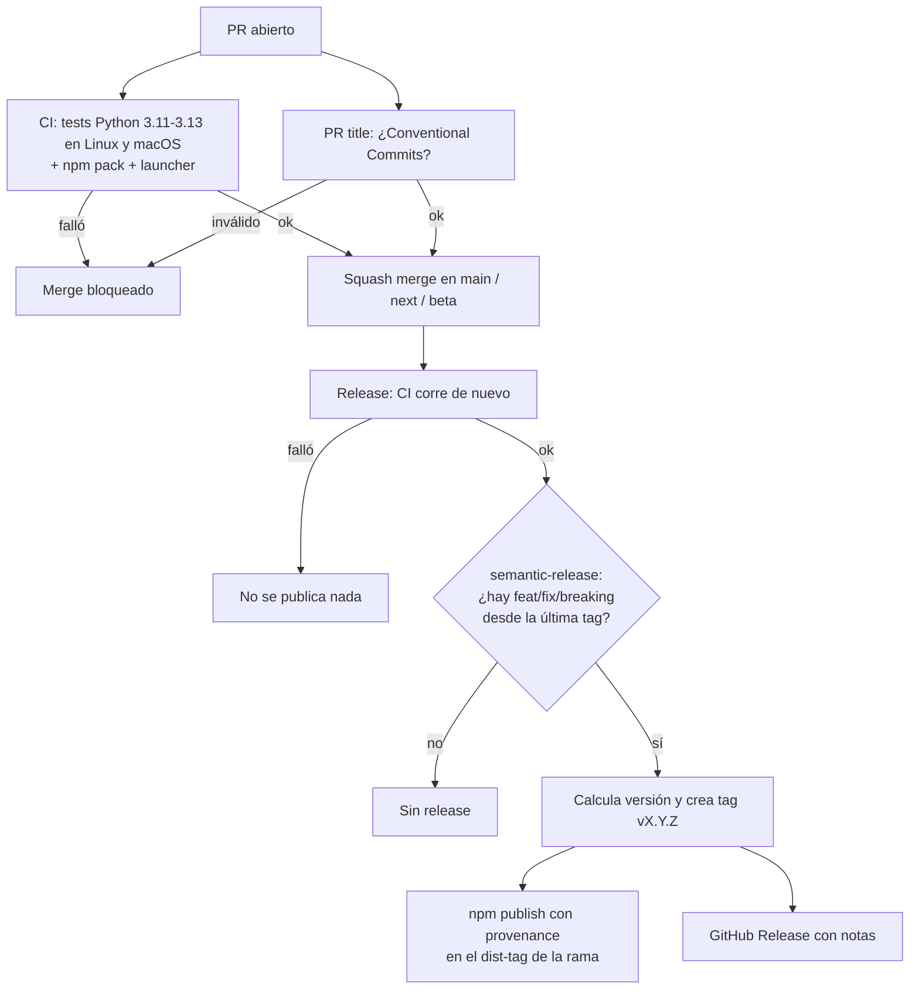

# Omni AI CLI


[](../LICENSE)


> [Português](../README.md) · [English](README.en.md) · [Français](README.fr.md)

Una terminal de chat que reúne **Claude Code, Codex, Cursor, Antigravity, Grok, DeepSeek y
OpenRouter** en un solo lugar. Escribes la pregunta, `ai` decide quién responde y, si la
herramienta falla o agota la cuota, pasa a la siguiente sin que hagas nada.

Mientras se genera una respuesta, la caja de entrada sigue libre: puedes seguir enviando
pedidos, que entran en una cola visible sobre la caja y se ejecutan en orden.

Las preguntas simples van a las herramientas más baratas. Las tareas pesadas van a
Claude, con cambio automático entre varias cuentas cuando una llega al límite. El historial
queda guardado, la interfaz habla portugués, inglés, español y francés, y los modelos y
las cuentas se configuran desde el propio chat.

---

## Índice

- [Cómo funciona](#cómo-funciona)
- [Instalación](#instalación)
- [Cómo usar](#cómo-usar)
- [Comandos del chat](#comandos-del-chat)
- [Modelos](#modelos)
- [Cuentas de Claude](#cuentas-de-claude)
- [Claves de API](#claves-de-api)
- [Modos](#modos)
- [Skills y MCP](#skills-y-mcp)
- [Uso directo, sin chat](#uso-directo-sin-chat)
- [Dónde están los archivos](#dónde-están-los-archivos)
- [Estructura del proyecto](#estructura-del-proyecto)
- [Pruebas](#pruebas)
- [Troubleshooting](#troubleshooting)
- [Limitaciones conocidas](#limitaciones-conocidas)
- [Privacidad](#privacidad)
- [Licencia](#licencia)

---

## Cómo funciona

Desde la línea escrita hasta la respuesta guardada. El chat (`chat.py`) no llama a
ninguna IA directamente: lanza el enrutador (`cli.py`) como subproceso y lee los
eventos que este emite, línea por línea, para mostrar quién está atendiendo y qué está
haciendo.



Tres detalles que el diagrama deja explícitos:

- **Cada cuenta de Claude tiene su propia carpeta de login.** Las cuentas adicionales
  corren con `CLAUDE_CONFIG_DIR` apuntando a `~/.claude-accounts/<nombre>`. La cuenta
  principal nunca se desloguea, y ninguna credencial se copia de un lugar a otro. Copiar
  el `.credentials.json` no funciona de forma confiable en macOS, donde el login queda
  en el Keychain.
- **Ctrl-C mata todo el árbol de procesos.** El enrutador corre en un grupo de procesos
  propio, así que cancelar también termina el `claude`, el `codex` o el `agy` que esté
  corriendo debajo, en lugar de dejar procesos huérfanos gastando cuota.
- **La cola no bloquea nada.** Sobre la caja aparecen el pedido en ejecución, el tiempo y
  los siguientes de la cola. Un pedido que esperó pasa por un clasificador gratis antes de
  ejecutarse: si la respuesta anterior ya lo resuelve, se omite. Los comandos y skills
  siempre se ejecutan. Ctrl-C con la cola activa cancela todo sin salir del chat.
- **Solo la respuesta entra al historial.** Las líneas de estado y diagnóstico aparecen
  en pantalla, pero no se envían como contexto en la siguiente pregunta. El razonamiento
  interno de los modelos también se descarta.

---

## Instalación

Un comando instala todo y, ejecutado de nuevo, actualiza. Tus cuentas, claves y modelos quedan en `~/.config/smart-ai` y no se tocan.

**macOS y Linux**:

```bash
curl -fsSL https://raw.githubusercontent.com/samuelrms/omni-ai-cli/main/get.sh | bash
```

**Windows** (PowerShell):

```powershell
irm https://raw.githubusercontent.com/samuelrms/omni-ai-cli/main/get.ps1 | iex
```

**Pronto en npm, yarn, pnpm y bun.** El paquete `omni-ai-cli` está listo y sale en cuanto se libere la publicación:

```bash
npm install -g omni-ai-cli
yarn global add omni-ai-cli
pnpm add -g omni-ai-cli
bun add -g omni-ai-cli
```

Por ahora, usa el comando de macOS/Linux o Windows de arriba.

Para actualizar después: `ai --update` (o `/update` en el chat).

Desde el código fuente, para desarrollar:

```bash
git clone https://github.com/samuelrms/omni-ai-cli ~/dev/omni-ai-cli
cd ~/dev/omni-ai-cli && ./scripts/install.sh        # Windows: powershell -File scripts\install.ps1
```

El instalador:

1. instala **Claude Code** con el instalador oficial si todavía no está en la máquina;
2. abre el login de la cuenta principal si aún no hay uno;
3. crea el comando `ai` en `~/.local/bin`;
4. muestra las cuentas de Claude configuradas.

Requisitos: nada más que `curl` (macOS/Linux) o PowerShell (Windows). Si falta Python 3.11+, el instalador descarga un Python 3.12 solo para Omni AI, sin sudo y sin tocar el Python del sistema.
Codex (`codex`) y Antigravity (`agy`) son opcionales y entran en la cola de alternativas cuando están instalados.

Si `~/.local/bin` no está en el `PATH`, agrégalo al `~/.zshrc`:

```bash
export PATH="$HOME/.local/bin:$PATH"
```

En Windows, el instalador crea `ai.cmd` en `%USERPROFILE%\.local\bin` y agrega esa carpeta al `PATH`; abre una terminal nueva después.

---

## Cómo usar

```bash
ai
```

La primera vez pregunta el idioma. Después solo escribe y presiona Enter.

| Tecla | Acción |
| --- | --- |
| Enter | Envía |
| ↑ / ↓ | Líneas anteriores |
| Ctrl-C | Durante la respuesta: cancela. En el prompt: guarda y sale |
| Ctrl-D | Guarda y sale |
| `\` + Enter · Shift+Enter · Option+Enter | Nueva línea sin enviar (Shift+Enter en iTerm2, Ghostty, Kitty, WezTerm y VS Code; en Terminal de macOS usa `\` + Enter) |
| Tab | Completa comandos y skills |

En el menú de Tab cada elemento termina diciendo de quién es: `omni`, `claude`, `codex` o `agy`. Al elegir
una skill con argumentos (como `/pr-review [pr-number | --branch]`), el chat los pregunta: Tab muestra
las opciones, puedes escribir tu propio texto, y Enter vacío la ejecuta sin argumentos.

La pantalla sigue el estilo de Claude Code y Codex: caja de entrada abajo con barra de estado
(herramienta, modelo, modo y carpeta), Tab para completar comandos y skills, cada acción de la IA
en una línea (`● Ran …`, `● Edited …`, `● Called …`) con la salida recogida, respuestas en markdown
y un indicador "Trabajando…" con el tiempo. Al abrir, una splash de 1,5 s a pantalla completa (Ctrl-C la
salta; `SMART_AI_NO_SPLASH=1` la desactiva).

Al salir, muestra el comando para volver a la misma conversación:

```text
Sessão salva. Retome com: ai --resume 1f3a9c2b7d40
```

---

## Comandos del chat

| Comando | Qué hace |
| --- | --- |
| `/tool auto\|claude\|codex\|cursor\|agy\|openrouter\|grok\|deepseek` | Fija una herramienta (`auto` decide solo) |
| `/model` | Lista los modelos de cada herramienta |
| `/model codex gpt-6-astra` | Cambia un modelo |
| `/model codex default` | Vuelve al predeterminado |
| `/account` | Lista las cuentas de Claude y si tienen sesión iniciada |
| `/account add pessoal` | Crea una cuenta y abre ahí mismo el login de Claude |
| `/account login NOME` | Rehace el login de una cuenta |
| `/account sync NOMBRE` | Vuelve a compartir skills, plugins y MCPs de la cuenta principal |
| `/account disable\|enable\|remove NOME` | Desactiva, reactiva o elimina |
| `/key` | Lista las claves de API configuradas (enmascaradas) |
| `/key claude\|codex\|cursor\|agy\|openrouter\|grok\|deepseek\|groq\|cerebras` | Agrega una clave, sin mostrar lo que escribes |
| `/key add HERRAMIENTA [NOMBRE]` | Una clave más para la misma herramienta (todas, incluido Claude); se prueban en orden cuando una falla o llega al límite |
| `/key remove HERRAMIENTA [NOMBRE]` | Elimina la clave (sin nombre, la principal) |
| `/status` · `/reset` | Estado de las cuentas · reinicia los cooldowns |
| `/lang pt\|en\|es\|fr` | Cambia el idioma |
| `/mode default\|plan\|edits\|auto\|yolo` | Modo de permisos, igual en las tres herramientas |
| `/sync` | Comparte MCPs y skills entre Claude, Codex y Antigravity |
| `/usage [watch]` · `/limits` | Uso real de cada cuenta en barras (e-mail, plan, % de la ventana de 5 h y semanal, hora de reinicio) para Claude y Codex; gasto de la clave en OpenRouter; en las demás, el aviso de límite que dio la herramienta. `watch` actualiza cada 30 s |
| `/versions [N]` | Qué cambió en cada versión, la más reciente primero; `N` abre la nota técnica. Antes de la primera release, muestra los `feat`/`fix` de `main` |
| `/clear` · `/compact` | Limpiar la conversación · resumirla en un bloque para ahorrar contexto |
| `/claude:usage` · `/codex:status` · `/agy:usage` … | Comandos nativos de cada herramienta: abre su pantalla y vuelve a Omni al salir |
| `/terminal-setup` | Muestra cómo tener Shift+Enter (u Option+Enter) para nueva línea en tu terminal |
| `/skills` | Lista skills y comandos del proyecto y del usuario, de Claude, Codex y Antigravity |
| `/nombre args` | Ejecuta la skill o comando (ej.: `/pr-review 237`). Tab completa |
| `/history` · `/sent` · `/trace` | Conversación · lo que se envió · eventos de la ejecución |
| `/sessions` · `/resume ID` · `/new` | Sesiones guardadas |
| `/parallel codex: tarefa \| deepseek: tarefa` | De 2 a 4 análisis en paralelo, solo lectura (codex, openrouter, grok, deepseek) |
| `/help` · `/exit` | Ayuda · salir |

Mientras la cola corre, `/clear`, `/new`, `/resume`, `/key`, `/usage` y los comandos nativos
esperan: toman la terminal o cambian la sesión. El resto funciona al instante.

Los comandos de configuración también funcionan fuera del chat: `ai --model`,
`ai --account add pessoal`, `ai --key claude`, `ai --status`, `ai --reset`.

---

## Modelos

| Clave | Predeterminado | Valores aceptados |
| --- | --- | --- |
| `claude` | `opus` (el más capaz) | `opus`, `sonnet`, `haiku` o ID completo |
| `codex` | `gpt-6-astra` | ID de modelo de Codex |
| `codex_effort` | `high` | `minimal`, `low`, `medium`, `high`, `xhigh` |
| `agy` | predeterminado de Antigravity | ID de modelo de Antigravity |
| `openrouter` | automático (gratuito) | ID del modelo; de pago solo con `openrouter_paid on` |
| `openrouter_paid` | `off` | `on` autoriza modelos de pago de OpenRouter |
| `grok` | predeterminado de Grok | ID de modelo de xAI |
| `deepseek` | `deepseek-chat` | `deepseek-chat`, `deepseek-reasoner` |
| `cursor` | predeterminado de la cuenta Cursor | ID de modelo de Cursor CLI |

El orden de prioridad es: variable de entorno, luego lo guardado con `/model` (en
`~/.config/smart-ai/models.json`), luego el predeterminado. Las variables son
`SMART_AI_CLAUDE_MODEL`, `SMART_AI_CODEX_MODEL`, `SMART_AI_CODEX_EFFORT`,
`SMART_AI_AGY_MODEL`, `SMART_AI_OPENROUTER_MODEL`, `SMART_AI_GROK_MODEL`,
`SMART_AI_DEEPSEEK_MODEL` y `SMART_AI_CURSOR_MODEL`. Cuando una de ellas está definida,
`/model` avisa que tiene precedencia.

---

## Cuentas de Claude

```text
ai [auto] › /account add trabalho
Abrindo login do Claude para a conta "trabalho" (pasta isolada ~/.claude-accounts/trabalho).
Sua conta principal não é afetada.
✓ Conta "trabalho" adicionada com prioridade 3.
```

Las cuentas se prueban por orden de prioridad. La que llega al límite entra en cooldown
(60 minutos por defecto, ajustable en `profiles.json`) y la siguiente toma su lugar. La
cuenta `primary` usa el login normal de Claude (`claude auth login`).

Skills, plugins, agentes, `CLAUDE.md`, `settings.json` y los servidores MCP de la cuenta
principal se comparten con cada cuenta extra al iniciar sesión. Solo el login queda
separado. Si instalas una skill o un MCP nuevo después, ejecuta `/account sync NOMBRE`.


---

## Claves de API

Además de las suscripciones, cada herramienta acepta una clave de API. **La suscripción
va primero**; la clave solo entra cuando la suscripción falla o llega al límite, porque
la clave se cobra por uso. OpenRouter funciona solo con clave.

| Herramienta | Comando | Variable que recibe el CLI | Dónde crearla |
| --- | --- | --- | --- |
| Claude | `/key claude` | `ANTHROPIC_API_KEY` | console.anthropic.com/settings/keys |
| Codex | `/key codex` | `CODEX_API_KEY` | platform.openai.com/api-keys |
| Antigravity | `/key agy` | `GEMINI_API_KEY` | aistudio.google.com/apikey |
| OpenRouter | `/key openrouter` | `OPENROUTER_API_KEY` | openrouter.ai/keys |
| Cursor | `/key cursor` | `CURSOR_API_KEY` | cursor.com/dashboard → Integrations |
| Grok | `/key grok` | `XAI_API_KEY` | console.x.ai |
| DeepSeek | `/key deepseek` | `DEEPSEEK_API_KEY` | platform.deepseek.com/api_keys |
| Groq (clasificador) | `/key groq` | `GROQ_API_KEY` | console.groq.com/keys |
| Cerebras (clasificador) | `/key cerebras` | `CEREBRAS_API_KEY` | cloud.cerebras.ai |

Cursor usa primero el login de la cuenta (`cursor-agent login`) y solo después las claves.
DeepSeek, como OpenRouter, funciona solo con clave y enmascara los datos personales antes
del envío. Groq y Cerebras no responden preguntas: solo clasifican cada pedido (gratis) y
verifican si un pedido de la cola ya fue resuelto.

```text
ai [auto] › /key claude
Chave de claude (console.anthropic.com/settings/keys). Cole e tecle Enter; ela não aparece na tela.
>
✓ Chave de claude salva em ~/.config/smart-ai/keys/claude (permissão 600).
```

Las claves quedan en `~/.config/smart-ai/keys/`, una por archivo, con permiso 600, y
se pasan solo al proceso de la herramienta, nunca al historial ni al log. Si la variable
ya está definida en el entorno, tiene precedencia. `/key` lista lo que está configurado,
mostrando solo el inicio y el final de cada clave.

En Claude, la clave funciona como una cuenta adicional después de todas las
suscripciones: si también llega al límite, entra en cooldown como las demás.

> **Nunca pegues una clave como comando en el shell.** Queda grabada en el historial de
> zsh. Si eso pasa, revoca la clave en el sitio de la herramienta y borra la línea de
> `~/.zsh_history`.

En OpenRouter, por defecto solo se usan modelos gratuitos: el cliente elige hasta tres
variantes `:free` del catálogo y usa `openrouter/free` como última alternativa. Los
modelos de pago quedan bloqueados hasta que los autorices:

```text
/model openrouter_paid on            # autoriza; avisa que se cobrará en tu cuenta
/model openrouter anthropic/claude-opus-5.5
/model openrouter_paid off           # bloquea de nuevo y vuelve a lo gratuito
```

Con la autorización activa, el modelo elegido va primero y los gratuitos quedan de
respaldo. Desactivada, se envía un límite de precio cero en cada llamada, así que ningún
modelo de pago responde.

---

## Modos

El modo vale para Claude, Codex y Antigravity a la vez y aparece en el prompt
(`ai [auto · plan] ›`). Cada sesión guarda el suyo.

| Modo | Qué hace | Claude | Codex | Antigravity |
| --- | --- | --- | --- | --- |
| `default` | Predeterminado de cada herramienta | — | — | — |
| `plan` | Solo lee y planifica, no cambia nada | `plan` | `--sandbox read-only` | `--mode plan` |
| `edits` | Acepta ediciones de archivos | `acceptEdits` | `--sandbox workspace-write` | `--mode accept-edits` |
| `auto` | Actúa solo, con las protecciones de la herramienta | `auto` | `workspace-write`, sin aprobación | `--mode auto` |
| `yolo` | Sin permisos ni sandbox | `bypassPermissions` | `--dangerously-bypass-approvals-and-sandbox` | `--dangerously-skip-permissions` |

`/mode yolo` pide confirmación, porque la IA puede borrar archivos y ejecutar cualquier
comando. Fuera del chat: `ai --mode plan "pregunta"`. `/parallel` siempre corre en `plan`.

---

## Skills y MCP

`ai` llama a los propios CLIs, así que cada uno usa las skills y MCPs que ya tiene.
`/sync` reúne todo e instala en cada herramienta lo que solo existe en las otras:

```text
ai [auto] › /sync
Ferramentas encontradas: claude, codex, agy
  MCP   github                   codex → claude
  MCP   obsidian                 claude → codex
  skill humanizer                claude → codex  (~/.agents/skills/humanizer)
Aplicar? [s/N]
```

- Los MCPs se agregan con el comando `mcp add` de cada CLI, sin editar archivos a mano.
- El mismo servidor con nombres distintos se reconoce por paquete o URL y no se duplica.
- Los MCPs que vienen dentro de una app (como los de Codex.app) se quedan ahí.
- Las skills se comparten por enlace: `~/.claude/skills`, `~/.agents/skills` (Codex) y
  `~/.gemini/antigravity/skills`. Editar una vale para las tres.
- Las cuentas extra de Claude también se actualizan.
- Las variables de entorno de los MCPs, que pueden tener tokens, se copian a la config de
  la otra herramienta. `/sync` avisa antes.
- `/sync --dry-run` solo muestra lo que haría.

**Skills y comandos del proyecto:** el chat lee `.claude/commands`, `.claude/skills`, `.agents/skills` y
`.agent/workflows` del proyecto abierto, además de las carpetas del usuario. `/pr-review 237` va a
Claude tal como se escribió, y Claude ejecuta el comando de forma nativa. Una skill que solo existe
en Codex o Antigravity va a esa herramienta, con las instrucciones del archivo en el pedido.

Como el chat no reenvía las solicitudes de aprobación, una herramienta MCP solo corre si ya
está permitida en el CLI o si el modo es `auto` o `yolo`. OpenRouter no tiene skills ni MCP.

---

## Uso directo, sin chat

```bash
ai "o que é um design pattern?"        # enrutamiento automático
ai --claude "refatorar o módulo X"     # fuerza Claude
ai --codex "explicar REST"             # fuerza Codex
ai --agy "pesquisar React hooks"       # fuerza Antigravity
ai --openrouter "explicar Docker"      # fuerza OpenRouter
ai --cursor "corrigir o teste X"       # fuerza Cursor
ai --deepseek "explicar CAP theorem"   # fuerza DeepSeek
ai --classify "prompt"                 # muestra cómo se clasificaría
ai --log                               # últimas llamadas
```

---

## Dónde están los archivos

| Ruta | Contenido |
| --- | --- |
| `~/.config/smart-ai/profiles.json` | Cuentas de Claude y reglas de enrutamiento |
| `~/.config/smart-ai/models.json` | Modelos elegidos con `/model` |
| `~/.config/smart-ai/lang` | Idioma del chat |
| `~/.config/smart-ai/keys/<ferramenta>` | Claves de API, una por archivo (permiso 600) |
| `~/.claude-accounts/<nome>/` | Login aislado de cada cuenta extra de Claude |
| `~/.local/share/smart-ai/sessions/` | Sesiones del chat |
| `~/.cache/smart-ai/state.json` | Cooldowns activos |
| `~/.cache/smart-ai/usage.log` | Log de uso, solo metadatos |

---

## Estructura del proyecto

```text
omni-ai-cli/
├── omni_ai/                  # el programa (paquete Python)
│   ├── cli.py                # comando ai: clasifica, enruta y ejecuta cada herramienta
│   ├── chat.py               # chat: sesiones, eventos, Ctrl-C, idiomas
│   ├── ui.py                 # aspecto: caja de entrada, barra de estado, acciones y respuestas
│   ├── skills.py             # skills y comandos del proyecto, del usuario y nativos
│   ├── config.py             # modelos, claves y cuentas Claude (/model, /key, /account)
│   ├── sync.py               # /sync: MCPs y skills entre las tres herramientas
│   ├── openrouter.py         # cliente OpenRouter: gratuitos, de pago solo si se autorizan
│   ├── grok.py               # cliente xAI, reutilizado por DeepSeek
│   ├── deepseek.py           # cliente DeepSeek con datos personales enmascarados
│   ├── pii.py                # enmascara y restaura datos personales
│   ├── osutils.py            # diferencias entre macOS, Linux y Windows
│   ├── profiles.json         # plantilla inicial; la tuya queda en ~/.config/smart-ai
│   └── vendor/               # prompt_toolkit y wcwidth incluidos (sin pip)
├── bin/ai.js                 # lanzador npm: encuentra o instala Python y ejecuta el paquete
├── scripts/                  # install.sh, install.ps1 y ai.cmd
├── docs/                     # README en inglés, español y francés
├── tests/                    # ejecutables ficticios, sin consumir cuota
├── postman/                  # simulación HTTP de OpenRouter
├── get.sh / get.ps1          # instalación con un comando
└── package.json · LICENSE
```

El enrutador no sabe nada del chat: solo ejecuta una pregunta y, con
`SMART_AI_EVENTS=1`, emite eventos JSON. El chat no sabe nada de credenciales: las
cuentas y los modelos pasan por `config.py`.

---

## Pruebas

```bash
python3 -m unittest discover -s tests -v
bash -n scripts/install.sh
```

**38 pruebas**: persistencia y reanudación de sesión, límite de contexto, permisos de
los archivos, sesión abierta en dos terminales, lectura de eventos, cancelación del árbol
de procesos, paralelismo real, sandbox de solo lectura, enmascaramiento de datos
personales, fallback OpenRouter → Codex, validación de modelos, almacenamiento de las
claves y el ciclo de vida de las cuentas. Todos los ejecutables son ficticios: **ninguna
prueba autentica ni consume suscripción.**

Para probar el HTTP de OpenRouter contra la simulación de Postman:

```bash
postman simulation run postman/simulations/openrouter.sim.yaml --port 4901 --no-history --output ndjson
SMART_AI_SIM_URL=http://127.0.0.1:4901/openrouter python3 -m unittest discover -s tests -v
```

---

## Releases y ramas

La publicación en npm es automática, hecha por GitHub Actions con semantic-release. La
versión sale de los mensajes de commit (Conventional Commits) — nadie edita `version` en
`package.json` a mano.

| Rama | Publica como | Ejemplo |
|---|---|---|
| `main` | `latest` | `1.4.0` |
| `next` | `next` (release candidate) | `1.5.0-rc.1` |
| `beta` | `beta` | `2.0.0-beta.1` |
| otras / PR | nada, solo CI | — |

| Commit | Efecto en la versión |
|---|---|
| `fix: ...` | patch (`1.4.0` → `1.4.1`) |
| `feat: ...` | minor (`1.4.0` → `1.5.0`) |
| `feat!: ...` o `BREAKING CHANGE:` en el cuerpo | major (`1.4.0` → `2.0.0`) |
| `docs:`, `ci:`, `chore:`, `test:`, `refactor:` | sin release |

Usa squash merge: el título del PR se vuelve el commit, y el workflow `PR title` bloquea
títulos fuera del estándar.

### Mensajes de commit

`/versions` muestra el título de cada `feat`/`fix` como la "vista simple" y el cuerpo como
"nota técnica". Por eso:

- **Título:** qué cambia para quien lo usa, en inglés, en presente, sin nombres de archivo
  ni de función. `feat: keep the input free and queue new requests while one runs`, no
  `feat: add Queue class to chat.py`.
- **Cuerpo:** el porqué y el comportamiento nuevo en frases cortas; detalles técnicos solo
  al final, si ayudan.
- Un commit por cambio perceptible. Refactorizaciones y tests van en `refactor:`/`test:`,
  que no aparecen en `/versions`.



Configuración única en GitHub:

1. **Settings → Secrets and variables → Actions**: crear `NPM_TOKEN` (token *Automation*
   o *Granular* de npmjs.com con permiso de publish).
2. **Settings → Branches**: proteger `main` (y `next`/`beta` si se usan) exigiendo PR y
   los checks `Tests (...)`, `npm package` y `conventional`.
3. **Settings → General → Pull Requests**: permitir solo *squash merging* y marcar
   *Default to pull request title*.

---

## Troubleshooting

| Problema | Solución |
| --- | --- |
| `OPENROUTER_API_KEY não configurada` | `/key openrouter` en el chat o `ai --key openrouter`. |
| `Arquivo de credenciais não encontrado` o `Conta 'X' sem login` | `/account login X`. |
| `You've hit your session limit` | Cuota de la cuenta. `ai` pasa a la siguiente; agrega otra con `/account add` o una clave con `/key claude`. |
| `Individual quota reached` (Antigravity) | Cuota de Antigravity; se omite hasta la renovación. |
| `Not inside a trusted directory` (Codex) | Instalación antigua. Ejecuta el instalador de nuevo. |
| `Claude Code não instalado` | `./scripts/install.sh` (o `scripts\install.ps1` en Windows) lo instala con el instalador oficial. |
| Windows: fallan los enlaces de skills | Activa el Modo de desarrollador o ejecuta como administrador; si no, `ai` usa uniones de carpeta. |
| `/model` no cambia nada | Hay una variable `SMART_AI_*_MODEL` definida y tiene precedencia. |
| `/key` no cambia nada | La variable de la herramienta (`ANTHROPIC_API_KEY`, etc.) está definida y tiene precedencia. |
| `Sessão já aberta em outro terminal` | Cierra la otra terminal o usa `/new`. |
| `ai: command not found` | Agrega `~/.local/bin` al `PATH`. |

---

## Limitaciones conocidas

- El chat usa los modos no interactivos de los CLI. Las solicitudes de aprobación
  nativas (por ejemplo, "¿puedo editar este archivo?") no aparecen; en esos casos, usa
  el CLI nativo.
- `/parallel` solo analiza: Codex con `--sandbox read-only` u OpenRouter, que no accede
  a los archivos. Los agentes no editan el proyecto al mismo tiempo.
- La clasificación simple/compleja se hace por palabras clave y tamaño, no con un modelo.
- Cambiar de modelo no renueva la cuota de la cuenta.
- OpenRouter no tiene streaming en esta versión: la respuesta aparece completa al final.
- En Windows el código usa los equivalentes nativos (grupos de procesos y `taskkill`, `msvcrt`, uniones de carpeta), pero solo se probó de verdad en macOS.

---

## Privacidad

- Las sesiones, las claves de API y los logs quedan solo en tu máquina, con permiso restringido a tu usuario.
- El log de uso registra herramienta, cuenta y estado, **nunca el texto de la pregunta**.
- Antes de ir a OpenRouter, los correos, teléfonos, documentos y otros datos personales
  se cambian por marcadores y se restauran en la respuesta. El enmascaramiento es por
  patrones y no garantiza un anonimato total.
- Claude, Codex y Antigravity reciben el texto original, bajo los términos de cada servicio.

---

## Licencia

[MIT](../LICENSE). Incluidas en `vendor/`: prompt_toolkit (BSD-3-Clause) y wcwidth (MIT), cada una con su licencia.
