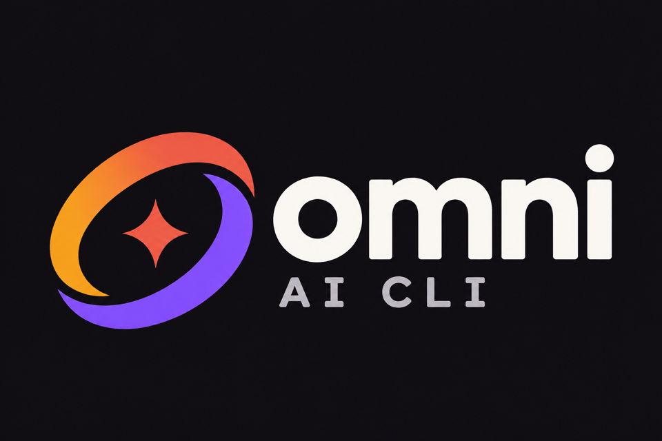
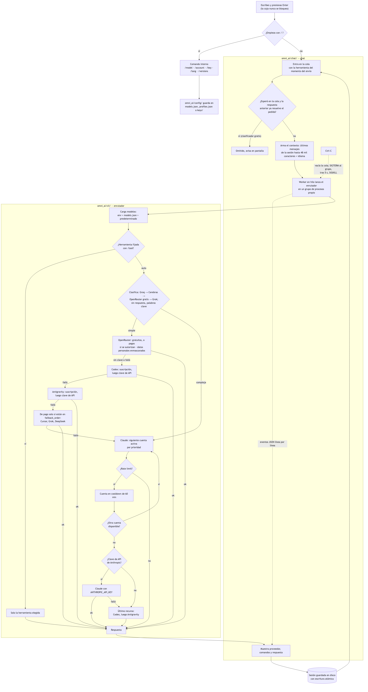
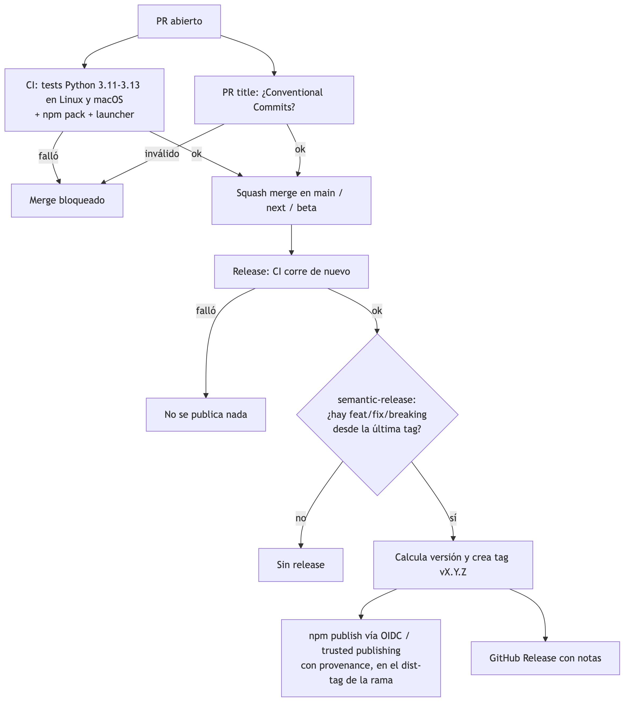

<p align="center">
  
</p>

# Omni AI CLI

[](https://www.npmjs.com/package/omni-ai-cli)
[](https://www.npmjs.com/package/omni-ai-cli)
[](https://marketplace.visualstudio.com/items?itemName=samuelrms.omni-ai-cli)
[](https://open-vsx.org/extension/samuelrms/omni-ai-cli)
[](https://docs.npmjs.com/trusted-publishers)
[](https://github.com/samuelrms/omni-ai-cli/actions/workflows/coverage.yml)
[](../LICENSE)


> [Português](../README.md) · [English](README.en.md) · [Français](README.fr.md)

Una terminal de chat que reúne **Claude Code, Codex, Cursor, Antigravity, Grok, DeepSeek y
OpenRouter** en un solo lugar. Escribes la pregunta, `ai` decide quién responde y, si la
herramienta falla o agota la cuota, pasa a la siguiente sin que hagas nada.

Mientras se genera una respuesta, la caja de entrada sigue libre: puedes seguir enviando
pedidos, que entran en una cola visible sobre la caja y se ejecutan en orden.

Con `ai serve`, todo esto también está disponible como una [API compatible con OpenAI](#modo-servidor), directamente o [en Docker](#docker).

Las preguntas simples van a las herramientas más baratas. Las tareas pesadas van a
Claude, con cambio automático entre varias cuentas cuando una llega al límite. El historial
queda guardado, la interfaz habla portugués, inglés, español y francés, y los modelos y
las cuentas se configuran desde el propio chat.

---

## Índice

- [Cómo funciona](#cómo-funciona)
- [Instalación](#instalación)
- [Cómo usar](#cómo-usar)
- [Extensión del editor](#extensión-del-editor)
- [Comandos del chat](#comandos-del-chat)
- [Modelos](#modelos)
- [Cuentas de Claude](#cuentas-de-claude)
- [Inicio de sesión sin navegador](#inicio-de-sesión-sin-navegador)
- [Claves de API](#claves-de-api)
- [Modos](#modos)
- [Skills y MCP](#skills-y-mcp)
- [Uso directo, sin chat](#uso-directo-sin-chat)
- [Modo servidor](#modo-servidor)
- [Docker](#docker)
- [Dónde están los archivos](#dónde-están-los-archivos)
- [Estructura del proyecto](#estructura-del-proyecto)
- [Pruebas](#pruebas)
- [Releases y ramas](#releases-y-ramas)
- [Troubleshooting](#troubleshooting)
- [Limitaciones conocidas](#limitaciones-conocidas)
- [Privacidad](#privacidad)
- [Licencia](#licencia)

---

## Cómo funciona

Desde la línea escrita hasta la respuesta guardada. El chat (`omni_ai/chat/`) no llama a
ninguna IA directamente: lanza el enrutador (`omni_ai/cli/`) como subproceso y lee los
eventos que este emite, línea por línea, para mostrar quién está atendiendo y qué está
haciendo.



Tres detalles que el diagrama deja explícitos:

- **Cada cuenta de Claude tiene su propia carpeta de login.** Las cuentas adicionales
  corren con `CLAUDE_CONFIG_DIR` apuntando a `~/.claude-accounts/<nombre>`. La cuenta
  principal nunca se desloguea, y ninguna credencial se copia de un lugar a otro. Copiar
  el `.credentials.json` no funciona de forma confiable en macOS, donde el login queda
  en el Keychain.
- **Ctrl-C mata todo el árbol de procesos.** El enrutador corre en un grupo de procesos
  propio, así que cancelar también termina el `claude`, el `codex` o el `agy` que esté
  corriendo debajo, en lugar de dejar procesos huérfanos gastando cuota.
- **La cola no bloquea nada.** Sobre la caja aparecen el pedido en ejecución, el tiempo y
  los siguientes de la cola. Un pedido que esperó pasa por un clasificador gratis antes de
  ejecutarse: si la respuesta anterior ya lo resuelve, se omite. Los comandos y skills
  siempre se ejecutan. Ctrl-C con la cola activa cancela todo sin salir del chat. Si cierras el chat
  con pedidos en la cola, quedan guardados en la sesión y `ai --resume ID` pregunta si quieres continuar.
- **Cada respuesta muestra cuánto costó.** Al final de cada pedido aparecen los tokens y,
  cuando la herramienta lo informa (OpenRouter, Grok, Claude con clave de API), el costo en
  dólares. `/usage` suma el gasto del día por herramienta.
- **Ves por qué se eligió la herramienta.** En modo `auto`, una línea corta dice si el pedido
  se trató como tarea de código o pregunta simple y quién lo clasificó (Groq, Cerebras,
  OpenRouter, Grok o las palabras clave).
- **Solo la respuesta entra al historial.** Las líneas de estado y diagnóstico aparecen
  en pantalla, pero no se envían como contexto en la siguiente pregunta. El razonamiento
  interno de los modelos también se descarta.

---

## Instalación

Un comando instala todo y, ejecutado de nuevo, actualiza. Tus cuentas, claves y modelos quedan en `~/.config/smart-ai` y no se tocan.

**macOS y Linux**:

```bash
curl -fsSL https://raw.githubusercontent.com/samuelrms/omni-ai-cli/main/get.sh | bash
```

**Windows** (PowerShell):

```powershell
irm https://raw.githubusercontent.com/samuelrms/omni-ai-cli/main/get.ps1 | iex
```

**En npm, yarn, pnpm o bun:**

```bash
npm install -g omni-ai-cli
yarn global add omni-ai-cli
pnpm add -g omni-ai-cli
bun add -g omni-ai-cli
```

Cualquiera de los comandos de arriba (script o gestor de paquetes) instala el mismo `ai`.

**Homebrew** (macOS/Linux):

```bash
brew install samuelrms/tap/omni-ai-cli
```

> En Homebrew reciente, si rechaza el tap como "untrusted", ejecuta una vez: `brew trust samuelrms/tap`.

Para actualizar después: `ai --update` (o `/update` en el chat). Al terminar, muestra las novedades de las versiones instaladas.

Desde el código fuente, para desarrollar:

```bash
git clone https://github.com/samuelrms/omni-ai-cli ~/dev/omni-ai-cli
cd ~/dev/omni-ai-cli && ./scripts/install.sh        # Windows: powershell -File scripts\install.ps1
```

El instalador:

1. instala **Claude Code** con el instalador oficial si todavía no está en la máquina;
2. abre el login de la cuenta principal si aún no hay uno;
3. crea el comando `ai` en `~/.local/bin`;
4. muestra las cuentas de Claude configuradas.

Requisitos: nada más que `curl` (macOS/Linux) o PowerShell (Windows). Si falta Python 3.11+, el instalador descarga un Python 3.12 solo para Omni AI, sin sudo y sin tocar el Python del sistema.
Codex (`codex`) y Antigravity (`agy`) son opcionales y entran en la cola de alternativas cuando están instalados.

Si `~/.local/bin` no está en el `PATH`, agrégalo al `~/.zshrc`:

```bash
export PATH="$HOME/.local/bin:$PATH"
```

En Windows, el instalador crea `ai.cmd` en `%USERPROFILE%\.local\bin` y agrega esa carpeta al `PATH`; abre una terminal nueva después.

---

## Cómo usar

```bash
ai
```

La primera vez pregunta el idioma y ofrece instalar las herramientas que faltan
(Claude Code, Codex, Cursor, Grok Build) con los instaladores oficiales. Antigravity se
instala desde su página. Después solo escribe y presiona Enter.

| Tecla | Acción |
| --- | --- |
| Enter | Envía |
| ↑ / ↓ | Líneas anteriores |
| Ctrl-C | Durante la respuesta: cancela. En el prompt: guarda y sale |
| Ctrl-D | Guarda y sale |
| `\` + Enter · Shift+Enter · Option+Enter | Nueva línea sin enviar (Shift+Enter en iTerm2, Ghostty, Kitty, WezTerm y VS Code; en Terminal de macOS usa `\` + Enter) |
| Tab | Completa comandos y skills |

En el menú de Tab cada elemento termina diciendo de quién es: `omni`, `claude`, `codex` o `agy`. Al elegir
una skill con argumentos (como `/pr-review [pr-number | --branch]`), el chat los pregunta: Tab muestra
las opciones, puedes escribir tu propio texto, y Enter vacío la ejecuta sin argumentos.

La pantalla sigue el estilo de Claude Code y Codex: caja de entrada abajo con barra de estado
(herramienta, modelo, modo y carpeta), Tab para completar comandos y skills, cada acción de la IA
en una línea (`● Ran …`, `● Edited …`, `● Called …`) con la salida recogida, respuestas en markdown
y un indicador "Trabajando…" con el tiempo. Al abrir, una splash de 1,5 s a pantalla completa (Ctrl-C la
salta; `SMART_AI_NO_SPLASH=1` la desactiva).

Al salir, muestra el comando para volver a la misma conversación:

```text
Sessão salva. Retome com: ai --resume 1f3a9c2b7d40
```

---

## Extensión del editor

**Omni AI CLI** — la misma experiencia de chat dentro de VS Code y Cursor (barra lateral y pestaña del editor), funcionando sobre `ai`.

Instalar desde la CLI:

```bash
# Cursor
cursor --install-extension samuelrms.omni-ai-cli

# VS Code
code --install-extension samuelrms.omni-ai-cli
```

Instalar desde el navegador: [Open VSX](https://open-vsx.org/extension/samuelrms/omni-ai-cli) · [VS Code Marketplace](https://marketplace.visualstudio.com/items?itemName=samuelrms.omni-ai-cli)

En la primera ejecución la extensión instala el CLI `ai` por debajo si no existe y abre un tutorial de configuración.

---

## Comandos del chat

| Comando | Qué hace |
| --- | --- |
| `/tool auto\|claude\|codex\|cursor\|agy\|openrouter\|grok\|deepseek` | Fija una herramienta (`auto` decide solo) |
| `/model` | Lista los modelos de cada herramienta |
| `/model codex gpt-6-astra` | Cambia un modelo |
| `/model codex default` | Vuelve al predeterminado |
| `/account` | Lista las cuentas de Claude y si tienen sesión iniciada |
| `/account add pessoal` | Crea una cuenta y abre ahí mismo el login de Claude |
| `/account login NOME` | Rehace el login de una cuenta |
| `/account sync NOMBRE` | Vuelve a compartir skills, plugins y MCPs de la cuenta principal |
| `/account disable\|enable\|remove NOME` | Desactiva, reactiva o elimina |
| `/key` | Lista las claves de API configuradas (enmascaradas) |
| `/key claude\|codex\|cursor\|agy\|openrouter\|grok\|deepseek\|groq\|cerebras` | Agrega una clave, sin mostrar lo que escribes |
| `/key add HERRAMIENTA [NOMBRE]` | Una clave más para la misma herramienta (todas, incluido Claude); se prueban en orden cuando una falla o llega al límite |
| `/key remove HERRAMIENTA [NOMBRE]` | Elimina la clave (sin nombre, la principal) |
| `/status` · `/reset` | Estado de las cuentas · reinicia los cooldowns |
| `/lang pt\|en\|es\|fr` | Cambia el idioma |
| `/mode default\|plan\|edits\|auto\|yolo` | Modo de permisos, igual en las tres herramientas |
| `/sync` | Comparte MCPs y skills entre Claude, Codex y Antigravity |
| `/usage [watch]` · `/limits` | Uso real de cada cuenta en barras (e-mail, plan, % de la ventana de 5 h y semanal, hora de reinicio) para Claude y Codex; gasto de la clave en OpenRouter; en las demás, el aviso de límite que dio la herramienta. `watch` actualiza cada 30 s |
| `/queue [rm\|up\|down N\|clear]` | Muestra la cola; quita (`rm`), sube (`up`), baja (`down`) un pedido o vacía (`clear`) lo que espera |
| `/versions [N]` | Qué cambió en cada versión, la más reciente primero; `N` abre la nota técnica. Antes de la primera release, muestra los `feat`/`fix` de `main`. Los títulos salen en el idioma del chat (traducidos por los clasificadores gratis y guardados). Al abrir el chat, una línea avisa si hay versión nueva. |
| `/clear` · `/compact` | Limpiar la conversación · resumirla en un bloque para ahorrar contexto |
| `/claude:usage` · `/codex:status` · `/agy:usage` … | Comandos nativos de cada herramienta: abre su pantalla y vuelve a Omni al salir |
| `/setup [install]` | Guía de primer acceso: lo que falta instalar, iniciar sesión y configurar; `install` instala las herramientas que faltan |
| `/terminal-setup` | Muestra cómo tener Shift+Enter (u Option+Enter) para nueva línea en tu terminal |
| `/skills` | Lista skills y comandos del proyecto y del usuario, de Claude, Codex y Antigravity |
| `/nombre args` | Ejecuta la skill o comando (ej.: `/pr-review 237`). Tab completa |
| `/history` · `/sent` · `/trace` | Conversación · lo que se envió · eventos de la ejecución |
| `/sessions` · `/resume ID` · `/new` | Sesiones guardadas |
| `/parallel codex: tarefa \| deepseek: tarefa` | De 2 a 4 análisis en paralelo, solo lectura (codex, openrouter, grok, deepseek) |
| `/help` · `/exit` | Ayuda · salir |

Mientras la cola corre, `/clear`, `/new`, `/resume`, `/key`, `/usage` y los comandos nativos
esperan: toman la terminal o cambian la sesión. El resto funciona al instante.

Los comandos de configuración también funcionan fuera del chat: `ai --model`,
`ai --account add pessoal`, `ai --key claude`, `ai --status`, `ai --reset`.

---

## Modelos

| Clave | Predeterminado | Valores aceptados |
| --- | --- | --- |
| `claude` | `opus` (el más capaz) | `opus`, `sonnet`, `haiku` o ID completo |
| `codex` | `gpt-6-astra` | ID de modelo de Codex |
| `codex_effort` | `high` | `minimal`, `low`, `medium`, `high`, `xhigh` |
| `agy` | predeterminado de Antigravity | ID de modelo de Antigravity |
| `openrouter` | automático (gratuito) | ID del modelo; de pago solo con `openrouter_paid on` |
| `openrouter_paid` | `off` | `on` autoriza modelos de pago de OpenRouter |
| `grok` | predeterminado de Grok | ID de modelo de xAI |
| `deepseek` | `deepseek-chat` | `deepseek-chat`, `deepseek-reasoner` |
| `cursor` | predeterminado de la cuenta Cursor | ID de modelo de Cursor CLI |

El orden de prioridad es: variable de entorno, luego lo guardado con `/model` (en
`~/.config/smart-ai/models.json`), luego el predeterminado. Las variables son
`SMART_AI_CLAUDE_MODEL`, `SMART_AI_CODEX_MODEL`, `SMART_AI_CODEX_EFFORT`,
`SMART_AI_AGY_MODEL`, `SMART_AI_OPENROUTER_MODEL`, `SMART_AI_GROK_MODEL`,
`SMART_AI_DEEPSEEK_MODEL` y `SMART_AI_CURSOR_MODEL`. Cuando una de ellas está definida,
`/model` avisa que tiene precedencia.

---

## Cuentas de Claude

```text
ai [auto] › /account add trabalho
Abrindo login do Claude para a conta "trabalho" (pasta isolada ~/.claude-accounts/trabalho).
Sua conta principal não é afetada.
✓ Conta "trabalho" adicionada com prioridade 3.
```

Las cuentas se prueban por orden de prioridad. La que llega al límite entra en cooldown
(60 minutos por defecto, ajustable en `profiles.json`) y la siguiente toma su lugar. La
cuenta `primary` usa el login normal de Claude (`claude auth login`).

Skills, plugins, agentes, `CLAUDE.md`, `settings.json` y los servidores MCP de la cuenta
principal se comparten con cada cuenta extra al iniciar sesión. Solo el login queda
separado. Si instalas una skill o un MCP nuevo después, ejecuta `/account sync NOMBRE`.


---

## Inicio de sesión sin navegador

En un servidor, un contenedor o por SSH, abre el enlace en otro dispositivo:

```bash
ai --account login primary       # Claude
ai --account login codex
ai --account login grok
ai --account login cursor
ai --account login codex NOMBRE  # cuenta adicional
```

| Herramienta | Qué ocurre sin navegador |
| --- | --- |
| Claude Code | Muestra un enlace y pide pegar el código en la terminal |
| Codex | Sin navegador, Omni usa `--device-auth`: un enlace y un código de un solo uso. El inicio predeterminado depende de `localhost:1455` |
| Cursor | Muestra un enlace y espera la autorización |
| Grok | Muestra un enlace y un código |
| Antigravity | No probado. No tiene comando de inicio de sesión, así que usa `GEMINI_API_KEY` |

Omni considera "sin navegador" una sesión SSH, un contenedor o Linux sin pantalla. Usa `SMART_AI_HEADLESS=1` o `0` para definirlo manualmente.

En un contenedor, el inicio de sesión necesita una terminal interactiva (`docker exec -it`). Conserva en un volumen `~/.claude`, `~/.claude.json`, `~/.claude-accounts`, `~/.codex`, `~/.grok`, `~/.cursor`, `~/.config/cursor` y `~/.config/smart-ai`.

---

## Claves de API

Además de las suscripciones, cada herramienta acepta una clave de API. **La suscripción
va primero**; la clave solo entra cuando la suscripción falla o llega al límite, porque
la clave se cobra por uso. OpenRouter funciona solo con clave.

| Herramienta | Comando | Variable que recibe el CLI | Dónde crearla |
| --- | --- | --- | --- |
| Claude | `/key claude` | `ANTHROPIC_API_KEY` | console.anthropic.com/settings/keys |
| Codex | `/key codex` | `CODEX_API_KEY` | platform.openai.com/api-keys |
| Antigravity | `/key agy` | `GEMINI_API_KEY` | aistudio.google.com/apikey |
| OpenRouter | `/key openrouter` | `OPENROUTER_API_KEY` | openrouter.ai/keys |
| Cursor | `/key cursor` | `CURSOR_API_KEY` | cursor.com/dashboard → Integrations |
| Grok | `/key grok` | `XAI_API_KEY` | console.x.ai |
| DeepSeek | `/key deepseek` | `DEEPSEEK_API_KEY` | platform.deepseek.com/api_keys |
| Groq (clasificador) | `/key groq` | `GROQ_API_KEY` | console.groq.com/keys |
| Cerebras (clasificador) | `/key cerebras` | `CEREBRAS_API_KEY` | cloud.cerebras.ai |

Cursor usa primero el login de la cuenta (`cursor-agent login`) y solo después las claves.
DeepSeek, como OpenRouter, funciona solo con clave y enmascara los datos personales antes
del envío. Groq y Cerebras no responden preguntas: solo clasifican cada pedido (gratis) y
verifican si un pedido de la cola ya fue resuelto.

```text
ai [auto] › /key claude
Chave de claude (console.anthropic.com/settings/keys). Cole e tecle Enter; ela não aparece na tela.
>
✓ Chave de claude salva em ~/.config/smart-ai/keys/claude (permissão 600).
```

Las claves quedan en `~/.config/smart-ai/keys/`, una por archivo, con permiso 600, y
se pasan solo al proceso de la herramienta, nunca al historial ni al log. Si la variable
ya está definida en el entorno, tiene precedencia. `/key` lista lo que está configurado,
mostrando solo el inicio y el final de cada clave.

En Claude, la clave funciona como una cuenta adicional después de todas las
suscripciones: si también llega al límite, entra en cooldown como las demás.

> **Nunca pegues una clave como comando en el shell.** Queda grabada en el historial de
> zsh. Si eso pasa, revoca la clave en el sitio de la herramienta y borra la línea de
> `~/.zsh_history`.

En OpenRouter, por defecto solo se usan modelos gratuitos: el cliente elige hasta tres
variantes `:free` del catálogo y usa `openrouter/free` como última alternativa. Los
modelos de pago quedan bloqueados hasta que los autorices:

```text
/model openrouter_paid on            # autoriza; avisa que se cobrará en tu cuenta
/model openrouter anthropic/claude-opus-5.5
/model openrouter_paid off           # bloquea de nuevo y vuelve a lo gratuito
```

Con la autorización activa, el modelo elegido va primero y los gratuitos quedan de
respaldo. Desactivada, se envía un límite de precio cero en cada llamada, así que ningún
modelo de pago responde.

---

## Modos

El modo vale para Claude, Codex y Antigravity a la vez y aparece en el prompt
(`ai [auto · plan] ›`). Cada sesión guarda el suyo.

| Modo | Qué hace | Claude | Codex | Antigravity |
| --- | --- | --- | --- | --- |
| `default` | Predeterminado de cada herramienta | — | — | — |
| `plan` | Solo lee y planifica, no cambia nada | `plan` | `--sandbox read-only` | `--mode plan` |
| `edits` | Acepta ediciones de archivos | `acceptEdits` | `--sandbox workspace-write` | `--mode accept-edits` |
| `auto` | Actúa solo, con las protecciones de la herramienta | `auto` | `workspace-write`, sin aprobación | `--mode auto` |
| `yolo` | Sin permisos ni sandbox | `bypassPermissions` | `--dangerously-bypass-approvals-and-sandbox` | `--dangerously-skip-permissions` |

`/mode yolo` pide confirmación, porque la IA puede borrar archivos y ejecutar cualquier
comando. Fuera del chat: `ai --mode plan "pregunta"`. `/parallel` siempre corre en `plan`.

---

## Skills y MCP

Antes de ejecutar una skill del proyecto, el chat muestra su ruta. Una skill del proyecto reemplaza la tuya del mismo nombre, y los enlaces que salen del proyecto se ignoran.

`ai` llama a los propios CLIs, así que cada uno usa las skills y MCPs que ya tiene.
`/sync` reúne todo e instala en cada herramienta lo que solo existe en las otras:

```text
ai [auto] › /sync
Ferramentas encontradas: claude, codex, agy
  MCP   github                   codex → claude
  MCP   obsidian                 claude → codex
  skill humanizer                claude → codex  (~/.agents/skills/humanizer)
Aplicar? [s/N]
```

- Los MCPs se agregan con el comando `mcp add` de cada CLI, sin editar archivos a mano.
- El mismo servidor con nombres distintos se reconoce por paquete o URL y no se duplica.
- Los MCPs que vienen dentro de una app (como los de Codex.app) se quedan ahí.
- Las skills se comparten por enlace: `~/.claude/skills`, `~/.agents/skills` (Codex) y
  `~/.gemini/antigravity/skills`. Editar una vale para las tres.
- Las cuentas extra de Claude también se actualizan.
- Las variables de entorno de los MCPs, que pueden tener tokens, se copian a la config de
  la otra herramienta. `/sync` avisa antes.
- `/sync --dry-run` solo muestra lo que haría.

**Skills y comandos del proyecto:** el chat lee `.claude/commands`, `.claude/skills`, `.agents/skills` y
`.agent/workflows` del proyecto abierto, además de las carpetas del usuario. `/pr-review 237` va a
Claude tal como se escribió, y Claude ejecuta el comando de forma nativa. Una skill que solo existe
en Codex o Antigravity va a esa herramienta, con las instrucciones del archivo en el pedido.

Como el chat no reenvía las solicitudes de aprobación, una herramienta MCP solo corre si ya
está permitida en el CLI o si el modo es `auto` o `yolo`. OpenRouter no tiene skills ni MCP.

---

## Uso directo, sin chat

```bash
ai "o que é um design pattern?"        # enrutamiento automático
ai --claude "refatorar o módulo X"     # fuerza Claude
ai --codex "explicar REST"             # fuerza Codex
ai --agy "pesquisar React hooks"       # fuerza Antigravity
ai --openrouter "explicar Docker"      # fuerza OpenRouter
ai --cursor "corrigir o teste X"       # fuerza Cursor
ai --deepseek "explicar CAP theorem"   # fuerza DeepSeek
ai --install                           # instala las herramientas que faltan (pregunta antes)
ai --classify "prompt"                 # muestra cómo se clasificaría
ai --log                               # últimas llamadas
ai doctor                              # diagnóstico de instalación, cuentas y claves
ai --version                           # versión de Omni AI CLI
ai --completions zsh|bash              # autocompletado del shell
```

---

## Modo servidor

`ai serve` expone el enrutador como una API compatible con OpenAI. Usa los mismos inicios de sesión, claves, cuentas, cooldowns y fallbacks que el CLI.

```bash
ai serve                       # http://127.0.0.1:8080/v1
ai serve --host 0.0.0.0 --port 9000 --max-concurrent 4 --timeout 600
ai serve keys [list | add NAME | remove NAME]
```

### API de administración

Desactivada por defecto. Configura un servidor en ejecución sin acceso al shell.

```bash
ai serve admin-keys add ops                    # clave propia, mostrada una sola vez
ai serve --enable-admin
curl -H "Authorization: Bearer omni-admin-..." http://127.0.0.1:8080/admin/health
```

| Ruta | Función |
| --- | --- |
| `GET/PUT /admin/config` | Modelos, orden de fallback (`fallback_order`) y `routing` |
| `GET/POST /admin/keys`, `DELETE /admin/keys/{id}` | Claves de proveedores. El id es `openrouter` u `openrouter.work` |
| `GET /admin/accounts` | Cuentas, inicio de sesión y cooldown |
| `GET/POST /admin/api-keys`, `DELETE /admin/api-keys/{nombre}` | Claves de los clientes de `/v1` |
| `GET /admin/health` | Estado del servidor |
| `POST /admin/accounts/{cuenta}/login` | Inicia el inicio de sesión por suscripción: devuelve el enlace y el id del intento |
| `POST /admin/accounts/{cuenta}/login/complete` | Termina el inicio de sesión |
| `DELETE /admin/accounts/{cuenta}/login` | Cancela, con el id en `X-Omni-Login-Attempt` |

- **Claves separadas:** una clave de `/v1` nunca abre `/admin`, ni al revés. Sin clave de administración, `--enable-admin` no arranca.
- **Red:** desde fuera de esta máquina, exige HTTPS con proxy inverso, que debe definir `X-Forwarded-Proto`. `--admin-allow-http` desactiva esta comprobación. En Docker, el puerto publicado cuenta como acceso externo.
- **Secretos:** las respuestas muestran solo el final de las claves de proveedores. La excepción es la clave de cliente recién creada, mostrada una sola vez.
- **Campos protegidos:** el modo de permisos, las rutas de binarios y `config_dir` devuelven 403.
- **Cuidado:** esta clave puede activar modelos de pago (`openrouter_paid`) y cambiar claves de proveedores. En Docker, usa `SMART_AI_ADMIN=1`.

**Inicio de sesión por la API.** `{cuenta}` es `primary` y las otras cuentas Claude, `codex`, `cursor`, `grok`, o `codex.NOMBRE` para una cuenta extra. Un intento dura 10 minutos y cada cuenta acepta uno a la vez (409).

| Herramienta | Cómo terminar |
| --- | --- |
| Claude Code | Abre el enlace y envía `{"attempt_id": "...", "code": "..."}` con el código obtenido |
| Codex, Grok | Abre el enlace, escribe el `user_code` y envía `{"attempt_id": "..."}`. La respuesta es 202 hasta terminar |
| Cursor | Abre el enlace y envía `{"attempt_id": "..."}`. La respuesta es 202 hasta terminar |

Antigravity y las herramientas solo con clave devuelven 400. Los códigos y tokens no aparecen en respuestas ni en logs. La excepción es `user_code`, que hay que escribir en el navegador.

### Escritura en paralelo

En los modos de escritura, los pedidos se ejecutan en paralelo, hasta `--max-concurrent`, sin tocar la carpeta original.

| | Carpeta con git | Carpeta sin git |
| --- | --- | --- |
| **Dónde trabaja** | Worktree en una rama `omni/<id>`, desde el último commit | Copia de la carpeta, hasta 1 GB |
| **Resultado** | Commit en la rama, indicada en `X-Omni-Branch`. El merge es tuyo | Copia en `~/.local/share/smart-ai/runs/`, indicada en `X-Omni-Copy` |
| **Continuar** | Envía `X-Omni-Branch` en el siguiente pedido | Envía `X-Omni-Copy` en el siguiente pedido |
| **Limpieza** | El worktree se va al final. La rama queda hasta que la borres | La copia queda hasta que la borres |

- **Sin cambios:** la rama o copia nueva se descarta y el header no viene. En streaming, el header sale al inicio y puede apuntar a algo descartado.
- **Fallo o timeout:** lo hecho se conserva y el header viene en la respuesta de error. Tras una caída del servidor, los cambios se guardan en el siguiente inicio.
- **Concurrencia:** dos pedidos en la misma rama o copia reciben 409. Solo se pueden continuar ramas `omni/`.
- **Cola:** por encima del límite, el pedido espera hasta `--queue-wait` segundos (60), con hasta `--queue-size` en la cola (16). Solo entonces recibe 429.
- **Limitaciones:** los cambios sin commit y los archivos ignorados por git, como `node_modules`, no entran en el worktree. El aislamiento cubre archivos: puertos, bases de datos y otros servicios usados por los comandos aún pueden chocar, y un comando puede escribir fuera de la carpeta. La memoria también cuenta: cada pedido es un proceso de CLI. Los comandos git del propio servidor no ejecutan hooks ni `core.fsmonitor` del repositorio. Los filtros de git, como los de Git LFS, siguen ejecutándose: sirve solo repositorios en los que confías.

```bash
ai serve work --workdir CARPETA                # lista
ai serve work remove ID --workdir CARPETA      # muestra; con --yes, borra
ai serve work prune --older-than 30 --workdir CARPETA  # también --merged; con --yes, borra
```

Sin `--yes`, no se borra nada. El comando solo alcanza ramas `omni/` y copias de Omni. Un elemento en uso, o una copia cambiada hace menos de 15 minutos, se conserva.

### Como servicio

```bash
ai serve --install-service [--host H] [--port P] [--mode M] [--workdir CARPETA]
ai serve --service-status
ai serve --uninstall-service
```

Arranca solo y se reinicia si falla, con launchd en macOS y systemd de usuario en Linux. En Windows, en contenedores y en WSL sin systemd, el comando avisa y no instala nada; ejecuta `ai serve` manualmente.

- **Secretos:** el archivo del servicio no guarda claves. Sin clave guardada, la instalación crea una y la muestra una sola vez. Fuera de `127.0.0.1`, exige una clave guardada antes.
- **Entorno:** solo `PATH` y las carpetas de Omni llegan al servicio. Las claves que existen solo en tu shell no llegan: guárdalas con `ai --key`. La instalación las lista, junto con los CLI que no encontró.
- **Carpeta y modo:** el valor por defecto es `plan`, en `~/.local/share/smart-ai/serve`. `--mode yolo` y sobrescribir un archivo que Omni no generó requieren `--yes`.
- **Logs:** `~/.cache/smart-ai/serve.log`, con rotación, y `serve.out.log`, que se vacía en cada instalación.
- **Linux:** para arrancar con el sistema sin sesión abierta, ejecuta `loginctl enable-linger $USER`. La instalación avisa, pero no lo hace por ti.
- **Actualización:** `ai --update` reinicia el servicio. En instalaciones sin git, reinstala el servicio después.

### Uso de la API

```python
from openai import OpenAI
client = OpenAI(base_url="http://127.0.0.1:8080/v1", api_key="omni-...")
client.chat.completions.create(model="omni-auto", messages=[{"role": "user", "content": "Olá"}])
```

En el primer inicio, el servidor crea una clave y la muestra una sola vez. Solo se guarda su hash. En un contenedor, también se puede definir `SMART_AI_SERVER_KEY`. No existe un modo sin autenticación.

| Ruta | Función |
| --- | --- |
| `POST /v1/chat/completions` | Respuesta completa o streaming (SSE) |
| `GET /v1/models` | `omni-auto`, que usa el enrutador, y `omni/<herramienta>` para cada herramienta configurada |

| Header de la respuesta | Significado |
| --- | --- |
| `X-Omni-Provider` | Herramienta que respondió |
| `X-Omni-Usage` | `reported` (informado por el proveedor) o `estimated` (estimado). No aparece en streaming |
| `X-Omni-Ignored-Params` | Parámetros recibidos e ignorados |

**Seguridad:**

- Por defecto, las herramientas se ejecutan en modo `plan`, en una carpeta temporal, sea cual sea el `SMART_AI_MODE`.
- **Para crear, editar y ejecutar comandos:** `ai serve --mode edits|auto|yolo --workdir CARPETA`. La carpeta es obligatoria y nada pide aprobación. [Cada pedido trabaja aislado](#escritura-en-paralelo). Quien tiene la clave puede cambiar la carpeta y, con comandos, alcanzar los inicios de sesión de las cuentas.
- **Solo lectura no impide leer archivos.** Quien tiene la clave puede pedirle a una herramienta que lea archivos de esta máquina. Los MCP configurados también pueden estar disponibles. Trata la clave como acceso a tu cuenta.
- El valor predeterminado es `127.0.0.1`. Para exponerlo en red, usa `--host` y HTTPS con un proxy inverso.
- Por encima del límite de conexiones (128 o más, según el sistema), la respuesta es 503. El inicio de cada pedido debe llegar en 30 segundos como máximo. En exposición pública, usa también los límites por origen del proxy.
- Compartir una instancia significa compartir las mismas cuentas y suscripciones. Revisa los términos de cada proveedor.

**Limitaciones:**

- Cuando el modo del servidor niega una acción y la herramienta termina con error, como hace Grok, la respuesta es `403 action_not_allowed`.
- `temperature` solo se aplica en OpenRouter, DeepSeek y Grok por API. Los CLI la ignoran, y aparece en `X-Omni-Ignored-Params`.
- `max_tokens` es aproximado en los CLI (unos 4 caracteres por token).
- `usage` es estimado cuando el proveedor no informa el consumo.
- Cada pedido puede consumir bastante cuota, porque los CLI de agente cargan su propio contexto. En Codex, un simple "OK" usó unos 19 mil tokens de entrada.
- En los CLI, el streaming entrega la respuesta de una vez, al final. Solo OpenRouter envía partes durante la generación, salvo cuando hay datos personales enmascarados.
- El fallback es transparente hasta la primera parte de la respuesta. Si el proveedor falla después, el cliente recibe un error.
- `tools`/function calling solo en los proveedores de API (OpenRouter, DeepSeek y Grok con clave). El servidor nunca ejecuta las herramientas: la llamada vuelve a tu código. Otros modelos devuelven 400, porque los CLI de agente no pueden devolver la llamada, salvo con `--tool-emulation`. Con `omni-auto`, el orden es OpenRouter, DeepSeek y Grok. En OpenRouter, sin `openrouter_paid`, solo modelos gratuitos. En streaming, la llamada llega de una vez, al final. Los argumentos fuera del schema hacen que el servidor pruebe el siguiente proveedor; solo se comprueba el núcleo de JSON Schema (`type`, `required`, `enum`, `properties`, `items`, `additionalProperties`). `functions` (formato antiguo) devuelve 400.
- **Experimental:** `ai serve --tool-emulation` (`SMART_AI_TOOL_EMULATION=1` en Docker) emula `tools` en Claude Code y Grok CLI, con sus herramientas propias desactivadas. El modelo escribe la llamada en JSON, y el servidor la valida y reintenta una vez, lo que gasta más cuota. Solo se aplica cuando no hay proveedor de API. Codex y Cursor quedan fuera, porque sus herramientas no se pueden desactivar. El modelo puede fallar más que en el modo nativo, los datos personales no se enmascaran, y el contenido del cliente puede imitar el formato.
- Las imágenes devuelven error 400.
- El prompt llega a las herramientas como argumento de línea de comandos y queda visible en la lista de procesos de la máquina. El límite es de 100 KB por pedido.
- Los perfiles Claude heredados, que cambian el archivo de credenciales, limitan el servidor a un pedido a la vez.

---

## Docker

Imagen con Omni y los CLI en versiones fijas, para ejecutar `ai serve` en tu propio servidor. Incluye Claude Code, Codex, Cursor y Grok. Antigravity no está incluido, porque no se instala por comando.

```bash
git clone https://github.com/samuelrms/omni-ai-cli && cd omni-ai-cli
docker compose up -d
docker compose logs omni                       # clave generada en el primer inicio
docker exec -it omni ai --account login primary
```

- **Inicio de sesión:** consulta [Inicio de sesión sin navegador](#inicio-de-sesión-sin-navegador). Las claves de proveedores van con `docker exec -it omni ai --key <herramienta>`.
- **Datos:** los inicios de sesión, las claves, la configuración y los cooldowns están en el volumen `omni-home`, que sobrevive a la recreación del contenedor. `docker compose down -v` lo elimina.
- **Clave del servidor:** si no se indica ninguna, se genera una y aparece una sola vez en el log. Para definir la tuya, usa `SMART_AI_SERVER_KEY`, o `SMART_AI_SERVER_KEY_FILE` con un Docker secret. `docker-compose.yml` trae el ejemplo.
- **Puerto:** publicado solo en `127.0.0.1`. `OMNI_PORT` cambia el puerto.
- **Aislamiento:** se ejecuta sin root, con sistema de archivos de solo lectura y sin capabilities.
- **Modos:** `OMNI_MODE=plan|edits|auto|yolo docker compose up -d` (por defecto: `plan`). Las herramientas trabajan en `/workspace`, en el volumen `omni-workspace`. Para usar tu carpeta, define `OMNI_WORKSPACE=/ruta`, con escritura para el uid 10001.
- **Riesgo fuera de `plan`:** los comandos se ejecutan con el mismo usuario que guarda los inicios de sesión en `omni-home`. Quien tiene la clave puede leerlos, así que da claves solo a personas de confianza y revoca las sesiones si una se filtra.
- **Codex:** su sandbox no arranca en el contenedor, porque necesita recursos bloqueados por Docker y por el kernel del host. Solo usa herramientas en `yolo`, con el contenedor como aislamiento. En `plan`, `edits` y `auto` solo responde, sin leer ni cambiar archivos.
- **Actualización:** `git pull && docker compose up -d --build`. `ai --update` no se aplica a la imagen.
- **Imagen lista:** `export OMNI_IMAGE=ghcr.io/samuelrms/omni-ai-cli:latest && docker compose pull omni && docker compose up -d --no-build`. Cada release publica su versión y `latest`, para amd64 y arm64. Para fijar una versión, cambia `latest` por su número, como `1.23.0`. La imagen incluye CLI de terceros, sujetos a sus propios términos; el uso de tu cuenta también sigue esos términos.

Para exponerlo en red, usa un proxy inverso con HTTPS, como Caddy:

```text
omni.example.com {
    reverse_proxy 127.0.0.1:8080
}
```

**Riesgo:** el contenedor no ve los archivos de tu máquina, pero sí ve el volumen. Quien tiene la clave puede pedirle a una herramienta que lea las credenciales guardadas allí. Trata la clave del servidor como acceso a tus cuentas.

---

## Dónde están los archivos

| Ruta | Contenido |
| --- | --- |
| `~/.config/smart-ai/profiles.json` | Cuentas de Claude y reglas de enrutamiento |
| `~/.config/smart-ai/models.json` | Modelos elegidos con `/model` |
| `~/.config/smart-ai/lang` | Idioma del chat |
| `~/.config/smart-ai/keys/<ferramenta>` | Claves de API, una por archivo (permiso 600) |
| `~/.claude-accounts/<nome>/` | Login aislado de cada cuenta extra de Claude |
| `~/.local/share/smart-ai/sessions/` | Sesiones del chat |
| `~/.cache/smart-ai/state.json` | Cooldowns activos |
| `~/.cache/smart-ai/usage.log` | Log de uso, solo metadatos |
| `~/.config/smart-ai/server_keys.json` | Hash de las claves de `ai serve` (permiso 600) |
| `~/.config/smart-ai/admin_keys.json` | Hash de las claves de la API de administración (permiso 600) |
| `~/.cache/smart-ai/costs.jsonl` | Costo y tokens de cada pedido del chat, sin pregunta ni respuesta (total del día en `/usage`) |
| `~/.local/share/smart-ai/runs/` | Copias de los pedidos de escritura en carpetas sin git |
| `~/.cache/smart-ai/serve.log` | Log de `ai serve` como servicio, con rotación |

---

## Estructura del proyecto

```text
omni-ai-cli/
├── omni_ai/                  # el programa (paquete Python)
│   ├── tools.py              # registro único de herramientas: nombre, color, CLI, modelo, clave
│   ├── cli/                  # comando ai: clasifica, enruta y ejecuta cada herramienta
│   ├── chat/                 # chat: sesiones, eventos, Ctrl-C, idiomas
│   ├── ui/                   # aspecto: caja de entrada, barra de estado, acciones y respuestas
│   ├── skills.py             # skills y comandos del proyecto, del usuario y nativos
│   ├── config/               # modelos, claves y cuentas Claude (/model, /key, /account)
│   ├── sync.py               # /sync: MCPs y skills entre las tres herramientas
│   ├── usage/                # uso y límites de cada herramienta y cuenta
│   ├── export/               # exporta la conversación en PDF o Markdown
│   ├── history.py            # conversaciones de todas las herramientas (ai history)
│   ├── onboarding.py         # guía de primer acceso (ai --setup)
│   ├── openrouter/           # cliente OpenRouter: gratuitos, de pago solo si se autorizan
│   ├── grok.py               # cliente xAI, reutilizado por DeepSeek
│   ├── deepseek.py           # cliente DeepSeek con datos personales enmascarados
│   ├── agy_events.py         # lee los eventos de Antigravity para el chat y el servidor
│   ├── pii/                  # enmascara y restaura datos personales
│   ├── server/               # ai serve: API compatible con OpenAI
│   ├── osutils.py            # diferencias entre macOS, Linux y Windows
│   ├── profiles.json         # plantilla inicial; la tuya queda en ~/.config/smart-ai
│   └── vendor/               # prompt_toolkit y wcwidth incluidos (sin pip)
├── bin/ai.js                 # lanzador npm: encuentra o instala Python y ejecuta el paquete
├── scripts/                  # install.sh, install.ps1 y ai.cmd
├── docs/                     # README en inglés, español y francés
├── tests/                    # ejecutables ficticios, sin consumir cuota
├── postman/                  # simulación HTTP de OpenRouter
├── get.sh / get.ps1          # instalación con un comando
├── Dockerfile · docker-compose.yml  # imagen y Compose de ai serve
└── package.json · LICENSE
```

El enrutador no sabe nada del chat: solo ejecuta una pregunta y, con
`SMART_AI_EVENTS=1`, emite eventos JSON. El chat no sabe nada de credenciales: las
cuentas y los modelos pasan por `omni_ai/config/`.

---

## Pruebas

```bash
python3 -m unittest discover -s tests -v
bash -n scripts/install.sh
```

**Más de 900 pruebas**: persistencia y reanudación de sesión, límite de contexto, permisos de
los archivos, sesión abierta en dos terminales, lectura de eventos, cancelación del árbol
de procesos, paralelismo real, sandbox de solo lectura, enmascaramiento de datos
personales, fallback OpenRouter → Codex, validación de modelos, almacenamiento de las
claves y el ciclo de vida de las cuentas. Todos los ejecutables son ficticios: **ninguna
prueba autentica ni consume suscripción.**

Para probar el HTTP de OpenRouter contra la simulación de Postman:

```bash
postman simulation run postman/simulations/openrouter.sim.yaml --port 4901 --no-history --output ndjson
SMART_AI_SIM_URL=http://127.0.0.1:4901/openrouter python3 -m unittest discover -s tests -v
```

---

## Releases y ramas

Mira qué cambió en cada versión en el [CHANGELOG](../CHANGELOG.md) (en inglés) y en los [Releases](https://github.com/samuelrms/omni-ai-cli/releases).

La publicación en npm es automática, hecha por GitHub Actions con semantic-release. La
versión sale de los mensajes de commit (Conventional Commits) — nadie edita `version` en
`package.json` a mano.

Cada release también publica la imagen Docker en `ghcr.io/samuelrms/omni-ai-cli`, con el número de versión. La etiqueta `latest` solo cambia en `main`.

| Rama | Publica como | Ejemplo |
|---|---|---|
| `main` | `latest` | `1.4.0` |
| `next` | `next` (release candidate) | `1.5.0-rc.1` |
| `beta` | `beta` | `2.0.0-beta.1` |
| otras / PR | nada, solo CI | — |

| Commit | Efecto en la versión |
|---|---|
| `fix: ...` | patch (`1.4.0` → `1.4.1`) |
| `feat: ...` | minor (`1.4.0` → `1.5.0`) |
| `feat!: ...` o `BREAKING CHANGE:` en el cuerpo | major (`1.4.0` → `2.0.0`) |
| `docs:`, `ci:`, `chore:`, `test:`, `refactor:` | sin release |

Usa squash merge: el título del PR se vuelve el commit, y el workflow `PR title` bloquea
títulos fuera del estándar.

### Mensajes de commit

`/versions` muestra el título de cada `feat`/`fix` como la "vista simple" y el cuerpo como
"nota técnica". Por eso:

- **Título:** qué cambia para quien lo usa, en inglés, en presente, sin nombres de archivo
  ni de función. `feat: keep the input free and queue new requests while one runs`, no
  `feat: add Queue class to chat.py`.
- **Cuerpo:** el porqué y el comportamiento nuevo en frases cortas; detalles técnicos solo
  al final, si ayudan.
- Un commit por cambio perceptible. Refactorizaciones y tests van en `refactor:`/`test:`,
  que no aparecen en `/versions`.



La publicación usa **OIDC / trusted publishing**: GitHub Actions se autentica en npm sin
token y el paquete sale con *provenance*. Configuración única:

1. **npm → página del paquete → Settings → Trusted Publisher**: añadir *GitHub Actions* con
   `samuelrms/omni-ai-cli` y el workflow `release.yml`.
2. **GitHub → Settings → Branches**: proteger `main` (y `next`/`beta` si se usan) exigiendo
   PR y los checks `Tests (...)`, `npm package` y `conventional`.
3. **GitHub → Settings → General → Pull Requests**: permitir solo *squash merging* y marcar
   *Default to pull request title*.

El workflow ya pide `id-token: write` y `NPM_CONFIG_PROVENANCE`; no hay `NPM_TOKEN` que
guardar ni rotar.

---

## Troubleshooting

| Problema | Solución |
| --- | --- |
| `OPENROUTER_API_KEY não configurada` | `/key openrouter` en el chat o `ai --key openrouter`. |
| `Arquivo de credenciais não encontrado` o `Conta 'X' sem login` | `/account login X`. |
| `You've hit your session limit` | Cuota de la cuenta. `ai` pasa a la siguiente; agrega otra con `/account add` o una clave con `/key claude`. |
| `Individual quota reached` (Antigravity) | Cuota de Antigravity; se omite hasta la renovación. |
| `Not inside a trusted directory` (Codex) | Instalación antigua. Ejecuta el instalador de nuevo. |
| `Claude Code não instalado` | `./scripts/install.sh` (o `scripts\install.ps1` en Windows) lo instala con el instalador oficial. |
| Windows: fallan los enlaces de skills | Activa el Modo de desarrollador o ejecuta como administrador; si no, `ai` usa uniones de carpeta. |
| `/model` no cambia nada | Hay una variable `SMART_AI_*_MODEL` definida y tiene precedencia. |
| `/key` no cambia nada | La variable de la herramienta (`ANTHROPIC_API_KEY`, etc.) está definida y tiene precedencia. |
| `Sessão já aberta em outro terminal` | Cierra la otra terminal o usa `/new`. |
| `ai: command not found` | Agrega `~/.local/bin` al `PATH`. |

---

## Limitaciones conocidas

- El chat usa los modos no interactivos de los CLI. Las solicitudes de aprobación
  nativas (por ejemplo, "¿puedo editar este archivo?") no aparecen; en esos casos, usa
  el CLI nativo.
- `/parallel` solo analiza: Codex con `--sandbox read-only` u OpenRouter, que no accede
  a los archivos. Los agentes no editan el proyecto al mismo tiempo.
- La clasificación simple/compleja se hace por palabras clave y tamaño, no con un modelo.
- Cambiar de modelo no renueva la cuota de la cuenta.
- En Windows el código usa los equivalentes nativos (grupos de procesos y `taskkill`, `msvcrt`, uniones de carpeta), pero solo se probó de verdad en macOS.

---

## Privacidad

- Las sesiones, las claves de API y los logs quedan solo en tu máquina, con permiso restringido a tu usuario.
- El log de uso registra herramienta, cuenta y estado, **nunca el texto de la pregunta**.
- Antes de ir a OpenRouter, los correos, teléfonos, documentos y otros datos personales
  se cambian por marcadores y se restauran en la respuesta. El enmascaramiento es por
  patrones y no garantiza un anonimato total.
- Claude, Codex y Antigravity reciben el texto original, bajo los términos de cada servicio.

---

## Licencia

[MIT](../LICENSE). Incluidas en `vendor/`: prompt_toolkit (BSD-3-Clause) y wcwidth (MIT), cada una con su licencia.
