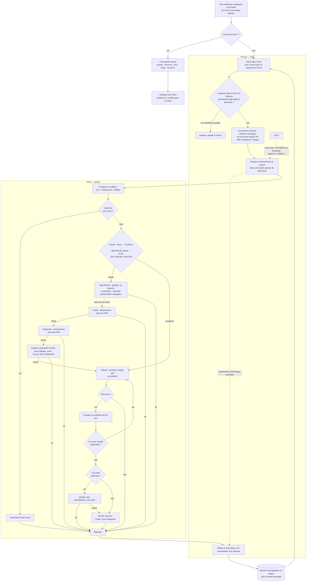
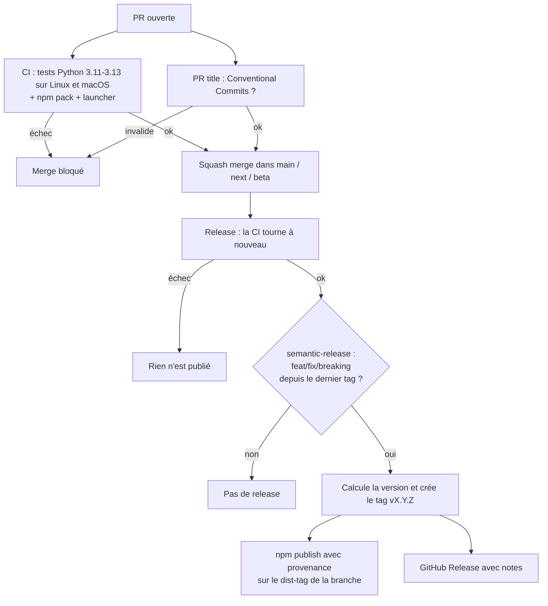

# Omni AI CLI


[](../LICENSE)


> [Português](../README.md) · [English](README.en.md) · [Español](README.es.md)

Un terminal de chat qui réunit **Claude Code, Codex, Cursor, Antigravity, Grok, DeepSeek et
OpenRouter** au même endroit. Vous écrivez la question, `ai` décide qui répond et, si
l'outil échoue ou dépasse son quota, il passe au suivant sans que vous ayez rien à faire.

Pendant qu'une réponse est générée, la zone de saisie reste libre : vous continuez à
envoyer des demandes, qui entrent dans une file visible au-dessus de la zone et
s'exécutent dans l'ordre.

Les questions simples vont vers les outils les moins chers. Les tâches lourdes vont vers
Claude, avec bascule automatique entre plusieurs comptes quand l'un atteint sa limite.
L'historique est sauvegardé, l'interface parle portugais, anglais, espagnol et français,
et les modèles comme les comptes se configurent depuis le chat lui-même.

---

## Sommaire

- [Comment ça marche](#comment-ça-marche)
- [Installation](#installation)
- [Utilisation](#utilisation)
- [Commandes du chat](#commandes-du-chat)
- [Modèles](#modèles)
- [Comptes Claude](#comptes-claude)
- [Clés API](#clés-api)
- [Modes](#modes)
- [Skills et MCP](#skills-et-mcp)
- [Utilisation directe, sans chat](#utilisation-directe-sans-chat)
- [Emplacement des fichiers](#emplacement-des-fichiers)
- [Structure du projet](#structure-du-projet)
- [Tests](#tests)
- [Dépannage](#dépannage)
- [Limitations connues](#limitations-connues)
- [Confidentialité](#confidentialité)
- [Licence](#licence)

---

## Comment ça marche

De la ligne saisie jusqu'à la réponse sauvegardée. Le chat (`chat.py`) n'appelle
aucune IA directement : il lance le routeur (`cli.py`) comme sous-processus et lit
les événements qu'il émet, ligne par ligne, pour afficher qui répond et ce qu'il fait.



Trois détails que le diagramme rend explicites :

- **Chaque compte Claude a son propre dossier de connexion.** Les comptes
  supplémentaires s'exécutent avec `CLAUDE_CONFIG_DIR` pointant vers
  `~/.claude-accounts/<nom>`. Le compte principal n'est jamais déconnecté, et aucun
  identifiant n'est copié d'un endroit à un autre. Copier le `.credentials.json` ne
  fonctionne pas de façon fiable sur macOS, où la connexion est stockée dans le
  Keychain.
- **Ctrl-C tue tout l'arbre de processus.** Le routeur s'exécute dans son propre groupe de
  processus ; annuler arrête donc aussi le `claude`, le `codex` ou le `agy` qui tourne en
  dessous, au lieu de laisser des processus orphelins consommer du quota.
- **La file ne bloque rien.** Au-dessus de la zone s'affichent la demande en cours, le
  temps écoulé et les suivantes. Une demande qui a attendu passe par un classifieur gratuit
  avant de s'exécuter : si la réponse précédente la règle déjà, elle est ignorée. Les
  commandes et skills s'exécutent toujours. Ctrl-C avec la file active annule tout sans
  quitter le chat. Si vous fermez le chat avec des demandes en attente, elles restent
  enregistrées dans la session et `ai --resume ID` propose de les relancer.
- **Chaque réponse indique son coût.** À la fin de chaque demande s'affichent les tokens et,
  quand l'outil le fournit (OpenRouter, Grok, Claude avec clé API), le coût en dollars.
  `/usage` additionne la dépense du jour par outil.
- **Vous voyez pourquoi l'outil a été choisi.** En mode `auto`, une ligne courte indique si la
  demande a été traitée comme une tâche de code ou une question simple, et qui l'a classée
  (Groq, Cerebras, OpenRouter, Grok ou les mots-clés).
- **Seule la réponse entre dans l'historique.** Les lignes de statut et de diagnostic
  s'affichent à l'écran, mais ne sont pas envoyées comme contexte à la question suivante.
  Le raisonnement interne des modèles est aussi écarté.

---

## Installation

Une commande installe tout et, relancée, met à jour. Vos comptes, clés et modèles restent dans `~/.config/smart-ai` et ne sont pas touchés.

**macOS et Linux**:

```bash
curl -fsSL https://raw.githubusercontent.com/samuelrms/omni-ai-cli/main/get.sh | bash
```

**Windows** (PowerShell):

```powershell
irm https://raw.githubusercontent.com/samuelrms/omni-ai-cli/main/get.ps1 | iex
```

**Bientôt sur npm, yarn, pnpm et bun.** Le paquet `omni-ai-cli` est prêt et sera publié dès que possible :

```bash
npm install -g omni-ai-cli
yarn global add omni-ai-cli
pnpm add -g omni-ai-cli
bun add -g omni-ai-cli
```

En attendant, utilisez la commande macOS/Linux ou Windows ci-dessus.

Pour mettre à jour ensuite : `ai --update` (ou `/update` dans le chat).

Depuis les sources, pour développer :

```bash
git clone https://github.com/samuelrms/omni-ai-cli ~/dev/omni-ai-cli
cd ~/dev/omni-ai-cli && ./scripts/install.sh        # Windows: powershell -File scripts\install.ps1
```

L'installateur :

1. installe **Claude Code** avec l'installateur officiel s'il n'est pas encore sur la machine ;
2. ouvre la connexion du compte principal s'il n'y en a pas encore ;
3. crée la commande `ai` dans `~/.local/bin` ;
4. affiche les comptes Claude configurés.

Prérequis : rien d'autre que `curl` (macOS/Linux) ou PowerShell (Windows). S'il manque Python 3.11+, l'installateur télécharge un Python 3.12 réservé à Omni AI, sans sudo et sans toucher au Python du système.
Codex (`codex`) et Antigravity (`agy`) sont optionnels et rejoignent la file des alternatives quand ils sont installés.

Si `~/.local/bin` n'est pas dans le `PATH`, ajoutez à `~/.zshrc` :

```bash
export PATH="$HOME/.local/bin:$PATH"
```

Sous Windows, l'installateur crée `ai.cmd` dans `%USERPROFILE%\.local\bin` et ajoute ce dossier au `PATH` ; ouvrez un nouveau terminal ensuite.

---

## Utilisation

```bash
ai
```

La première fois, il demande la langue et propose d'installer les outils manquants
(Claude Code, Codex, Cursor, Grok Build) avec les installeurs officiels. Antigravity
s'installe depuis sa page. Ensuite, il suffit d'écrire et d'appuyer sur Entrée.

| Touche | Action |
| --- | --- |
| Entrée | Envoie |
| ↑ / ↓ | Lignes précédentes |
| Ctrl-C | Pendant la réponse : annule. Au prompt : sauvegarde et quitte |
| Ctrl-D | Sauvegarde et quitte |
| `\` + Entrée · Maj+Entrée · Option+Entrée | Nouvelle ligne sans envoyer (Maj+Entrée dans iTerm2, Ghostty, Kitty, WezTerm et VS Code ; dans Terminal macOS, `\` + Entrée) |
| Tab | Complète commandes et skills |

Dans le menu Tab, chaque élément indique à qui il appartient : `omni`, `claude`, `codex` ou `agy`. Quand
vous choisissez une skill avec arguments (comme `/pr-review [pr-number | --branch]`), le chat les
demande : Tab montre les options, vous pouvez écrire votre propre texte, et Entrée seule la lance sans arguments.

L'écran suit le style de Claude Code et Codex : zone de saisie en bas avec barre d'état (outil,
modèle, mode et dossier), Tab pour compléter commandes et skills, chaque action de l'IA sur une
ligne (`● Ran …`, `● Edited …`, `● Called …`) avec la sortie repliée, réponses en markdown et un
indicateur « Au travail… » avec la durée. Au démarrage, un écran d'accueil de 1,5 s en plein écran
(Ctrl-C le passe ; `SMART_AI_NO_SPLASH=1` le désactive).

À la sortie, il affiche la commande pour revenir à la même conversation :

```text
Sessão salva. Retome com: ai --resume 1f3a9c2b7d40
```

---

## Commandes du chat

| Commande | Ce qu'elle fait |
| --- | --- |
| `/tool auto\|claude\|codex\|cursor\|agy\|openrouter\|grok\|deepseek` | Fixe un outil (`auto` décide tout seul) |
| `/model` | Liste les modèles de chaque outil |
| `/model codex gpt-6-astra` | Change un modèle |
| `/model codex default` | Revient au défaut |
| `/account` | Liste les comptes Claude et indique s'ils sont connectés |
| `/account add pessoal` | Crée un compte et ouvre la connexion Claude sur-le-champ |
| `/account login NOME` | Refait la connexion d'un compte |
| `/account sync NOM` | Repartage les skills, plugins et MCP du compte principal |
| `/account disable\|enable\|remove NOME` | Désactive, réactive ou supprime |
| `/key` | Liste les clés d'API configurées (masquées) |
| `/key claude\|codex\|cursor\|agy\|openrouter\|grok\|deepseek\|groq\|cerebras` | Ajoute une clé, sans afficher ce que vous tapez |
| `/key add OUTIL [NOM]` | Une clé de plus pour le même outil (tous, Claude compris) ; les clés sont essayées dans l'ordre quand l'une échoue ou atteint sa limite |
| `/key remove OUTIL [NOM]` | Supprime la clé (sans nom : la principale) |
| `/status` · `/reset` | Statut des comptes · remet les cooldowns à zéro |
| `/lang pt\|en\|es\|fr` | Change la langue |
| `/mode default\|plan\|edits\|auto\|yolo` | Mode de permissions, identique sur les trois outils |
| `/sync` | Partage MCP et skills entre Claude, Codex et Antigravity |
| `/usage [watch]` · `/limits` | Usage réel de chaque compte en barres (e-mail, offre, % des fenêtres de 5 h et hebdomadaire, heure de remise à zéro) pour Claude et Codex ; dépense de la clé sur OpenRouter ; pour les autres, le message de limite de l'outil. `watch` rafraîchit toutes les 30 s |
| `/queue [rm\|up\|down N\|clear]` | Affiche la file ; retire (`rm`), monte (`up`), descend (`down`) une demande ou vide (`clear`) ce qui attend |
| `/versions [N]` | Ce qui a changé dans chaque version, la plus récente d'abord ; `N` ouvre la note technique. Avant la première release, affiche les `feat`/`fix` de `main` |
| `/clear` · `/compact` | Effacer la conversation · la résumer en un bloc pour économiser du contexte |
| `/claude:usage` · `/codex:status` · `/agy:usage` … | Commandes natives de chaque outil : ouvre son écran et revient à Omni en sortant |
| `/setup [install]` | Guide de démarrage : ce qu'il reste à installer, connecter et configurer ; `install` installe les outils manquants |
| `/terminal-setup` | Montre comment avoir Maj+Entrée (ou Option+Entrée) pour une nouvelle ligne dans votre terminal |
| `/skills` | Liste les skills et commandes du projet et de l'utilisateur (Claude, Codex, Antigravity) |
| `/nom args` | Lance la skill ou la commande (ex. `/pr-review 237`). Tab complète |
| `/history` · `/sent` · `/trace` | Conversation · ce qui a été envoyé · événements de l'exécution |
| `/sessions` · `/resume ID` · `/new` | Sessions sauvegardées |
| `/parallel codex: tarefa \| deepseek: tarefa` | 2 à 4 analyses en parallèle, en lecture seule (codex, openrouter, grok, deepseek) |
| `/help` · `/exit` | Aide · quitter |

Pendant que la file tourne, `/clear`, `/new`, `/resume`, `/key`, `/usage` et les commandes
natives attendent : elles prennent le terminal ou changent de session. Le reste fonctionne
tout de suite.

Les commandes de configuration fonctionnent aussi hors du chat : `ai --model`,
`ai --account add pessoal`, `ai --key claude`, `ai --status`, `ai --reset`.

---

## Modèles

| Clé | Défaut | Valeurs acceptées |
| --- | --- | --- |
| `claude` | `opus` (le plus capable) | `opus`, `sonnet`, `haiku` ou ID complet |
| `codex` | `gpt-6-astra` | ID de modèle Codex |
| `codex_effort` | `high` | `minimal`, `low`, `medium`, `high`, `xhigh` |
| `agy` | défaut d'Antigravity | ID de modèle Antigravity |
| `openrouter` | automatique (gratuit) | ID du modèle ; payant seulement avec `openrouter_paid on` |
| `openrouter_paid` | `off` | `on` autorise les modèles payants d'OpenRouter |
| `grok` | défaut de Grok | ID de modèle xAI |
| `deepseek` | `deepseek-chat` | `deepseek-chat`, `deepseek-reasoner` |
| `cursor` | défaut du compte Cursor | ID de modèle du Cursor CLI |

L'ordre de priorité est : variable d'environnement, puis ce qui a été sauvegardé avec
`/model` (dans `~/.config/smart-ai/models.json`), puis le défaut. Les variables sont
`SMART_AI_CLAUDE_MODEL`, `SMART_AI_CODEX_MODEL`, `SMART_AI_CODEX_EFFORT`,
`SMART_AI_AGY_MODEL`, `SMART_AI_OPENROUTER_MODEL`, `SMART_AI_GROK_MODEL`,
`SMART_AI_DEEPSEEK_MODEL` et `SMART_AI_CURSOR_MODEL`. Quand l'une d'elles est définie,
`/model` signale qu'elle est prioritaire.

---

## Comptes Claude

```text
ai [auto] › /account add trabalho
Abrindo login do Claude para a conta "trabalho" (pasta isolada ~/.claude-accounts/trabalho).
Sua conta principal não é afetada.
✓ Conta "trabalho" adicionada com prioridade 3.
```

Les comptes sont essayés par ordre de priorité. Celui qui atteint sa limite passe en
cooldown (60 minutes par défaut, réglable dans `profiles.json`) et le suivant prend le
relais. Le compte `primary` utilise la connexion normale de Claude (`claude auth login`).

Les skills, plugins, agents, `CLAUDE.md`, `settings.json` et les serveurs MCP du compte
principal sont partagés avec chaque compte supplémentaire à la connexion. Seule la
connexion reste séparée. Si vous installez une nouvelle skill ou un nouveau MCP ensuite,
lancez `/account sync NOM`.


---

## Clés API

En plus des abonnements, chaque outil accepte une clé d'API. **L'abonnement passe en
premier** ; la clé n'intervient que lorsque l'abonnement échoue ou atteint sa limite,
car une clé est facturée à l'usage. OpenRouter fonctionne uniquement avec une clé.

| Outil | Commande | Variable reçue par le CLI | Où la créer |
| --- | --- | --- | --- |
| Claude | `/key claude` | `ANTHROPIC_API_KEY` | console.anthropic.com/settings/keys |
| Codex | `/key codex` | `CODEX_API_KEY` | platform.openai.com/api-keys |
| Antigravity | `/key agy` | `GEMINI_API_KEY` | aistudio.google.com/apikey |
| OpenRouter | `/key openrouter` | `OPENROUTER_API_KEY` | openrouter.ai/keys |
| Cursor | `/key cursor` | `CURSOR_API_KEY` | cursor.com/dashboard → Integrations |
| Grok | `/key grok` | `XAI_API_KEY` | console.x.ai |
| DeepSeek | `/key deepseek` | `DEEPSEEK_API_KEY` | platform.deepseek.com/api_keys |
| Groq (classifieur) | `/key groq` | `GROQ_API_KEY` | console.groq.com/keys |
| Cerebras (classifieur) | `/key cerebras` | `CEREBRAS_API_KEY` | cloud.cerebras.ai |

Cursor utilise d'abord la connexion du compte (`cursor-agent login`), puis seulement les
clés. DeepSeek, comme OpenRouter, ne fonctionne qu'avec une clé et masque les données
personnelles avant l'envoi. Groq et Cerebras ne répondent pas aux questions : ils classent
seulement chaque demande (gratuitement) et vérifient si une demande de la file a déjà été
traitée.

```text
ai [auto] › /key claude
Chave de claude (console.anthropic.com/settings/keys). Cole e tecle Enter; ela não aparece na tela.
>
✓ Chave de claude salva em ~/.config/smart-ai/keys/claude (permissão 600).
```

Les clés sont stockées dans `~/.config/smart-ai/keys/`, une par fichier, avec la
permission 600, et ne sont transmises qu'au processus de l'outil, jamais à l'historique
ni au journal. Si la variable est déjà définie dans l'environnement, elle est
prioritaire. `/key` liste ce qui est configuré, en n'affichant que le début et la fin de
chaque clé.

Pour Claude, la clé fonctionne comme un compte supplémentaire placé après tous les
abonnements : si elle atteint elle aussi sa limite, elle passe en cooldown comme les
autres.

> **Ne collez jamais une clé comme commande dans le shell.** Elle reste enregistrée dans
> l'historique de zsh. Si cela arrive, révoquez la clé sur le site de l'outil et
> supprimez la ligne de `~/.zsh_history`.

Sur OpenRouter, par défaut seuls les modèles gratuits sont utilisés : le client choisit
jusqu'à trois variantes `:free` du catalogue et utilise `openrouter/free` en dernière
alternative. Les modèles payants restent bloqués tant que vous ne les autorisez pas :

```text
/model openrouter_paid on            # autorise ; prévient que ce sera facturé sur votre compte
/model openrouter anthropic/claude-opus-5.5
/model openrouter_paid off           # bloque à nouveau et revient au gratuit
```

Avec l'autorisation active, le modèle choisi passe en premier et les gratuits restent en
secours. Désactivée, un plafond de prix à zéro est envoyé à chaque appel : aucun modèle
payant ne répond.

---

## Modes

Le mode s'applique à Claude, Codex et Antigravity en même temps et s'affiche dans le
prompt (`ai [auto · plan] ›`). Chaque session garde le sien.

| Mode | Effet | Claude | Codex | Antigravity |
| --- | --- | --- | --- | --- |
| `default` | Comportement par défaut de chaque outil | — | — | — |
| `plan` | Lit et planifie seulement, ne modifie rien | `plan` | `--sandbox read-only` | `--mode plan` |
| `edits` | Accepte les modifications de fichiers | `acceptEdits` | `--sandbox workspace-write` | `--mode accept-edits` |
| `auto` | Agit seul, avec les protections de l'outil | `auto` | `workspace-write`, sans approbation | `--mode auto` |
| `yolo` | Sans permissions ni sandbox | `bypassPermissions` | `--dangerously-bypass-approvals-and-sandbox` | `--dangerously-skip-permissions` |

`/mode yolo` demande une confirmation, car l'IA peut alors supprimer des fichiers et lancer
n'importe quelle commande. Hors du chat : `ai --mode plan "question"`. `/parallel` tourne
toujours en `plan`.

---

## Skills et MCP

`ai` appelle les CLI eux-mêmes, donc chacun utilise les skills et MCP qu'il a déjà.
`/sync` rassemble tout et installe dans chaque outil ce qui n'existe que dans les autres :

```text
ai [auto] › /sync
Ferramentas encontradas: claude, codex, agy
  MCP   github                   codex → claude
  MCP   obsidian                 claude → codex
  skill humanizer                claude → codex  (~/.agents/skills/humanizer)
Aplicar? [s/N]
```

- Les MCP sont ajoutés via la commande `mcp add` de chaque CLI, sans éditer de fichiers.
- Un même serveur sous des noms différents est reconnu par paquet ou URL et n'est pas dupliqué.
- Les MCP fournis dans une app (comme ceux de Codex.app) y restent.
- Les skills sont partagées par lien : `~/.claude/skills`, `~/.agents/skills` (Codex) et
  `~/.gemini/antigravity/skills`. Modifier l'une vaut pour les trois.
- Les comptes Claude supplémentaires sont mis à jour aussi.
- Les variables d'environnement des MCP, qui peuvent contenir des jetons, sont copiées dans
  la config de l'autre outil. `/sync` prévient avant.
- `/sync --dry-run` montre seulement ce qu'il ferait.

**Skills et commandes du projet :** le chat lit `.claude/commands`, `.claude/skills`, `.agents/skills` et
`.agent/workflows` du projet ouvert, en plus des dossiers de l'utilisateur. `/pr-review 237` part vers
Claude tel quel, et Claude exécute la commande nativement. Une skill qui n'existe que dans Codex
ou Antigravity part vers cet outil, avec les instructions du fichier dans la demande.

Comme le chat ne relaie pas les demandes d'approbation, un outil MCP ne s'exécute que s'il
est déjà autorisé dans le CLI ou si le mode est `auto` ou `yolo`. OpenRouter n'a ni skills
ni MCP.

---

## Utilisation directe, sans chat

```bash
ai "o que é um design pattern?"        # routage automatique
ai --claude "refatorar o módulo X"     # force Claude
ai --codex "explicar REST"             # force Codex
ai --agy "pesquisar React hooks"       # force Antigravity
ai --openrouter "explicar Docker"      # force OpenRouter
ai --cursor "corrigir o teste X"       # force Cursor
ai --deepseek "explicar CAP theorem"   # force DeepSeek
ai --install                           # installe les outils manquants (demande avant)
ai --classify "prompt"                 # montre la classification
ai --log                               # derniers appels
```

---

## Emplacement des fichiers

| Chemin | Contenu |
| --- | --- |
| `~/.config/smart-ai/profiles.json` | Comptes Claude et règles de routage |
| `~/.config/smart-ai/models.json` | Modèles choisis avec `/model` |
| `~/.config/smart-ai/lang` | Langue du chat |
| `~/.config/smart-ai/keys/<ferramenta>` | Clés d'API, une par fichier (permission 600) |
| `~/.claude-accounts/<nome>/` | Connexion isolée de chaque compte Claude supplémentaire |
| `~/.local/share/smart-ai/sessions/` | Sessions du chat |
| `~/.cache/smart-ai/state.json` | Cooldowns actifs |
| `~/.cache/smart-ai/usage.log` | Journal d'utilisation, métadonnées uniquement |
| `~/.cache/smart-ai/costs.jsonl` | Coût et tokens de chaque demande du chat, sans question ni réponse (total du jour dans `/usage`) |

---

## Structure du projet

```text
omni-ai-cli/
├── omni_ai/                  # le programme (paquet Python)
│   ├── tools.py              # registre unique des outils : nom, couleur, CLI, modèle, clé
│   ├── cli.py                # commande ai : classe, route et exécute chaque outil
│   ├── chat.py               # chat : sessions, événements, Ctrl-C, langues
│   ├── ui.py                 # rendu : saisie, barre d'état, actions et réponses
│   ├── skills.py             # skills et commandes du projet, de l'utilisateur et natives
│   ├── config.py             # modèles, clés et comptes Claude (/model, /key, /account)
│   ├── sync.py               # /sync : MCP et skills entre les trois outils
│   ├── openrouter.py         # client OpenRouter : gratuits, payants seulement si autorisés
│   ├── grok.py               # client xAI, réutilisé par DeepSeek
│   ├── deepseek.py           # client DeepSeek avec données personnelles masquées
│   ├── pii.py                # masque et restaure les données personnelles
│   ├── osutils.py            # différences entre macOS, Linux et Windows
│   ├── profiles.json         # modèle initial ; le vôtre est dans ~/.config/smart-ai
│   └── vendor/               # prompt_toolkit et wcwidth intégrés (sans pip)
├── bin/ai.js                 # lanceur npm : trouve ou installe Python et lance le paquet
├── scripts/                  # install.sh, install.ps1 et ai.cmd
├── docs/                     # README en anglais, espagnol et français
├── tests/                    # exécutables fictifs, sans consommer de quota
├── postman/                  # simulation HTTP d'OpenRouter
├── get.sh / get.ps1          # installation en une commande
└── package.json · LICENSE
```

Le routeur ne sait rien du chat : il exécute seulement une question et, avec
`SMART_AI_EVENTS=1`, émet des événements JSON. Le chat ne sait rien des identifiants :
comptes et modèles passent par `config.py`.

---

## Tests

```bash
python3 -m unittest discover -s tests -v
bash -n scripts/install.sh
```

**38 tests** : persistance et reprise de session, limite de contexte, permissions des
fichiers, session ouverte dans deux terminaux, lecture des événements, annulation de
l'arbre de processus, parallélisme réel, sandbox en lecture seule, masquage des données
personnelles, fallback OpenRouter → Codex, validation des modèles, stockage des clés et
cycle de vie des comptes. Tous les exécutables sont factices : **aucun test
n'authentifie ni ne consomme d'abonnement.**

Pour tester le HTTP d'OpenRouter contre la simulation Postman :

```bash
postman simulation run postman/simulations/openrouter.sim.yaml --port 4901 --no-history --output ndjson
SMART_AI_SIM_URL=http://127.0.0.1:4901/openrouter python3 -m unittest discover -s tests -v
```

---

## Releases et branches

La publication sur npm est automatique, faite par GitHub Actions avec semantic-release.
La version découle des messages de commit (Conventional Commits) — personne ne modifie
`version` dans `package.json` à la main.

| Branche | Publie comme | Exemple |
|---|---|---|
| `main` | `latest` | `1.4.0` |
| `next` | `next` (release candidate) | `1.5.0-rc.1` |
| `beta` | `beta` | `2.0.0-beta.1` |
| autres / PR | rien, CI seulement | — |

| Commit | Effet sur la version |
|---|---|
| `fix: ...` | patch (`1.4.0` → `1.4.1`) |
| `feat: ...` | minor (`1.4.0` → `1.5.0`) |
| `feat!: ...` ou `BREAKING CHANGE:` dans le corps | major (`1.4.0` → `2.0.0`) |
| `docs:`, `ci:`, `chore:`, `test:`, `refactor:` | pas de release |

Utilisez le squash merge : le titre de la PR devient le commit, et le workflow `PR title`
bloque les titres hors convention.

### Messages de commit

`/versions` affiche le titre de chaque `feat`/`fix` comme « vue simple » et le corps comme
« note technique ». Donc :

- **Titre :** ce qui change pour l'utilisateur, en anglais, au présent, sans nom de
  fichier ni de fonction. `feat: keep the input free and queue new requests while one runs`,
  pas `feat: add Queue class to chat.py`.
- **Corps :** le pourquoi et le nouveau comportement en phrases courtes ; les détails
  techniques seulement à la fin, s'ils aident.
- Un commit par changement perceptible. Refactorisations et tests vont dans
  `refactor:`/`test:`, qui n'apparaissent pas dans `/versions`.



Configuration unique sur GitHub :

1. **Settings → Secrets and variables → Actions** : créer `NPM_TOKEN` (jeton *Automation*
   ou *Granular* npmjs.com avec droit de publish).
2. **Settings → Branches** : protéger `main` (et `next`/`beta` si utilisées) en exigeant
   une PR et les checks `Tests (...)`, `npm package` et `conventional`.
3. **Settings → General → Pull Requests** : n'autoriser que le *squash merging* et cocher
   *Default to pull request title*.

---

## Dépannage

| Problème | Solution |
| --- | --- |
| `OPENROUTER_API_KEY não configurada` | `/key openrouter` dans le chat ou `ai --key openrouter`. |
| `Arquivo de credenciais não encontrado` ou `Conta 'X' sem login` | `/account login X`. |
| `You've hit your session limit` | Quota du compte. `ai` passe au suivant ; ajoutez-en un autre avec `/account add` ou une clé avec `/key claude`. |
| `Individual quota reached` (Antigravity) | Quota d'Antigravity ; il est ignoré jusqu'au renouvellement. |
| `Not inside a trusted directory` (Codex) | Ancienne installation. Relancez l'installateur. |
| `Claude Code não instalado` | `./scripts/install.sh` (ou `scripts\install.ps1` sous Windows) l'installe avec l'installateur officiel. |
| Windows : les liens de skills échouent | Activez le mode développeur ou lancez en administrateur ; sinon `ai` utilise des jonctions de dossier. |
| `/model` ne change rien | Une variable `SMART_AI_*_MODEL` est définie et elle est prioritaire. |
| `/key` ne change rien | La variable de l'outil (`ANTHROPIC_API_KEY` etc.) est définie et elle est prioritaire. |
| `Sessão já aberta em outro terminal` | Fermez l'autre terminal ou utilisez `/new`. |
| `ai: command not found` | Ajoutez `~/.local/bin` au `PATH`. |

---

## Limitations connues

- Le chat utilise les modes non interactifs des CLI. Les demandes d'approbation natives
  (par exemple « puis-je modifier ce fichier ? ») n'apparaissent pas ; dans ces cas,
  utilisez le CLI natif.
- `/parallel` ne fait qu'analyser : Codex en `--sandbox read-only` ou OpenRouter, qui
  n'accède pas aux fichiers. Les agents ne modifient pas le projet en même temps.
- La classification simple/complexe repose sur des mots-clés et la taille, pas sur un
  modèle.
- Changer de modèle ne renouvelle pas le quota du compte.
- OpenRouter n'a pas de streaming dans cette version : la réponse apparaît en entier à
  la fin.
- Sous Windows le code utilise les équivalents natifs (groupes de processus et `taskkill`, `msvcrt`, jonctions de dossier), mais il n'a été testé pour de vrai que sous macOS.

---

## Confidentialité

- Les sessions, clés d'API et journaux restent uniquement sur votre machine, avec une permission limitée à votre utilisateur.
- Le journal d'utilisation enregistre l'outil, le compte et le statut, **jamais le texte de la question**.
- Avant d'aller vers OpenRouter, e-mails, téléphones, documents et autres données
  personnelles sont remplacés par des marqueurs et restaurés dans la réponse. Le
  masquage repose sur des motifs et ne garantit pas une anonymisation totale.
- Claude, Codex et Antigravity reçoivent le texte d'origine, selon les conditions de
  chaque service.

---

## Licence

[MIT](../LICENSE). Intégrées dans `vendor/` : prompt_toolkit (BSD-3-Clause) et wcwidth (MIT), chacune avec sa licence.
